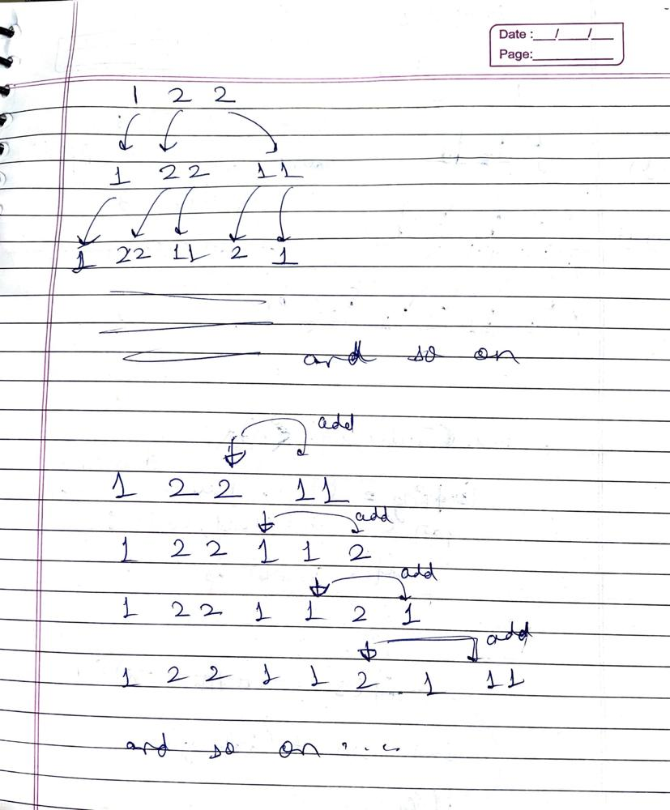

# Explained Solution with image👍✅ ||💥 O(n) solution💥||

**Author:** anuShr73
**Votes:** 3
**Link:** [https://leetcode.com/problems/magical-string/solutions/4562719/](https://leetcode.com/problems/magical-string/solutions/4562719/)

---

# Intuition
A pattern of alternate occurence of 1's and 2's can be seen.
# Approach


If the previous element or element at [currentIndex-1] was 1, then 2 is used and vice versa.
Also, the length of insertion depends on [currentIndex]. If element at 
[currentIndex] is 2, then a new substring of length 2 is attached gradualy.
# Complexity
- Time complexity:
while loop will execute 'n' times and for loop will execute maximum 2 times.
So, TC = O(2*n) -> **O(n)**
 
- Space complexity:
Same as TC.
SC = **O(n)**
# Code
```
function magicalString(n: number): number {
    
    // as base case is of length 3 with count of 1 as one only.
    if(n<=3) return 1;
    
    // base elements of magic string
    let set = [1, 2, 2];
    // times: element at times will be used for mutiple insertion of same token
    // token: is a value; either 1 or 2;
    // ans: count of 1's
    let times = 2, ans = 1, token = 1; 
 
    // till we achieve our taret length or near to it.
    while(set.length<n){
        
        // loop for insetion of token.
        for(let i = 0; i<set[times]; i++){
            set.push(token);
            // when 1 appears and is within the bound of array length [ 'n' here]
            if(token==1 && set.length<=n) ans+=1;
        }
        // increment index to explore next element 
        times+=1;
        // a pattern of 1,2,1,2.. can be seen. So, if present is 1 then next it'll be 2.
        token = 3 - token;

    }
    return ans;
};
```