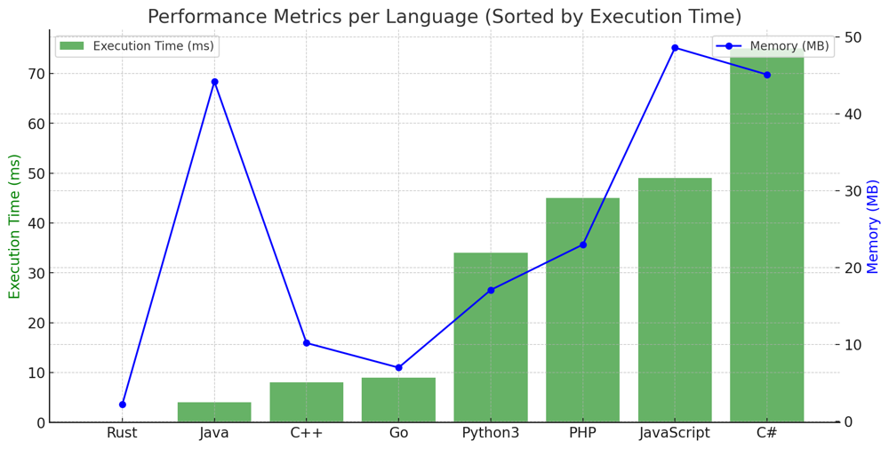

# ✅ 94.58% Split+Join & Two Pointers

**Author:** vanAmsen
**Votes:** 53
**Link:** [https://leetcode.com/problems/reverse-words-in-a-string-iii/solutions/4111436/](https://leetcode.com/problems/reverse-words-in-a-string-iii/solutions/4111436/)

---

# Comprehensive Guide to Solving "Reverse Words in a String III"

## Introduction & Problem Statement

In the "Reverse Words in a String III" problem, we are given a string `s`. The task is to reverse the order of characters in each word within a sentence while still preserving the whitespace and the initial word order. This problem is unique because instead of reversing the entire string or just the words' order, we need to reverse the characters within each word.

## Key Concepts and Constraints

### What Makes This Problem Unique?

1. **String Constraints**:
    - $$1 \\leq \	ext{len}(s) \\leq 5 \	imes 10^4$$
    - `s` contains printable ASCII characters.
  
2. **Whitespace Preservation**: 
    - We need to ensure that the spaces between words remain intact.

3. **No Leading or Trailing Spaces**:
    - The input string does not contain any leading or trailing spaces.

4. **Single Space Between Words**:
    - All words in the string `s` are separated by a single space.

---

## Live Coding & Comparing 2 Approaches
https://youtu.be/2hlQrb6P4as?si=ZJ1rgtNj82eSHmQ5

## Two Primary Strategies to Solve the Problem:

## 1. Approach: Using Python's split and join methods

### Key Data Structures:

- **List Comprehension**: 
    - Used to iterate over the words and reverse them.

### Enhanced Breakdown:

1. **Split the String**:
   - Use Python's `split()` method to split the string into individual words.
  
2. **Reverse Each Word**:
   - Use list comprehension and the slicing method to reverse each word.
  
3. **Join the Words**:
   - Join the reversed words back together with a single space between them using the `join()` method.

### Complexity Analysis:

**Time Complexity**: 
- $$O(n)$$, where $$n$$ is the length of the string `s`.

**Space Complexity**: 
- $$O(n)$$, due to the extra space required for the list comprehension and the split string.

# Code Split & Join
``` Python []
class Solution:
    def reverseWords(self, s: str) -> str:
        return ' '.join(word[::-1] for word in s.split())
```
``` JavaScript []
var reverseWords = function(s) {
        return s.split(' ').map(word => word.split('').reverse().join('')).join(' ');
    }
```
``` PHP []
class Solution {
    function reverseWords($s) {
        return implode(' ', array_map(function($word) {
            return strrev($word);
        }, explode(' ', $s)));
    }
}
```
``` C# []
public class Solution {
    public string ReverseWords(string s) {
        return String.Join(" ", s.Split(' ').Select(word => new string(word.Reverse().ToArray())));
    }
}
```
``` C++ []
class Solution {
public:
    std::string reverseWords(std::string s) {
        std::istringstream stream(s);
        std::string word, result;
        
        while (stream >> word) {
            std::reverse(word.begin(), word.end());
            result += word + " ";
        }
        
        if (!result.empty()) {
            result.pop_back();  // Remove trailing space
        }
        
        return result;
    }
};
```
``` Java []
public class Solution {
    public String reverseWords(String s) {
        String[] words = s.split(" ");
        StringBuilder result = new StringBuilder();
        
        for (String word : words) {
            result.append(new StringBuilder(word).reverse()).append(" ");
        }
        
        return result.toString().trim();
    }
}
```
``` Rust []
impl Solution {
    pub fn reverse_words(s: String) -> String {
        s.split_whitespace()
         .map(|word| word.chars().rev().collect::<String>())
         .collect::<Vec<String>>()
         .join(" ")
    }
}
```
``` Go []
import (
	"strings"
)

func reverseWords(s string) string {
	words := strings.Split(s, " ")
	for i, word := range words {
		words[i] = reverseString(word)
	}
	return strings.Join(words, " ")
}

func reverseString(s string) string {
	runes := []rune(s)
	for i, j := 0, len(runes)-1; i < j; i, j = i+1, j-1 {
		runes[i], runes[j] = runes[j], runes[i]
	}
	return string(runes)
}
```


---

## 2. Approach: Two Pointers

### Key Data Structures:

- **List of Characters**: 
    - Convert the string into a list of characters for in-place modifications.

### Enhanced Breakdown:

1. **Convert String to List**:
   - Convert the input string `s` to a list for easier in-place manipulation.
  
2. **Initialize Start Pointer**:
   - Initialize the `start` pointer to 0.

3. **Iterate through Characters**:
   - Traverse through the characters in the string using a loop.
   
4. **Identify Word Boundaries**:
   - Identify the boundaries of each word using spaces or the end of the string.

5. **Reverse the Word**:
   - Use two pointers, `start` and `end`, to reverse the characters within the identified word boundaries.

6. **Return the Result**:
   - Convert the list of characters back to a string using `join()` and return the result.

### Complexity Analysis:

**Time Complexity**: 
- $$O(n)$$, where $$n$$ is the length of the string `s`.

**Space Complexity**: 
- $$O(n)$$, because we convert the string into a list of characters.

# Code Two Pointers
``` Python []
class Solution:
    def reverseWords(self, s: str) -> str:
        s = list(s)
        start = 0

        for i in range(len(s)):
            if s[i] == ' ' or i == len(s) - 1:
                end = i
                if i == len(s) - 1 and s[i] != ' ':
                    end += 1
                # Inline reverse logic
                while start < end:
                    s[start], s[end - 1] = s[end - 1], s[start]
                    start += 1
                    end -= 1
                start = i + 1

        return ''.join(s)

```
``` Rust []
impl Solution {
    pub fn reverse_words(s: String) -> String {
        let mut chars: Vec<char> = s.chars().collect();
        let mut start = 0;

        for i in 0..chars.len() {
            if chars[i] == ' ' || i == chars.len() - 1 {
                let mut end = if i == chars.len() - 1 && chars[i] != ' ' { i + 1 } else { i };
                while start < end {
                    chars.swap(start, end - 1);
                    start += 1;
                    end -= 1;
                }
                start = i + 1;
            }
        }

        chars.iter().collect()
    }
}
```
``` Go []
func reverseWords(s string) string {
    runes := []rune(s)
    start := 0

    for i := 0; i < len(runes); i++ {
        if runes[i] == ' ' || i == len(runes)-1 {
            end := i
            if i == len(runes)-1 && runes[i] != ' ' {
                end++
            }
            for start < end {
                runes[start], runes[end-1] = runes[end-1], runes[start]
                start++
                end--
            }
            start = i + 1
        }
    }

    return string(runes)
}
```
``` C++ []
#include <string>

class Solution {
public:
    std::string reverseWords(std::string s) {
        int start = 0;
        
        for (int i = 0; i < s.length(); i++) {
            if (s[i] == ' ' || i == s.length() - 1) {
                int end = (i == s.length() - 1 && s[i] != ' ') ? i + 1 : i;
                while (start < end) {
                    std::swap(s[start], s[end - 1]);
                    start++;
                    end--;
                }
                start = i + 1;
            }
        }
        
        return s;
    }
};
```
``` Java []
public class Solution {
    public String reverseWords(String s) {
        char[] chars = s.toCharArray();
        int start = 0;
        
        for (int i = 0; i < chars.length; i++) {
            if (chars[i] == ' ' || i == chars.length - 1) {
                int end = (i == chars.length - 1 && chars[i] != ' ') ? i + 1 : i;
                while (start < end) {
                    char temp = chars[start];
                    chars[start] = chars[end - 1];
                    chars[end - 1] = temp;
                    start++;
                    end--;
                }
                start = i + 1;
            }
        }
        
        return new String(chars);
    }
}
```
``` C# []
public class Solution {
    public string ReverseWords(string s) {
        char[] chars = s.ToCharArray();
        int start = 0;
        
        for (int i = 0; i < chars.Length; i++) {
            if (chars[i] == ' ' || i == chars.Length - 1) {
                int end = (i == chars.Length - 1 && chars[i] != ' ') ? i + 1 : i;
                while (start < end) {
                    char temp = chars[start];
                    chars[start] = chars[end - 1];
                    chars[end - 1] = temp;
                    start++;
                    end--;
                }
                start = i + 1;
            }
        }
        
        return new string(chars);
    }
}
```
``` PHP []
class Solution {
    function reverseWords($s) {
        $chars = str_split($s);
        $start = 0;
        
        for ($i = 0; $i < count($chars); $i++) {
            if ($chars[$i] == ' ' || $i == count($chars) - 1) {
                $end = ($i == count($chars) - 1 && $chars[$i] != ' ') ? $i + 1 : $i;
                while ($start < $end) {
                    list($chars[$start], $chars[$end - 1]) = array($chars[$end - 1], $chars[$start]);
                    $start++;
                    $end--;
                }
                $start = $i + 1;
            }
        }
        
        return implode('', $chars);
    }
}
```
``` JavaScript []
var reverseWords = function(s){
        let chars = [...s];
        let start = 0;

        for (let i = 0; i < chars.length; i++) {
            if (chars[i] === ' ' || i === chars.length - 1) {
                let end = (i === chars.length - 1 && chars[i] !== ' ') ? i + 1 : i;
                while (start < end) {
                    [chars[start], chars[end - 1]] = [chars[end - 1], chars[start]];
                    start++;
                    end--;
                }
                start = i + 1;
            }
        }

        return chars.join('');
    }
```

## Performance

| Language  |  Time (ms) | Memory (MB) | Method  |
|-----------|---------------------|-------------|---------|
| Rust      | 0                   | 2.2         | Pointers|
| Rust      | 3                   | 2.3         | Split   |
| Java      | 4                   | 44.3        | Pointers|
| Java      | 4                   | 44.2        | Split   |
| PHP       | 4                   | 19.4        | Split   |
| C++       | 8                   | 10.2        | Pointers|
| Go        | 9                   | 7           | Split   |
| Go        | 12                  | 8.1         | Pointers|
| C++       | 15                  | 14.4        | Split   |
| PHP       | 45                  | 23          | Pointers|
| JavaScript| 49                  | 48.6        | Split   |
| JavaScript| 70                  | 48.9        | Pointers|
| C#        | 75                  | 45.1        | Pointers|
| C#        | 75                  | 50.3        | Split   |
| Python3   | 34                  | 17.1        | Split   |
| Python3   | 98                  | 17          | Pointers|




## Conclusion

The problem "Reverse Words in a String III" tests our understanding of string manipulation and offers two distinct approaches to tackle it. Whether you prefer the elegance of Python's built-in methods or the manual control of the two-pointer approach, the key lies in accurately identifying word boundaries and efficiently reversing characters within those boundaries. Dive deep into these techniques, practice them, and enhance your string manipulation skills. Happy coding!