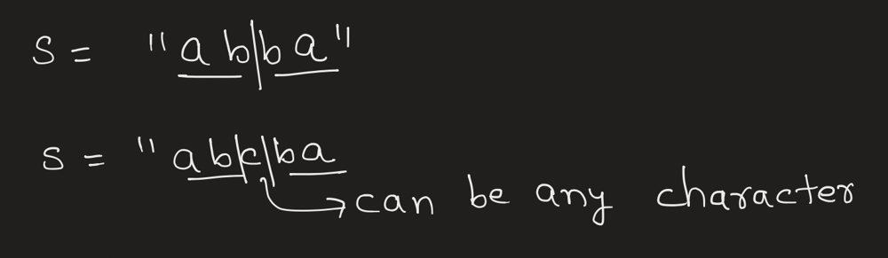
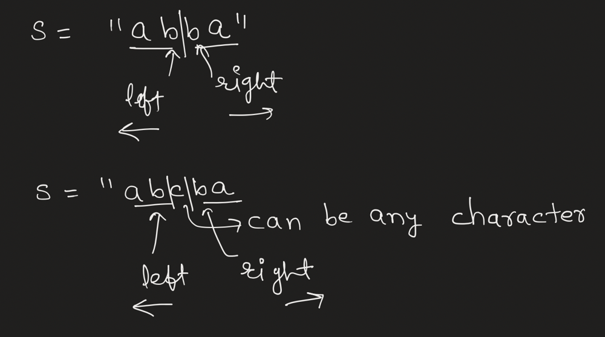
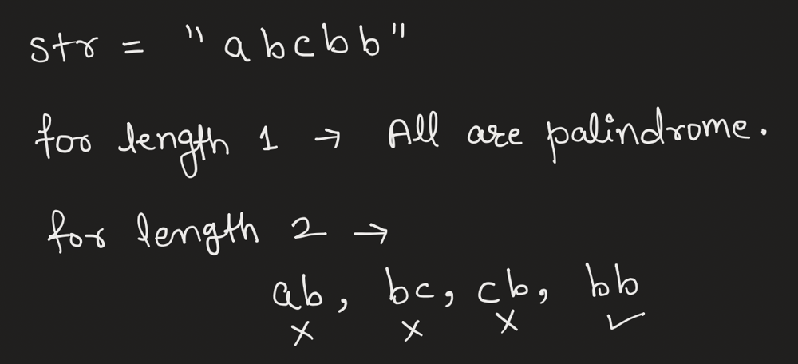
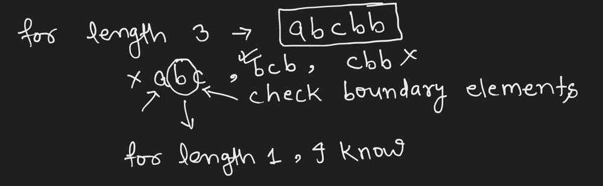
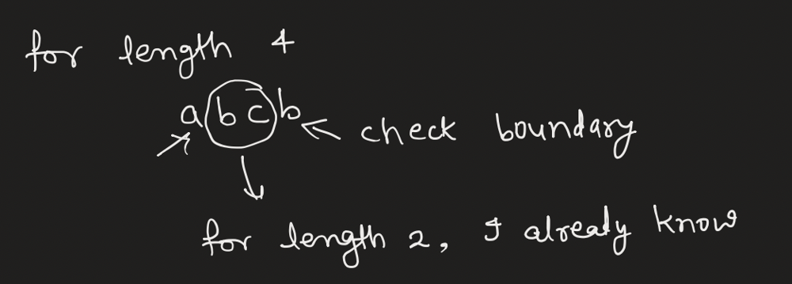
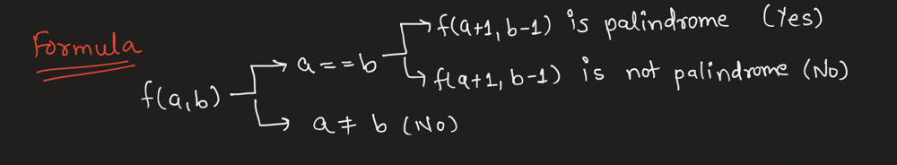

# 💡 Interview Approach | 3 Approach ( Brute Force, Expand Middle, DP )

**Author:** cs_iitian
**Votes:** 922
**Link:** [https://leetcode.com/problems/palindromic-substrings/solutions/4703811/](https://leetcode.com/problems/palindromic-substrings/solutions/4703811/)

---

Belive me guys at the end of blog, Interviewer would be like What the f**k , you are genious man \uD83D\uDE42!

## Video Solution ( In Hindi Language )
https://www.youtube.com/watch?v=J5P4OBhFKq0&ab_channel=CSIITIAN

# Let's come to the Point

So if we are discussing this with interviewer first thing is obviously the brute force. So let's discuss what is the brute force.

`A Brute force is a force which is applied brutally , Joking guys.` 

Let's see 
So I need all substring which are palindrome, and I know that every substring will have one start index and one end index. So we can have two loops first is for starting index and second is for end index. And now what I can do is, I can check if that substring is palindrome or not.

Let's code it also ( Although Interviewer don't want this , Because you have to ask him if he want more optimised version )
```Java []
class Solution {

    public boolean isPalindrome(String s, int left, int right) {
        while(left < right) {
            if(s.charAt(left++) != s.charAt(right--)) return false;
        } 
        return true;
    }
    
    public int countSubstrings(String s) {
        int ans = 0;
        int n = s.length();
        for(int i=0;i<n;i++) {
            for(int j=i;j<n;j++) {
                if(isPalindrome(s, i, j)) ans++;
            }
        }
        return ans;
    }
}
```


Wtf ? Our Brute Force worked.


`Interviewer:` What would be the time and space complexity here ?
`You:` Time Complexity would be $$O(n^3)$$. Because we have two for loops to iterate all possible substring and one loop to check if it is palindrome or not.
Space Complexity would be $$O(1)$$.

`Interviewer:` Cany you optimise it further ?
`You:` Sure ( MF ).

So Basically If I know a string is palindrome and I divide it in two parts ( if length is even ) that would have same characters.
and for odd length except the middle element, all other characters would be same.



So If I pick a character and expand it's left and right side till I have similiar elements. Those would be palindrome. But this could be even length palindrome's middle or odd length palindrome's middle. So we will take care of both case.



If it is odd, expand left = (i-1) and right = (i+1)
If it is even, expand left = (i) and right = (i+1)

We have to do this for each character to explore all substrings.

`Interviewer` : Approach seems good to me. Let's discuss Time and Space Complexity then we can proceed for the code part.
`You` : Sure , Here Time Complexity would be O(n^2) because for a character worst case can be to traverse all neighbours. 
and Space Complexity would be O(1).

Now let's code it
```Java []
class Solution {
    public int countSubstrings(String s) {
        int n = s.length();
        int ans = 0;
        for(int i=0;i<n;i++) {
            int even = palindromeCount(s, i, i+1);
            int odd = palindromeCount(s, i-1, i+1);
            ans += even + odd + 1;
        }
        return ans;
    }

    public int palindromeCount(String s, int left, int right) {
        int count = 0;
        while(left >= 0 && right < s.length() && s.charAt(left--) == s.charAt(right++)) {
            count++;
        }
        return count;
    }
}
```
```C++ []
class Solution {
public:
    int countSubstrings(string s) {
        int n = s.length(), ans = 0;
        for (int i = 0; i < n; ++i) {
            int even = palindromeCount(s, i, i + 1);
            int odd = palindromeCount(s, i, i);
            ans += even + odd;
        }
        return ans;
    }

    int palindromeCount(const string& s, int left, int right) {
        int count = 0;
        while (left >= 0 && right < s.length() && s[left] == s[right]) {
            --left;
            ++right;
            ++count;
        }
        return count;
    }
};
```
```Python []
class Solution:
    def countSubstrings(self, s: str) -> int:
        n, ans = len(s), 0
        
        def palindromeCount(left: int, right: int) -> int:
            count = 0
            while left >= 0 and right < n and s[left] == s[right]:
                left -= 1
                right += 1
                count += 1
            return count
        
        for i in range(n):
            even = palindromeCount(i, i + 1)
            odd = palindromeCount(i, i)
            ans += even + odd
            
        return ans
```


I've another approach for DP lovers. ( Let me know in comment section if you are )

# Another Approach ( Using DP )
### What about the length 1 ?
Yes, It will always be palindrome.

### and What about length 2 ?
It would be palindrome if only both are same.



now let's say I have one string f(a, b) = "nitin"
and I know that f(a+1, b-1) is palindrome, then if the boundary characters are same I can say that this is palindrome.







Here we can say that if I know the answer for length 1, I can build the answer for length 3, how ?
So basically  I just need to check boundary elements and middle one I already know if it palindrome or not.

So we will try to build from length 1 to n one by one and count the number of palindrome.

# Complexity
- Time complexity: $$O(n^2)$$
<!-- Add your time complexity here, e.g. $$O(n)$$ -->

- Space complexity: $$O(n^2)$$
<!-- Add your space complexity here, e.g. $$O(n)$$ -->

# Code
```java []
class Solution {
    public int countSubstrings(String s) {
        int n = s.length();
        boolean[][] palindrome = new boolean[n][n];
        int ans = 0;

        for(int i=0;i<n;i++) {
            palindrome[i][i] = true;
            ans++;
        }

        for(int i=0;i<n-1;i++) {
            if(s.charAt(i) == s.charAt(i+1)) {
                palindrome[i][i+1] = true;
                ans++;
            }
        }

        for(int len=3;len<=n;len++) {
            for(int i=0;i<n-len+1;i++) {
                if(s.charAt(i) == s.charAt(i+len-1) && palindrome[i+1][i+len-2]) {
                    palindrome[i][i+len-1] = true;
                    ans++;
                }
            }
        }

        return ans;
    }
}
```
```C++ []
class Solution {
public:
    int countSubstrings(string s) {
        int n = s.length();
        vector<vector<bool>> palindrome(n, vector<bool>(n, false));
        int ans = 0;

        for (int i = 0; i < n; ++i) {
            palindrome[i][i] = true;
            ans++;
        }

        for (int i = 0; i < n - 1; ++i) {
            if (s[i] == s[i + 1]) {
                palindrome[i][i + 1] = true;
                ans++;
            }
        }

        for (int len = 3; len <= n; ++len) {
            for (int i = 0; i < n - len + 1; ++i) {
                if (s[i] == s[i + len - 1] && palindrome[i + 1][i + len - 2]) {
                    palindrome[i][i + len - 1] = true;
                    ans++;
                }
            }
        }

        return ans;
    }
};
```
```Python []
class Solution:
    def countSubstrings(self, s: str) -> int:
        n = len(s)
        palindrome = [[False] * n for _ in range(n)]
        ans = 0

        for i in range(n):
            palindrome[i][i] = True
            ans += 1

        for i in range(n - 1):
            if s[i] == s[i + 1]:
                palindrome[i][i + 1] = True
                ans += 1

        for length in range(3, n + 1):
            for i in range(n - length + 1):
                if s[i] == s[i + length - 1] and palindrome[i + 1][i + length - 2]:
                    palindrome[i][i + length - 1] = True
                    ans += 1

        return ans
```
```JavaScript []
/**
 * @param {string} s
 * @return {number}
 */
var countSubstrings = function(s) {
    const n = s.length;
    const palindrome = Array.from(Array(n), () => Array(n).fill(false));
    let ans = 0;

    for (let i = 0; i < n; i++) {
        palindrome[i][i] = true;
        ans++;
    }

    for (let i = 0; i < n - 1; i++) {
        if (s[i] === s[i + 1]) {
            palindrome[i][i + 1] = true;
            ans++;
        }
    }

    for (let len = 3; len <= n; len++) {
        for (let i = 0; i < n - len + 1; i++) {
            if (s[i] === s[i + len - 1] && palindrome[i + 1][i + len - 2]) {
                palindrome[i][i + len - 1] = true;
                ans++;
            }
        }
    }

    return ans;
};
```

Now do you guys know who we are ? We are Coders and We write code that is best and clean as much as possible.

So I thought about the above solution and got to know that I can do this in one loop. But I just need to make sure I handle for len <= 2, because for that I don't want to check any middle substring.

```Java []
class Solution {
    public int countSubstrings(String s) {
        int n = s.length();
        boolean[][] palindrome = new boolean[n][n];
        int ans = 0;

        for(int len=1;len<=n;len++) {
            for(int i=0;i<n-len+1;i++) {
                if(s.charAt(i) == s.charAt(i+len-1) 
                    && (len <= 2 || palindrome[i+1][i+len-2])) {
                    palindrome[i][i+len-1] = true;
                    ans++;
                }
            }
        }

        return ans;
    }
}
```
```Python []
class Solution:
    def countSubstrings(self, s: str) -> int:
        n = len(s)
        palindrome = [[False] * n for _ in range(n)]
        ans = 0

        for length in range(1, n + 1):
            for i in range(n - length + 1):
                if s[i] == s[i + length - 1] and (length <= 2 or palindrome[i + 1][i + length - 2]):
                    palindrome[i][i + length - 1] = True
                    ans += 1

        return ans
```
```C++ []
class Solution {
public:
    int countSubstrings(string s) {
        int n = s.length();
        vector<vector<bool>> palindrome(n, vector<bool>(n, false));
        int ans = 0;

        for (int len = 1; len <= n; ++len) {
            for (int i = 0; i < n - len + 1; ++i) {
                if (s[i] == s[i + len - 1] && (len <= 2 || palindrome[i + 1][i + len - 2])) {
                    palindrome[i][i + len - 1] = true;
                    ans++;
                }
            }
        }

        return ans;
    }
};
```

`Interviwer` : You are hired.
`You` : Thank you !!!

If you have came so far, Please upvote it !!!


---
### Connect via
#### [1. Instagram](https://www.instagram.com/cs_iitian/) ( Follow )
#### [2. Facebook Page](https://www.facebook.com/cs.iitian)
#### [3. Twitter](https://twitter.com/cs_iitian)
#### [4. Blog](https://csiitian.blog/) ( Subscribe to news letter )
#### [5. Medium](https://medium.com/@csiitian)
#### [6. Youtube](https://www.youtube.com/channel/UCuxmikkhqbmBOUVxf-61hxw) ( Like, Share & Subscribe )
#### [7. Leetcode](https://leetcode.com/cs_iitian/)
