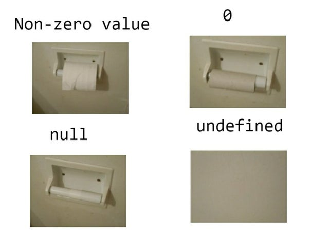

# Simple Solution with full explanation Java || Python3 || c++ || c# 😊

**Author:** sagarsindhu36
**Votes:** 5
**Link:** [https://leetcode.com/problems/palindromic-substrings/solutions/4704525/](https://leetcode.com/problems/palindromic-substrings/solutions/4704525/)

---

# Intuition
<!-- Describe your first thoughts on how to solve this problem. -->
The algorithm leverages the property that a palindrome can be expanded from its center. By iterating through all possible palindrome centers (both for odd and even length palindromes), the algorithm counts the number of palindromic substrings.

# Approach
---
<!-- Describe your approach to solving the problem. -->
## See comments and Do a dry run for better understanding\uD83D\uDE0A

---

1. Iterate through each possible `center` of a palindrome.
2. For each `center`, expand outwards to find palindromic substrings by comparing `characters` at symmetric positions.
3. Keep track of the `count` of palindromic substrings.

# Complexity
- Time complexity: ***O(n^2)***
<!-- Add your time complexity here, e.g. $$O(n)$$ -->

- Space complexity: ***O(1)***
<!-- Add your space complexity here, e.g. $$O(n)$$ -->

# Code
```java []
class Solution {
    public int countSubstrings(String s) {
        int count = 0; // Variable to store the count of palindromic substrings
        
        // Iterate through all possible palindrome centers
        for (int center = 0; center < 2 * s.length() - 1; center++) {
            // Calculate left and right boundaries based on the current center
            int left = center / 2;
            int right = left + center % 2;
            
            // Expand around the center to find palindromic substrings
            while (left >= 0 && right < s.length() && s.charAt(left) == s.charAt(right)) {
                count++; // Increment count for each palindromic substring found
                left--; // Expand left boundary
                right++; // Expand right boundary
            }
        }
        
        return count; // Return the total count of palindromic substrings
    }
}


```
```Python3 []
class Solution:
    def countSubstrings(self, s: str) -> int:
        count = 0
        
        # Iterate through all possible palindrome centers
        for center in range(2 * len(s) - 1):
            left = center // 2
            right = left + center % 2
            
            # Expand around the center to find palindromic substrings
            while left >= 0 and right < len(s) and s[left] == s[right]:
                count += 1
                left -= 1
                right += 1
        
        return count
```
```c++ []

class Solution {
public:
    int countSubstrings(std::string s) {
        int count = 0;
        
        // Iterate through all possible palindrome centers
        for (int center = 0; center < 2 * s.length() - 1; center++) {
            int left = center / 2;
            int right = left + center % 2;
            
            // Expand around the center to find palindromic substrings
            while (left >= 0 && right < s.length() && s[left] == s[right]) {
                count++;
                left--;
                right++;
            }
        }
        
        return count;
    }
};
```
```c# []
public class Solution {
    public int CountSubstrings(string s) {
        int count = 0;
        
        // Iterate through all possible palindrome centers
        for (int center = 0; center < 2 * s.Length - 1; center++) {
            int left = center / 2;
            int right = left + center % 2;
            
            // Expand around the center to find palindromic substrings
            while (left >= 0 && right < s.Length && s[left] == s[right]) {
                count++;
                left--;
                right++;
            }
        }
        
        return count;
    }
}
```

