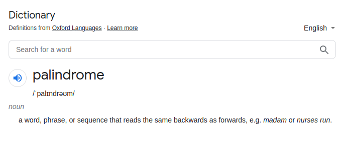

# [Java/C++] Awesome Visuall EXPLANATION

**Author:** hi-malik
**Votes:** 141
**Link:** [https://leetcode.com/problems/valid-palindrome-ii/solutions/1904942/](https://leetcode.com/problems/valid-palindrome-ii/solutions/1904942/)

---

How's going Ladies - n - Gentlemen today we are going to solve another coolest problem i.e. **Valid Palindrome II**

So, first of all let's talk about what the palindrome is. According to google,


**Now let's just talk about Problem Statement:-**
```
Given a string s, return true if the s can be palindrome after deleting at most one character from it.
```

Let's consider on example in order to understand it :-
**Input**: s = "abcdecba"
**Output**: true

So, what I can do is create two pointer's & start comparing them from. 
* One will start from 0th Index & another will start from last index.
* We'll check, if they are equal then continue checking
* But if they are undequal we can have 2 cases :-
* * Case 1 : Skip e to check whether it's forming an palindrome
* * Case 2 : Skip d to check whether it's forming an plaindrome
* But still if after deleting one character we are not gettong palindrome **return false**
* Otherwise **return true**


*I hope ladies - n - gentlemen, approach is absolute clear.* **Let's code it up**

**Java**
```
class Solution {
    public boolean validPalindrome(String s) {
        int i = 0;
        int j = s.length() - 1;
        
        while(i <= j){
            if(s.charAt(i) == s.charAt(j)){
                i++;
                j--;
            }
            else return isPalindrome(s, i + 1, j) || isPalindrome(s, i, j - 1);
        }
        return true;
    }
    public boolean isPalindrome(String s, int i, int j){
        while(i <= j){
            if(s.charAt(i) == s.charAt(j)){
                i++;
                j--;
            }
            else return false;
        }
        return true;
    }
}
```
**C++**
```
class Solution {
public:
    bool validPalindrome(string s) {
        int i = 0;
        int j = s.size() - 1;
        
        while(i <= j){
            if(s[i] == s[j]){
                i++;
                j--;
            }
            else return isPalindrome(s, i + 1, j) || isPalindrome(s, i, j - 1);
        }
        return true;
    }
    bool isPalindrome(string s, int i, int j){
        while(i <= j){
            if(s[i] == s[j]){
                i++;
                j--;
            }
            else return false;
        }
        return true;
    }
};
```
ANALYSIS :-
* **Time Complexity :-** BigO(N)

* **Space Complexity :-** BigO(1)