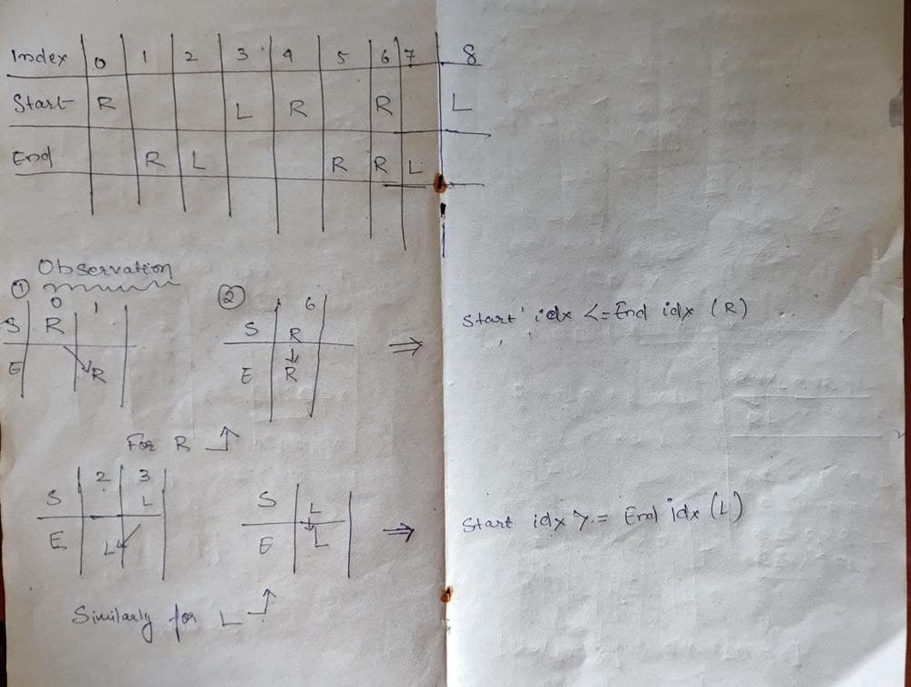

# Java Easy to Understand with Pictures

**Author:** EthanHunt1084
**Votes:** 25
**Link:** [https://leetcode.com/problems/swap-adjacent-in-lr-string/solutions/1571655/](https://leetcode.com/problems/swap-adjacent-in-lr-string/solutions/1571655/)

---


<br/>
From the above image it can be observed that 
* Both start and end have same number of L and R .
* Length of start and end are same.
* XL transforming to LX , means it either stays in the same start index  or is less than that of its start index in the end.
* Similarly RX transforming to XR , means it either stays in the same start index  or is greater than that of its start index in the end.

<br/>
** JAVA**

```
class Solution {
    public boolean canTransform(String start, String end) {
	
	//Checking if the number of L and R are equal without X in start and end
        if(!start.replace("X","").equals(end.replace("X",""))) return false;
		
	//Checking if length of start and end are different
        if(start.length()>end.length() || end.length()>start.length()) return false;
        
        //Making Arraylist for storing indices of L and R in both start and end
		
        ArrayList<Integer> lstart = new ArrayList<>(); 
        ArrayList<Integer> lend = new ArrayList<>(); 
        ArrayList<Integer> rstart = new ArrayList<>(); 
        ArrayList<Integer> rend = new ArrayList<>(); 
        
		//Iterating over start and storing L and R indices in their respective ArrayList
        for(int i=0;i<start.length();i++){
            if(start.charAt(i)=='L') lstart.add(i);
            if(start.charAt(i)=='R') rstart.add(i);
		
		//Iterating over end and storing L and R indices in their respective ArrayList
        }
        for(int i=0;i<end.length();i++){
            if(end.charAt(i)=='L') lend.add(i);
            if(end.charAt(i)=='R') rend.add(i);

        }
        
        //Taking two pointers and checking the condition which violates the rules
		
		//For L
        int i=0,j=0;
        while(i<lstart.size() && j<lend.size()){
            if (lend.get(j)>lstart.get(i)) return false;    //index in start should be less than or equal to index in end 
            i++;
            j++;
        }
        
		//For R
        i=0;j=0;
         while(i<rstart.size() && j<rend.size()){
            if (rend.get(j)<rstart.get(i)) return false;   //index in start should be greater than or equal to index in end 
             i++;
             j++;
        }
        
        return true;
    }
}
```