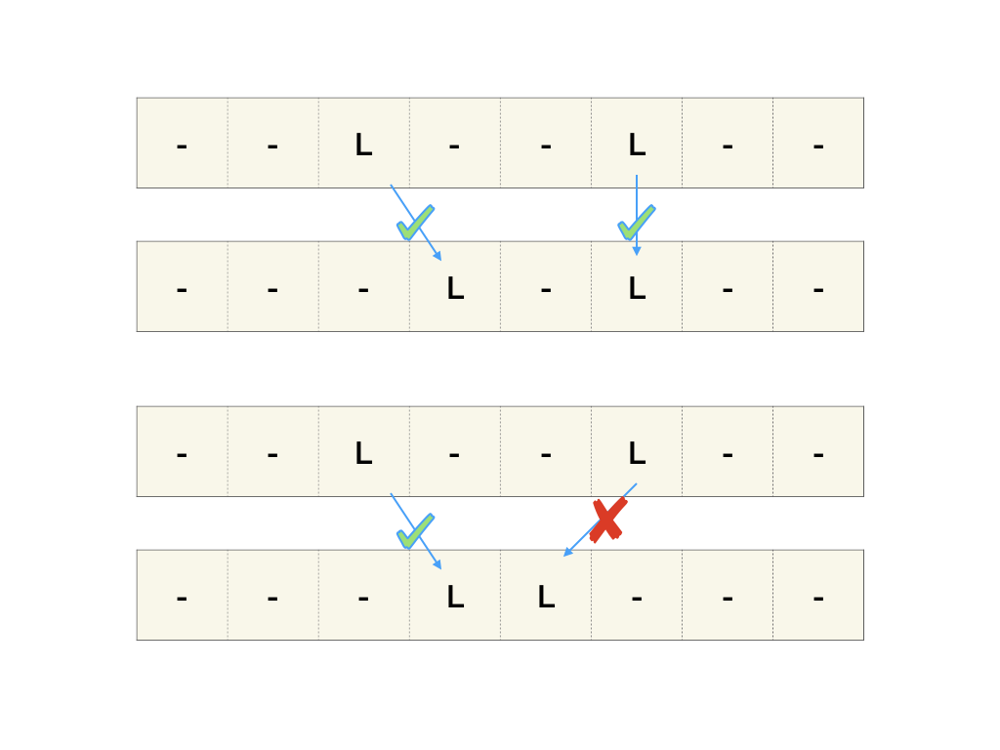

# Easy-to-understand explanation with PICTURE

**Author:** HigherBro
**Votes:** 199
**Link:** [https://leetcode.com/problems/swap-adjacent-in-lr-string/solutions/873004/](https://leetcode.com/problems/swap-adjacent-in-lr-string/solutions/873004/)

---


[Better formatted original blog post here](https://medium.com/@algo.monster.hello/leetcode-777-swap-adjacent-in-lr-string-google-interview-question-3574d2c77d19)

## Key observations:
There are three kinds of characters, \u2018L\u2019, \u2018R\u2019, \u2018X\u2019.
Replacing XL with LX = move L to the left by one
Replacing RX with XR = move R to the right by one
If we remove all the X in both strings, the resulting strings should be the same.
## Additional observations:
Since a move always involves X, an L or R cannot move through another L or R.
Since an L can only move to the right, for each occurrence of L in the start string, its position should be to the same or to the left of its corresponding L in the end string.



And vice versa for the R characters.

## Implementation

We first compare two strings with X removed. This checks relative position between Ls and Rs are correct.

Then we find the indices for each occurence of L and check the condition in the above figure. Then we do the same for R.

```python
class Solution:
    def canTransform(self, start: str, end: str) -> bool:
        if len(start) != len(end): return False
        
        # check L R orders are the same
        if start.replace('X','') != end.replace('X', ''): return False
        
        n = len(start)
        Lstart = [i for i in range(n) if start[i] == 'L']
        Lend = [i for i in range(n) if end[i] == 'L']
        
        Rstart = [i for i in range(n) if start[i] == 'R']
        Rend = [i for i in range(n) if end[i] == 'R']
		# check L positions are correct
        for i, j in zip(Lstart, Lend):
            if i < j:
                return False
            
        # check R positions are correct
        for i, j in zip(Rstart, Rend):
            if i > j:
                return False
            
        return True
```

[Better formatted original post and solutions and patterns ](https://medium.com/@algo.monster.hello/leetcode-777-swap-adjacent-in-lr-string-google-interview-question-3574d2c77d19)