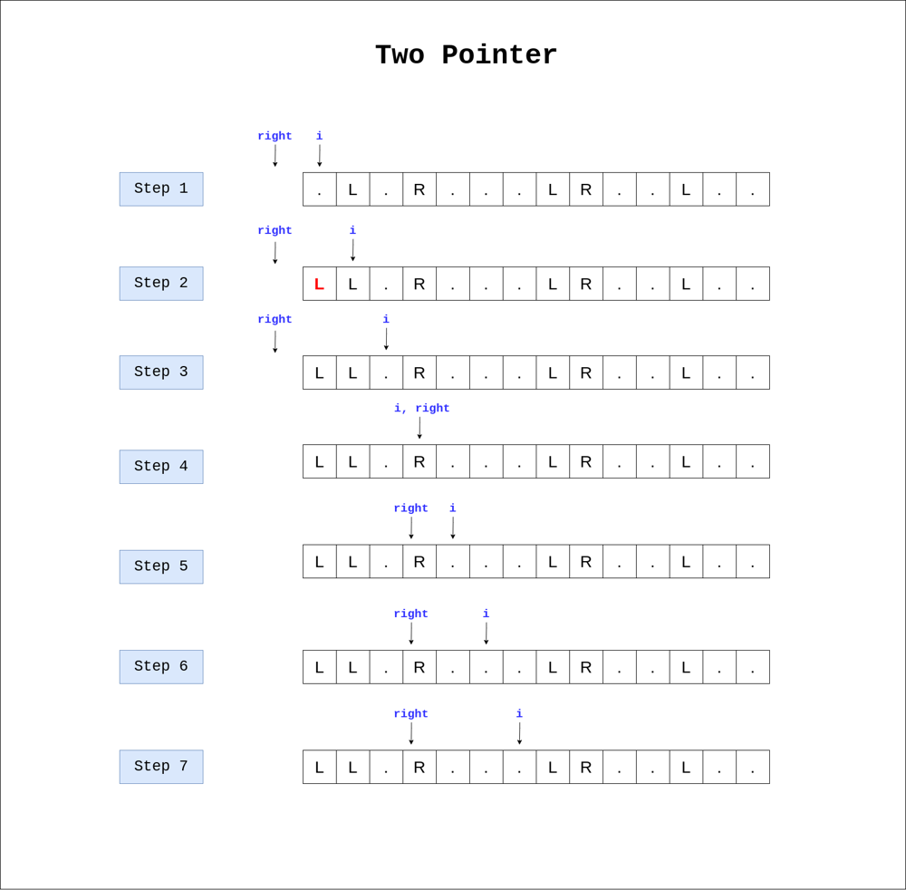
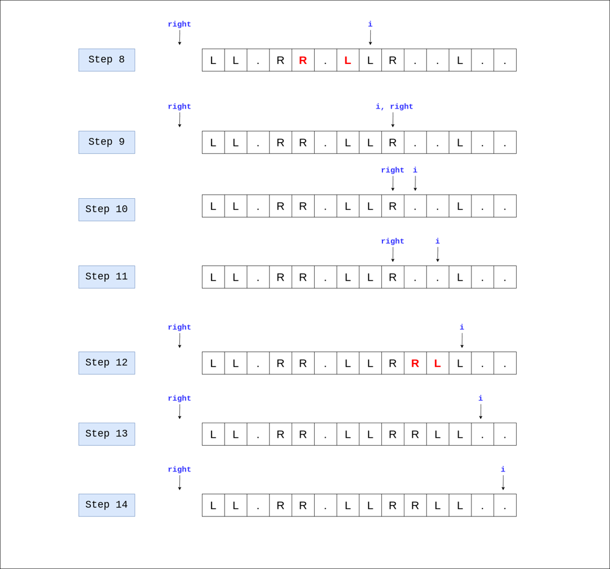

# C++ | Two Pointer | Diagram | Related Problems

**Author:** kiranpalsingh1806
**Votes:** 184
**Link:** [https://leetcode.com/problems/push-dominoes/solutions/2628923/](https://leetcode.com/problems/push-dominoes/solutions/2628923/)

---

**Approach**
1. If we encounter `.` in string, we move forward to next index.
2. If we encounter `L` in string, we see if index of right is -1, we make all the left index `L` until we see any other `L`.
2. If we encounter `L` in string and there is some previous `R` index, then we simultaneously change string from left and right side till two pointers reach each other. After that `right` moves back to `-1`.
3. If we encounter `R` in string, we see if the index of `R` is not -1, we make all the indices upto that index `R`.

**Diagram Explanation**





**Explanation of steps** 
In **step 8**, we encountered `L`, so first thing we check if index of previous `right` is not `-1`. Here `right` is `3`, so we started making `R` from index 4 onwards  and simultaneously started making `L` from index `7` in backward direction. We will stop if left and right pointer arrives at same point. After than, we send right to -1 until we find another `R` in string.

**C++ Code**

```cpp
string pushDominoes(string s) {
    int N = s.size(), right = -1;
    for (int i = 0; i < N; ++i) {
        if (s[i] == 'L') {
            if (right == -1) { 
                // Step 2
                for (int j = i - 1; j >= 0 && s[j] == '.'; --j) {
                  s[j] = 'L';  
                } 
            } else {
                // Step 8
                for (int j = right + 1, k = i - 1; j < k; ++j, --k) {
                    s[j] = 'R';
                    s[k] = 'L';
                } 
                right = -1;
            }
        } else if (s[i] == 'R') {
            if (right != -1) {
                for (int j = right + 1; j < i; ++j) s[j] = 'R';
            }
            right = i;
        }
    }
    if (right != -1) {
        for (int j = right + 1; j < N; ++j) s[j] = 'R';
    }
    return s;
}
```

**Related Problems - Two Pointer**
[1. Two Sum ](https://leetcode.com/problems/two-sum/)
[2. Container With Most Water ](https://leetcode.com/problems/container-with-most-water/)
[3. 3Sum ](https://leetcode.com/problems/3sum/)
[4. Minimum Window Substring ](https://leetcode.com/problems/minimum-window-substring/)
[5. Remove Duplicates from Sorted List ](https://leetcode.com/problems/remove-duplicates-from-sorted-list/)
[6. Reorder List ](https://leetcode.com/problems/reorder-list/)
[7. Maximum Product Subarray ](https://leetcode.com/problems/maximum-product-subarray/)
[8. Palindrome Linked List ](https://leetcode.com/problems/palindrome-linked-list/)
[9. Subarray Product Less Than K ](https://leetcode.com/problems/subarray-product-less-than-k/)
[10. Backspace String Compare ](https://leetcode.com/problems/backspace-string-compare/)