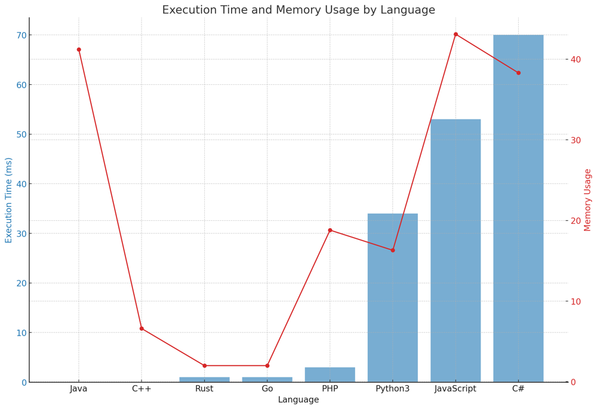

# ✅ 95.83% Two Pointers & Stack

**Author:** vanAmsen
**Votes:** 39
**Link:** [https://leetcode.com/problems/backspace-string-compare/solutions/4185122/](https://leetcode.com/problems/backspace-string-compare/solutions/4185122/)

---

# Intuition
When encountering two strings, `s` and `t`, where the character `#` behaves as a backspace, our immediate reaction is to understand the final form of each string after applying all the backspaces. If the post-processed strings match, they are equivalent. One way to address this is to emulate the keystrokes for each string: when a character isn't `#`, we "type" it out; if it is `#`, it leads to the "deletion" of the preceding character.

## Live Coding + Explain
https://youtu.be/MLgvNLew0U8?si=35-f5A9LefNs7p4_

# Approach 1: Two Pointers
1. **Processing the String**: To emulate the "typing" and "erasing" action, we navigate through each string with two pointers. The main pointer (`i`) traverses each character, while the auxiliary pointer (`k` for `s` and `p` for `t`) indicates the effective position of the last character post backspaces.
   - If the character at the main pointer isn't `#`, it's "typed" at the location of the auxiliary pointer, which is then incremented.
   - If the character is `#`, the preceding character is "erased" by decrementing the auxiliary pointer.
   - The concluding value of the auxiliary pointer after processing gives the effective string length after considering backspaces.

2. **Comparing the Strings**: After processing, the effective lengths (final values of `k` and `p`) are compared. A difference in lengths directly implies the strings aren't equal. If the lengths align, a character-by-character comparison is performed up to their effective lengths.

### Pros
- This approach is space efficient since it uses a constant amount of space.
- Directly manipulates the input strings without creating new ones.

### Cons
- Might be a bit harder to conceptualize for someone unfamiliar with the two-pointer technique.

# Approach 2: Using Stack
The idea here is to use the inherent nature of stacks to simulate the backspace operation.
1. Iterate through each character of the string.
2. If the character isn't `#`, it's pushed onto the stack.
3. If the character is `#` and the stack isn't empty, the top element (last typed character) is popped (i.e., "erased").
4. After processing, the contents of the stacks for both strings are compared.

### Pros
- More intuitive and straightforward. The stack naturally provides the "last in, first out" behavior which is handy for this problem.
- Easier to implement.

### Cons
- Uses extra space (although linear) to store characters in the stack.

# Complexity

For both approaches:
- **Time complexity**: $O(n)$ - Both strings are traversed once, where $n$ is the total length of the strings `s` and `t`.

For the two-pointer approach:
- **Space complexity**: $O(1)$ - Only a fixed amount of space is used for pointers and for converting strings to lists for in-place modifications.

For the stack approach:
- **Space complexity**: $O(n)$ - In the worst case, if there are no backspaces, the entire string might be stored in the stack.

# Code (Using Two Pointers)
``` Python []
class Solution:
    def backspaceCompare(self, s: str, t: str) -> bool:
        
        def process_string(string):
            k = 0
            for i in range(len(string)):
                if string[i] != '#':
                    string[k] = string[i]
                    k += 1
                else:
                    k = max(k-1, 0)
            return k
        
        # Convert strings to lists for in-place modifications
        s, t = list(s), list(t)
        
        k = process_string(s)
        p = process_string(t)
        
        # If effective lengths are different, return False
        if k != p:
            return False
        
        # Compare the effective characters
        for i in range(k):
            if s[i] != t[i]:
                return False
        
        return True
```
``` C++ []
class Solution {
public:
    bool backspaceCompare(string s, string t) {
        int k = processString(s);
        int p = processString(t);

        if (k != p) return false;

        for (int i = 0; i < k; i++) {
            if (s[i] != t[i]) return false;
        }

        return true;
    }

private:
    int processString(string& str) {
        int k = 0;
        for (char c : str) {
            if (c != '#') {
                str[k++] = c;
            } else if (k > 0) {
                k--;
            }
        }
        return k;
    }
};
```
``` Java []
public class Solution {
    public boolean backspaceCompare(String S, String T) {
        char[] sChars = S.toCharArray();
        char[] tChars = T.toCharArray();
        
        int k = processString(sChars);
        int p = processString(tChars);

        if (k != p) return false;

        for (int i = 0; i < k; i++) {
            if (sChars[i] != tChars[i]) return false;
        }

        return true;
    }

    private int processString(char[] chars) {
        int k = 0;
        for (char c : chars) {
            if (c != '#') {
                chars[k++] = c;
            } else if (k > 0) {
                k--;
            }
        }
        return k;
    }
}
```
``` Go []
func backspaceCompare(S string, T string) bool {
    sRunes := []rune(S)
    tRunes := []rune(T)
    k := processString(sRunes)
    p := processString(tRunes)

    if k != p {
        return false
    }

    for i := 0; i < k; i++ {
        if sRunes[i] != tRunes[i] {
            return false
        }
    }

    return true
}

func processString(chars []rune) int {
    k := 0
    for _, c := range chars {
        if c != '#' {
            chars[k] = c
            k++
        } else if k > 0 {
            k--
        }
    }
    return k
}
```
``` Rust []
impl Solution {
    pub fn backspace_compare(s: String, t: String) -> bool {
        let mut s_chars: Vec<char> = s.chars().collect();
        let mut t_chars: Vec<char> = t.chars().collect();
        
        let k = Self::process_string(&mut s_chars);
        let p = Self::process_string(&mut t_chars);

        if k != p {
            return false;
        }

        for i in 0..k {
            if s_chars[i] != t_chars[i] {
                return false;
            }
        }

        true
    }

    fn process_string(chars: &mut Vec<char>) -> usize {
        let chars_copy = chars.clone();
        let mut k = 0;
        for &c in chars_copy.iter() {
            if c != '#' {
                chars[k] = c;
                k += 1;
            } else if k > 0 {
                k -= 1;
            }
        }
        k
    }
}
```
``` JavaScript []
var backspaceCompare = function(S, T) {
    let sChars = S.split('');
    let tChars = T.split('');
    
    let k = processString(sChars);
    let p = processString(tChars);

    if (k !== p) return false;

    for (let i = 0; i < k; i++) {
        if (sChars[i] !== tChars[i]) return false;
    }

    return true;
};

function processString(chars) {
    let k = 0;
    for (let c of chars) {
        if (c !== '#') {
            chars[k++] = c;
        } else if (k > 0) {
            k--;
        }
    }
    return k;
}
```
``` PHP []
class Solution {

    /**
     * @param String $S
     * @param String $T
     * @return Boolean
     */
    function backspaceCompare($S, $T) {
        $k = $this->processString($S);
        $p = $this->processString($T);

        if ($k != $p) return false;

        for ($i = 0; $i < $k; $i++) {
            if ($S[$i] != $T[$i]) return false;
        }

        return true;
    }

    function processString(&$str) {
        $k = 0;
        for ($i = 0; $i < strlen($str); $i++) {
            if ($str[$i] != '#') {
                $str[$k] = $str[$i];
                $k++;
            } else if ($k > 0) {
                $k--;
            }
        }
        return $k;
    }
}
```
``` C# []
public class Solution {
    public bool BackspaceCompare(string S, string T) {
        char[] sChars = S.ToCharArray();
        char[] tChars = T.ToCharArray();
        
        int k = ProcessString(sChars);
        int p = ProcessString(tChars);

        if (k != p) return false;

        for (int i = 0; i < k; i++) {
            if (sChars[i] != tChars[i]) return false;
        }

        return true;
    }

    private int ProcessString(char[] chars) {
        int k = 0;
        foreach (char c in chars) {
            if (c != '#') {
                chars[k++] = c;
            } else if (k > 0) {
                k--;
            }
        }
        return k;
    }
}

```

## Live Coding Stack
https://youtu.be/S19mL8d1XEo?si=d5ltlzwXjMRKaixW

# Code (Using Stack)
``` Python
class Solution:
    def backspaceCompare(self, s: str, t: str) -> bool:
        
        def process_string(string):
            stack = []
            for char in string:
                if char != '#':
                    stack.append(char)
                elif stack:
                    stack.pop()
            return stack
        
        return process_string(s) == process_string(t)
```

## Performance 

| Language | Execution Time (ms) | Memory Usage |
|----------|---------------------|--------------|
| Java     | 0 ms                | 41.2 MB      |
| C++      | 0 ms                | 6.6 MB       |
| Rust     | 1 ms                | 2 MB         |
| Go       | 1 ms                | 2 MB         |
| PHP      | 3 ms                | 18.8 MB      |
| Python3  | 34 ms               | 16.3 MB      |
| JavaScript | 53 ms             | 43.1 MB      |
| C#       | 70 ms               | 38.3 MB      |




# What We Learned
By exploring these two approaches, we see the importance of understanding and applying different problem-solving techniques. While both strategies lead to the same solution, they offer different perspectives and trade-offs. The two-pointer technique is a powerful tool, especially for space-constrained problems. On the other hand, using data structures like stacks can simplify problems by leveraging their inherent properties. The choice of approach often depends on the problem's constraints and the desired trade-offs between time and space efficiency.