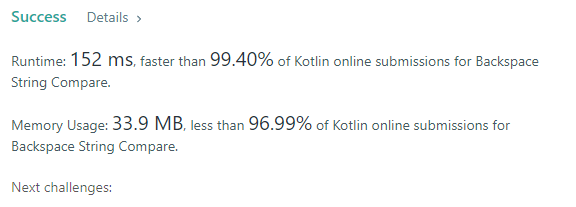

# kotlin faster than 99.40% with extra space O(1)

**Author:** Dad52
**Votes:** 6
**Link:** [https://leetcode.com/problems/backspace-string-compare/solutions/2655835/](https://leetcode.com/problems/backspace-string-compare/solutions/2655835/)

---


```
class Solution {
    fun backspaceCompare(s: String, t: String): Boolean {
        
        var i = s.length - 1
        var j = t.length - 1
        var back: Int
        
        while (true) {
            back = 0
            while (i >= 0 && (back > 0 || s[i] == '#')) {
                back += if (s[i] == '#') 1 else -1
                i--
            }
            
            back = 0
            while (j >= 0 && (back > 0 || t[j] == '#')) {
                back += if (t[j] == '#') 1 else -1
                j--
            }
            
            if (i >= 0 && j >= 0 && s[i] == t[j]) {
                i--
                j--
            } else {
                break
            }
            
        }
        
        return i == -1 && j == -1
        
    }
}
```