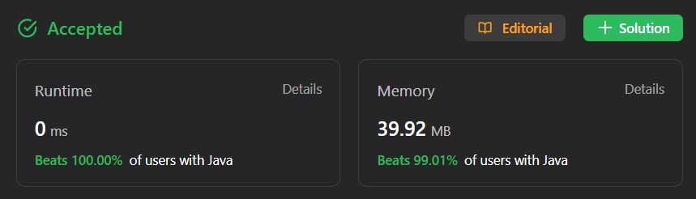

# ✅ Easier Than Easy ✅ Multiple Approaches ✅ Beats 100% ✅ O(N) Time  O(1) Space

**Author:** millenium103
**Votes:** 23
**Link:** [https://leetcode.com/problems/backspace-string-compare/solutions/4184515/](https://leetcode.com/problems/backspace-string-compare/solutions/4184515/)

---



# YouTube Video Explanation
[https://youtu.be/AANUkU-FVqc](https://youtu.be/AANUkU-FVqc)

\uD83D\uDD25 ***Please like, share, and subscribe to support our channel's mission of making complex concepts easy to understand.***

Subscribe Link: https://www.youtube.com/@leetlogics/?sub_confirmation=1

***Subscribe Goal: 100 Subscribers
Current Subscribers: 84***

## Intution:
The "Backspace String Compare" problem presents us with two strings, `s` and `t`, which contain lowercase letters and the '#' character. We need to determine if these strings are equal when typed into empty text editors that support backspace typing.

## Approach 1 - Brute Force (Using Stacks):
We can start with a straightforward approach. We'll utilize two stacks, `s1` and `s2`, to simulate typing both strings into text editors that handle backspace. We iterate through the strings, handling backspaces when we encounter the '#' character. After processing, we construct the resulting strings `res1` and `res2` from the stacks. If these strings are equal, we return `true`, indicating that the original strings are equivalent.

Here's the code for this approach:

```java
class Solution {
    public boolean backspaceCompare(String s, String t) {
        Stack<Character> s1 = new Stack<Character>();
        Stack<Character> s2 = new Stack<Character>();
        
        for(char ch : s.toCharArray()){
            if(ch == '#'){
                if(!s1.isEmpty())
                    s1.pop();
                continue;
            }
            s1.push(ch);
        }
        
        for(char ch : t.toCharArray()){
            if(ch == '#'){
                if(!s2.isEmpty())
                    s2.pop();
                continue;
            }
            s2.push(ch);
        }
        
        String res1 = "";
        String res2 = "";
        
        while(!s1.isEmpty())
            res1 += s1.pop();
        
        while(!s2.isEmpty())
            res2 += s2.pop();
        
        return res1.equals(res2);
    }
}
```

## Approach 2 - Optimized Solution:
In this optimized approach, we avoid constructing temporary strings. Instead, we iterate through the strings in reverse order, taking into account backspaces along the way. The method `nextChar` helps us navigate through the '#' characters and calculate the effective position of the next valid character.

Here's the code for the optimized approach:

```java
class Solution {
    private static int nextChar(String str, int cur){
        while(cur > -1 && str.charAt(cur) == '#'){
            int cnt = 1;
            for(cur--; cur > -1 && cnt > 0; cur--)
                cnt += str.charAt(cur) == '#'? 1 : -1;
        }
        return cur;
    }
    
    public boolean backspaceCompare(String s, String t) {
        int i = nextChar(s, s.length() - 1);
        int j = nextChar(t, t.length() - 1);
        
        while(i > -1 && j > -1){
            if(s.charAt(i) != t.charAt(j)) return false;
            i = nextChar(s, i - 1);
            j = nextChar(t, j - 1);
        }
        
        if(i == -1 && j == -1) return true;
        return false;
    }
}
```

<iframe src="https://leetcode.com/playground/CDwCd2a7/shared" frameBorder="0" width="600" height="400"></iframe>

## Complexity:
- The time complexity for both approaches is `O(N)`, where N is the length of the longer of the two input strings, as we iterate through both strings only once.

- Space Complexity if `O(1)` for optimal approach and `O(N)` for stack approack.

---


