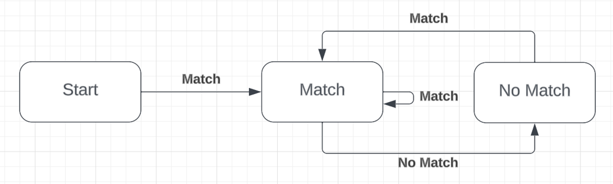
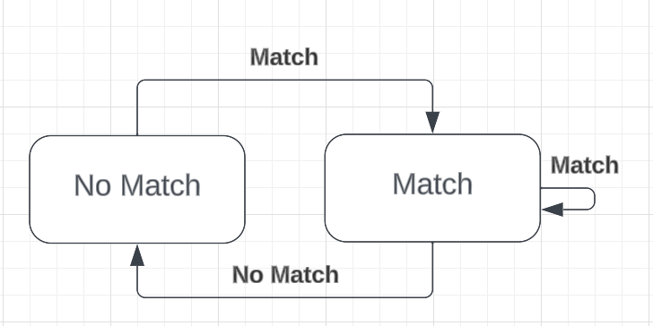

# 3 Solutions | Time: O(M) | Space: O(1)

**Author:** rojas
**Votes:** 2
**Link:** [https://leetcode.com/problems/long-pressed-name/solutions/4223840/](https://leetcode.com/problems/long-pressed-name/solutions/4223840/)

---

# Key
- $N$ is name.length
- $M$ is typed.length

# Code 1: Regex
- Time complexity: $(N + M)$
- Space complexity: $O(N)$
```Typescript
function isLongPressedName(name: string, typed: string): boolean {
    if (name.length > typed.length) {
        return false;
    }

    // Create Regex string
    let curr = "";
    let count = 0;
    const buf: string[] = [];
    for (const c of name) {
        if (c !== curr) {
            buf.push(`${curr}{${count},}`);
            curr = c;
            count = 0;
        }
        ++count;
    }
    buf[0] = "^";
    buf.push(`${curr}{${count},}$`);
    
    return new RegExp(buf.join("")).test(typed);
};
```

# Code 2: Pointers
- Time complexity: $(M)$
- Space complexity: $O(1)$
```Typescript
function isLongPressedName(name: string, typed: string): boolean {
    const N = name.length;
    const M = typed.length;
    
    if (N > M) {
        return false;
    }

    let i = 0;
    let prev = "";
    for (let j = 0; j < M; ++j) {
        if (i < N && name[i] === typed[j]) {
            prev = name[i++];
        } else if (prev !== typed[j]) {
            return false;
        }
    }

    return i >= N;
};
```

# Code 3: DFA (Deterministic Finite Automaton)
- Time complexity: $(M)$
- Space complexity: $O(1)$

A bit overboard for this question, but hopefully this is as an approachable example of [DFA](https://en.wikipedia.org/wiki/Deterministic_finite_automaton). Some problems that can be approached this way are:
1. [231. Power of Two](https://leetcode.com/problems/power-of-two/)
1. [520. Detect Capital](https://leetcode.com/problems/detect-capital)
1. [925. Long Pressed Name](https://leetcode.com/problems/long-pressed-name)
1. [1816. Truncate Sentence](https://leetcode.com/problems/truncate-sentence)
1. [2437. Number of Valid Clock Times](https://leetcode.com/problems/number-of-valid-clock-times)
1. [65. Valid Number](https://leetcode.com/problems/valid-number/description/)

This approach involves creating a state diagram (aka state machine) that maps out possible states, connections between them, and appropriate final states. As we iterate through the input strings, we use the values at each index to move between states. 

For example, a state diagram for this problem is shown below. Implicit in the diagram are invalid states.




You might notice that both the "Start" and "No Match" states are the same; they both have only 1 connection to the "Match" state. You could reduce the number of states by combining them. Now, "No Match" will be our starting state.




1. Start at the "No Match" state and indices 0, 0 (name index and typed index, respectively).
2. In the "No Match" state, compare $name$ and $typed$ at the current indices. If they match, increment both indices by 1 and move to the "Match" state. Otherwise, go the invalid state.
3. In the "Match" state, compare $name$ and $typed$ at the current indices. If they match, increment both indices by 1. Otherwise, decrement the name index by 1 (so that the next comparison is with the previous index) and go to the "No Match" state.

```Typescript
function isLongPressedName(name: string, typed: string): boolean {
    const N = name.length;
    const M = typed.length;

    if (N > M) {
        return false;
    }

    // [False, True]
    const states: number[][][] = [
        // Matched Previous
        [[-1, 0, 0], [1, 1, 1]],
        // Matched Current
        [[0, -1, 0], [1, 1, 1]]
    ];

    let i = 0;
    let j = 0;
    let state = 0;
    while (j < M && state >= 0) {
        const bool = i < N && name[i] === typed[j];
        const [nextState, di, dj] = states[state][+bool];
        state = nextState;
        i += di;
        j += dj;
    }

    return state >= 0 && i >= N;
};
```