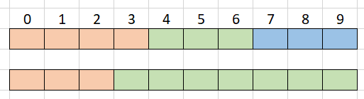

# Greedy with picture

**Author:** votrubac
**Votes:** 93
**Link:** [https://leetcode.com/problems/shortest-way-to-form-string/solutions/309404/](https://leetcode.com/problems/shortest-way-to-form-string/solutions/309404/)

---

# Intuition
When the data needs to be processed in a certain order, think greedy. Here, greedy means exhausting all characters in the source before starting a new subsequence.

We can use a contradiction to see if greedy works. Let's say that greedy produced 3 subsequences, and another algorithm produced two (see the picture below). 

To do that, the other algorithm must end the subsequence before the source is exhausted and start the second subsequence at position #3. However, if the second subsequence covers positions ```[3...9]```, then it also covers positions ```[4...9]``` and therefore greedy would also produce 2 subsequenes as the result \u25A0


# Greedy Solution
Match characters in source and target by moving indices ```i``` and ```j```. Every time we run out of characters in the source (```j == s.size()```), we increase the number of subsequences and reset the source index (```j = 0```).

Since the number of subsequences cannot be larger than the target, we can use this fact to exist and return ```-1``` when a character is missing in the source.
**C++**
Minimalizm Version
```cpp
int shortestWay(string s, string t) {
    int sz = s.size(), i = 0, res = 0;
    for (int j = 0; i < t.size() && res <= i + 1; ++j) {
        res += j % sz == 0;
        i += t[i] == s[j % sz];
    }
    return i == t.size() ? res : -1;
}
```
Original Version
```cpp
int shortestWay(string s, string t) {
  auto i = 0, j = 0, res = 0;
  while (i < t.size() && res <= i) {
    while (t[i] != s[j] && j < s.size()) ++j;
    if (j == s.size()) j = 0, ++res;
    else ++i, ++j;
  }
  return res <= i ? res + 1 : -1;
}
```
## Complexity Analysis
Runtime: *O(nm)*, where *n* and *m* are sizes of the source and target.
Memory: *O(1)*
# Runtime Optimization
Instead of scanning the source linearly, we can collect positions for each char and use a binary search. Thanks [avrastogi](https://leetcode.com/avrastogi/) for the recommendation!
```
int shortestWay(string s, string t, int res = 0) {
  vector<int> ch_ids[26] = {};
  for (auto j = 0; j < s.size(); ++j) ch_ids[s[j] - 'a'].push_back(j);
  for (auto i = 0, j = -1; i < t.size(); ) {
    auto &ids = ch_ids[t[i] - 'a'];
    if (ids.empty()) return -1;
    auto it = upper_bound(begin(ids), end(ids), j);
    if (it == end(ids)) ++res, j = -1;
    else ++i, j = *it;
  }
  return res + 1;
}
```
## Complexity Analysis
Runtime: *O(n log m)*, where *n* and *m* are sizes of the source and target.
Memory: *O(m)*, to store indexes for target.