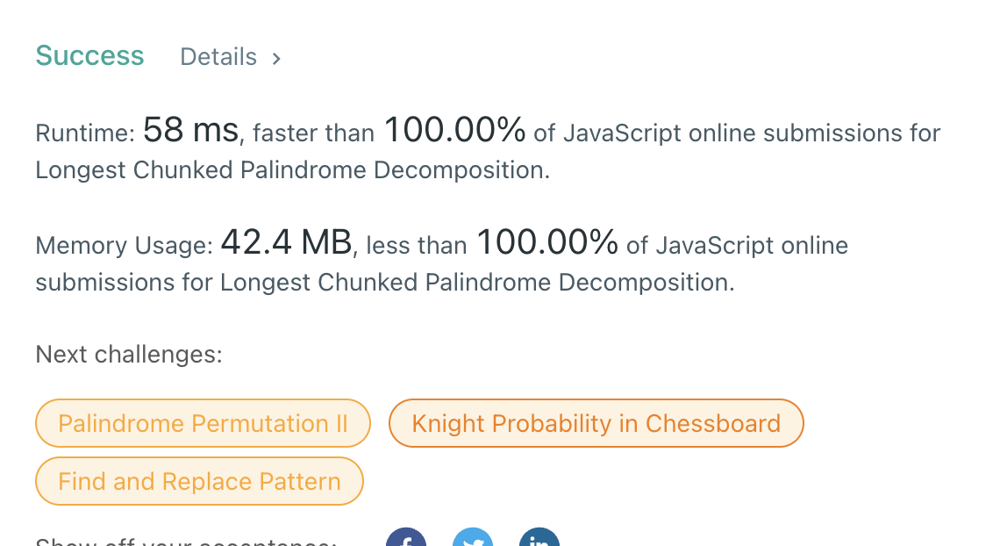

# Javascript 100% fast&easy

**Author:** stanislav_h
**Votes:** 0
**Link:** [https://leetcode.com/problems/longest-chunked-palindrome-decomposition/solutions/2539927/](https://leetcode.com/problems/longest-chunked-palindrome-decomposition/solutions/2539927/)

---

```
var longestDecomposition = function(text) {
    let counter = 0
    let len = text.length

    for (let i = 1; i <= len / 2; i++) {
        const start = text.substr(0, i)
        const end = text.substr(len - i, i)
        if (start == end) {
            // Cut palindromes from text, increase counter, loop again
            text = text.substr(0, len - i).substr(i)
            len = text.length
            i = 0
            counter += 2
        }
    }

    return counter + (text.length ? 1 : 0)
};
```



