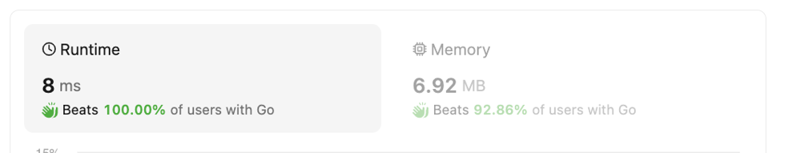

# Solution with Runtime Beats 100.00% Memory 6.92 MB Beats 92.86%

**Author:** rafatgofers
**Votes:** 0
**Link:** [https://leetcode.com/problems/last-substring-in-lexicographical-order/solutions/4863886/](https://leetcode.com/problems/last-substring-in-lexicographical-order/solutions/4863886/)

---

# Intuition
We aim to find the lexicographically largest substring within the given string s.
To achieve this, we iterate through the string starting from the end, comparing characters to determine the maximum index where the substring starts.
By comparing characters and indexes, we identify the lexicographically largest substring efficiently.

<!-- Describe your first thoughts on how to solve this problem. -->

# Approach
### Intuition:
- We aim to find the lexicographically largest substring within the given string `s`.
- To achieve this, we iterate through the string starting from the end, comparing characters to determine the maximum index where the substring starts.
- By comparing characters and indexes, we identify the lexicographically largest substring efficiently.

### Approach:
1. Initialize `maxIndex` to the last index of the string `s`.
2. Iterate through the string from the end to the beginning.
3. At each iteration, compare the current character with the character at `maxIndex`.
4. If the current character is greater than the character at `maxIndex`, update `maxIndex` to the current index.
5. If the current character is equal to the character at `maxIndex`, compare the next characters to break the tie.
6. Finally, return the substring starting from `maxIndex`.

### Complexity:
- **Time complexity:** The time complexity of the algorithm is O(n), where n is the length of the string `s`. This is because we iterate through the string only once.
- **Space complexity:** The space complexity is O(1) since we only use a constant amount of extra space for variables regardless of the input size.
<!-- Describe your approach to solving the problem. -->




# Code
```
func lastSubstring(s string) string {
    maxIndex := len(s) - 1

	for currIndex := len(s) - 1; currIndex >= 0; currIndex-- {
		if s[currIndex] > s[maxIndex] {
			maxIndex = currIndex
		} else if s[currIndex] == s[maxIndex] {
			i, j := currIndex+1, maxIndex+1

			for i < maxIndex && j < len(s) && s[i] == s[j] {
				i++
				j++
			}

			if i == maxIndex || j == len(s) || s[i] > s[j] {
				maxIndex = currIndex
			}
		}
	}

	return s[maxIndex:]   
}
```