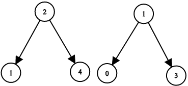
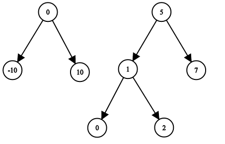

# [1214. Two Sum BSTs](https://leetcode.com/problems/two-sum-bsts/)

| Category | Difficulty | Likes | Dislikes |
| :------: | :--------: | :---: | :------: |
| Algorithms | Medium | 577 | 46 |

**Tags:** [`two-pointers`](https://leetcode.com/tag/two-pointers), [`binary-search`](https://leetcode.com/tag/binary-search), [`stack`](https://leetcode.com/tag/stack), [`tree`](https://leetcode.com/tag/tree), [`depth-first-search`](https://leetcode.com/tag/depth-first-search), [`binary-search-tree`](https://leetcode.com/tag/binary-search-tree), [`binary-tree`](https://leetcode.com/tag/binary-tree)

**Companies:** `amazon`

## Description

Given the roots of two binary search trees, `root1` and `root2`, return `true` if and only if there is a node in the first tree and a node in the second tree whose values sum up to a given integer `target`.

 

**Example 1:**


```

Input: root1 = [2,1,4], root2 = [1,0,3], target = 5
Output: true
Explanation: 2 and 3 sum up to 5.

```

**Example 2:**


```

Input: root1 = [0,-10,10], root2 = [5,1,7,0,2], target = 18
Output: false

```

 

**Constraints:**

	- The number of nodes in each tree is in the range `[1, 5000]`.

	- `-10^9 <= Node.val, target <= 10^9`

---

**Links:** [Submissions](https://leetcode.com/problems/two-sum-bsts/) | [Solutions](https://leetcode.com/problems/two-sum-bsts/)
