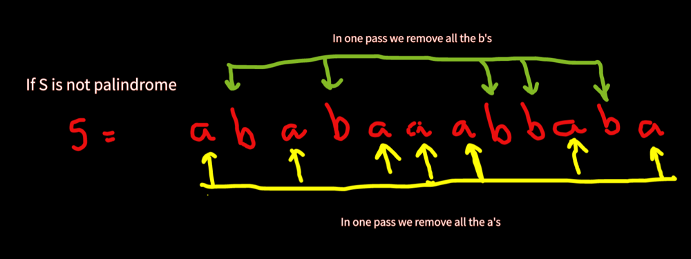

# Easy O(n) Solution in C++ || Two Pointers

**Author:** harshit7962
**Votes:** 67
**Link:** [https://leetcode.com/problems/remove-palindromic-subsequences/solutions/2124549/](https://leetcode.com/problems/remove-palindromic-subsequences/solutions/2124549/)

---

The idea here is pretty simple...
1) If the string is a palindrome, the answer is 1 and
2) If the string is not palindrome, the answer is 2, becuase:
	 * String s only consists of two characters 'a' and 'b',
	 * This implies, there always exists two different palindromic subsequence in the string, one consisting of all the a's and other consisting of all the b's.
	 * We just need to identify if there is a need to return 2 as a result or 1(in case of palindrome)





**Pls upvote this thread if you found the solution helpful**


```
class Solution {
public:
    int removePalindromeSub(string s) {
        int i=0, j=s.size()-1;
        while(i<j) {
			//If string is not palindrome return 2
            if(s[i]!=s[j]) return 2;
            i++;
            j--;
        }
        
        return 1;
    }
};
```