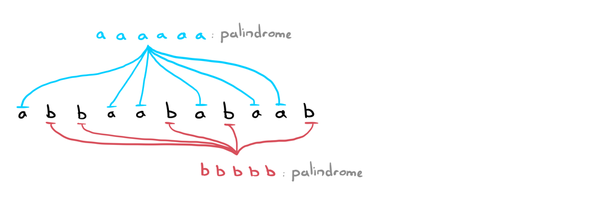

# One Major Observation | JAVA Explanation

**Author:** ciote
**Votes:** 189
**Link:** [https://leetcode.com/problems/remove-palindromic-subsequences/solutions/2124240/](https://leetcode.com/problems/remove-palindromic-subsequences/solutions/2124240/)

---

### Logic
It's quite easy to trip over this problem since it looks like we have to do all sorts of stuff to the string to get our answer. Actually, once you identify the main trick behind this question, it's really quite a simple algorithm!

### What is a Subsequence?
This is quite important to understand. Below are the main string sub-types (literally) that could be mentioned in a question.
* **Substring:** A *contiguous* sequence of characters in a string.
* **Subsequence:** Any sequence of characters in a string where their *relative order is maintained*.

In particular, this question is asking to remove *subsequences* in the string. Therefore, we don't actually care where these subsequences are as long as they maintain their original relative ordering in the string. For example, a subsequence of "leetcode" could be "toe". 

### The Major Observation:
What makes a subsequence a palindrome? Well of course it's when the string is the same forwards and backwards. Is "a" a palindrome? Yes. Is "aa" a palindrome? Yes. What about "aaaaaaaaa"? Yes! 
> The main observation here is that any string consisting of the same letters is a palindrome. Since we're working with subsequences and the only characters in the string are 'a' and 'b', we know we can get rid of all palindromes in **at most 2 steps**. 



What other cases are there? Well when could we ever remove a palindrome in just 1 step? When the input string itself is a palindrome of course. 
Awesome. Now we're ready to start coding!

### Algorithm:
```text
If string is a palindrome: return 1
Else return 2
```
___
### Code
If you have any questions, suggestions or improvements, feel free to let me know. Thank you for reading!
> Solution with custom isPalindrome() function (this is the recommended choice during an interview):
```java
public int removePalindromeSub(String s) {
	if (isPalindrome(s)) return 1;
	return 2;
}

private boolean isPalindrome(String s) {
	int i = 0, n = s.length();
	while (i <= n/2)
		if (s.charAt(i) != s.charAt(n-1-i++)) return false;
	return true;
}
```
> Solution with StringBuilder:
```java
public int removePalindromeSub(String s) {
	if (s.equals(new StringBuilder(s).reverse().toString())) return 1;
	return 2;
}
```
**Time Complexity:** `O(n)` where `n` is the length of the string.
**Space Complexity:** `O(1)` (note that the StringBuilder solution takes `O(n)` space).