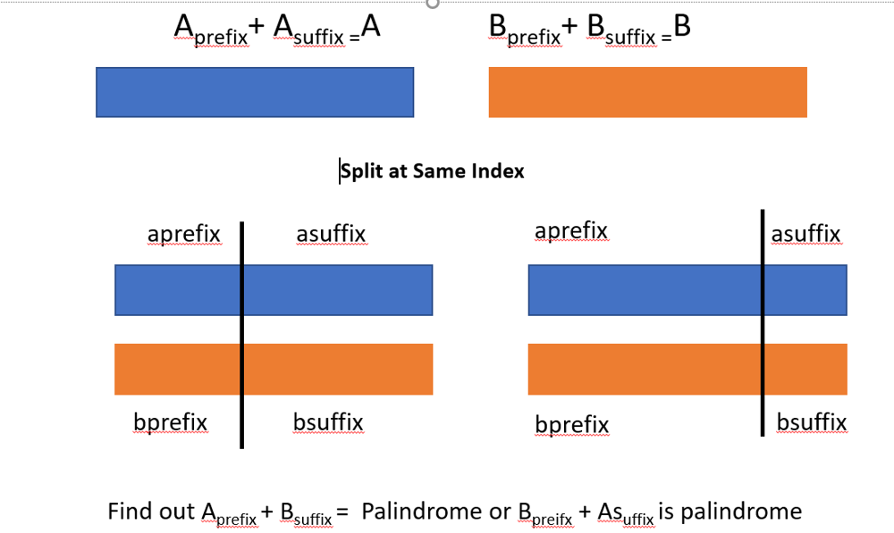
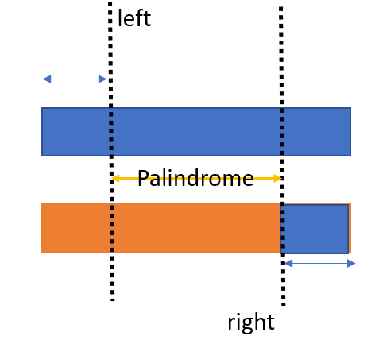

# Java | Greedy | Explanation to O(n) Solution

**Author:** prashul
**Votes:** 99
**Link:** [https://leetcode.com/problems/split-two-strings-to-make-palindrome/solutions/891646/](https://leetcode.com/problems/split-two-strings-to-make-palindrome/solutions/891646/)

---

Intution says find out a prefix string that matches with postfix part of the second string. But thats not enough, after that we check for a palindrome within a string...why we are doing that , below images helps us to understand that.

Question Summary


So Intution says , start from 0 from string A, and from the end of String B and keep on comparing till the match is there ,



By doing this we find out **substring_of_A(0,left) == reverse_of( substring_of_B( right, B.length() ) -----(1)**, Below code find outs that

```
   int l = 0, r = a.length()-1;
        while (l < r) {
            if (a.charAt(l) != b.charAt(r)) 
                break; 
            l++;
            r--;
        }
```

Since split is done at only one end , if done at left then that means we need to find out **A(0,left)  + B(left,B.length() )** is paindrome, we can also break it down to **A(0,left) + B(left,right)  + B(right,B.length())------(2)**, from (1) we know A(0,left) and B(right,B.length()) are palindrome for **(2)** to be palindrome **B(left,right) also needs to be palindrome**( reason for checking palindrome within the string ,yellow arrow in image indicates the string which we need to check for palindrome)

we can also take **A(0,left) + A ( left,right) + B(right,B.length())** , for this we need to check whether A(left,right) is palindrome or not.

Similary other scenarios are generated if we split at the **right** index.

Following code does that 
```
private boolean validate( String a, int l, int r )
    {
         while (l < r) {
            if (a.charAt(l) != a.charAt(r)) 
                break; 
            l++;
            r--;
        }
    return l >=r;
    }
```

Final Solution which cover  all scenarios - 
```
class Solution {
    public boolean checkPalindromeFormation(String a, String b) {
    
      return validate(a,b) || validate(b,a);
    }
    
    private boolean validate(String a, String b) {
        int l = 0, r = a.length()-1;
        while (l < r) {
            if (a.charAt(l) != b.charAt(r)) 
                break; 
            l++;
            r--;
        }
        
        return  validate(a,l,r) || validate(b,l,r);
    }
    
    private boolean validate( String a, int l, int r )
    {
         while (l < r) {
            if (a.charAt(l) != a.charAt(r)) 
                break; 
            l++;
            r--;
        }
    return l >=r;
    }
}
```
Please upvote if you like the post :)