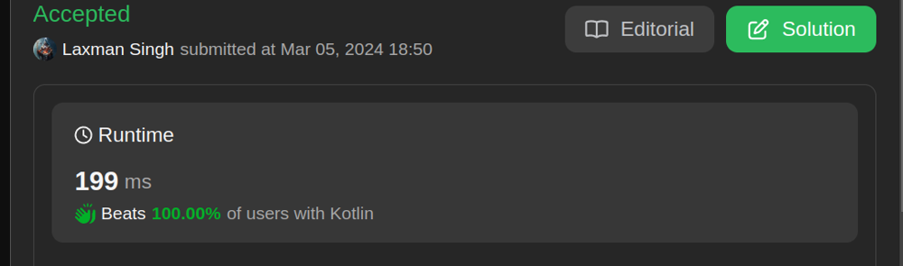

# 🔥✅ Worst solution ever |✅but explantion is good✅

**Author:** CS_MONKS
**Votes:** 31
**Link:** [https://leetcode.com/problems/minimum-length-of-string-after-deleting-similar-ends/solutions/4824247/](https://leetcode.com/problems/minimum-length-of-string-after-deleting-similar-ends/solutions/4824247/)

---

# Intuition
<!-- Describe your first thoughts on how to solve this problem. -->


kotlin is very good language beacuse in this language i beat 100% people
\u26A1\uFE0F\u26A1\uFE0F\u26A1\uFE0F
if you want me to add code in any other language. feel free to comment.
                                                \u26A1\uFE0F\u26A1\uFE0F\u26A1\uFE0F
# Approach
<!-- Describe your approach to solving the problem. -->
1. Initialize two pointers, start at the beginning and end at the end of the string.
2. While start is less than end:
a. Shrink the common prefix and suffix by moving start and end towards each other while characters are equal.
b. Move start one step forward and end one step backward.
3. Calculate the remaining string length as end - start + 1.
4. Return the minimum length of the remaining string.
# Complexity
- Time complexity:O(n)
<!-- Add your time complexity here, e.g. $$O(n)$$ -->

- Space complexity:O(1)
<!-- Add your space complexity here, e.g. $$O(n)$$ -->

# Code
```c++ []
class Solution {
public:
    int minimumLength(string s) {
        int l=0,r=s.length()-1;
        while(l<r &&s[l]==s[r]){
            char ch=s[l];
            while(l<=r&&s[l]==ch)l++;
            while(l<=r&&s[r]==ch)r--;
        }
         return r-l+1;
    }
};
```
```java []
class Solution {
    public int minimumLength(String s) {
        int l = 0, r = s.length() - 1;
        while (l < r && s.charAt(l) == s.charAt(r)) {
            char ch = s.charAt(l);
            while (l <= r && s.charAt(l) == ch) l++;
            while (l <= r && s.charAt(r) == ch) r--;
        }
        return r - l + 1;
    }
}

```
```python3 []
class Solution:
    def minimumLength(self, s: str) -> int:
        l, r = 0, len(s) - 1
        while l < r and s[l] == s[r]:
            ch = s[l]
            while l <= r and s[l] == ch:
                l += 1
            while l <= r and s[r] == ch:
                r -= 1
        return  r - l + 1
```
```javascript []
/**
 * @param {string} s
 * @return {number}
 */
var minimumLength = function(s) {
    let l = 0, r = s.length - 1;
    while (l < r && s[l] === s[r]) {
        let ch = s[l];
        while (l <= r && s[l] === ch) l++;
        while (l <= r && s[r] === ch) r--;
    }
    return  r - l + 1;
};

```
```c []
int minimumLength(char* s) {
    int l = 0, r = strlen(s) - 1;
    while (l < r && s[l] == s[r]) {
        char ch = s[l];
        while (l <= r && s[l] == ch) l++;
        while (l <= r && s[r] == ch) r--;
    }
    return r - l + 1;
}

```
```c# []
public class Solution {
    public int MinimumLength(string s) {
        int l = 0, r = s.Length - 1;
        while (l < r && s[l] == s[r]) {
            char ch = s[l];
            while (l <= r && s[l] == ch) l++;
            while (l <= r && s[r] == ch) r--;
        }
        return r - l + 1;
    }
}

```
```kotlin []
class Solution {
    fun minimumLength(s: String): Int {
        var l = 0
        var r = s.length - 1
        while (l < r && s[l] == s[r]) {
            val ch = s[l]
            while (l <= r && s[l] == ch) l++
            while (l <= r && s[r] == ch) r--
        }
        return r - l + 1
    }
}

```
