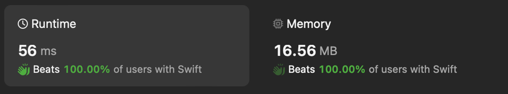

# ✅ O(n) Efficient String Index Manipulation

**Author:** eleev
**Votes:** 2
**Link:** [https://leetcode.com/problems/minimum-length-of-string-after-deleting-similar-ends/solutions/4825107/](https://leetcode.com/problems/minimum-length-of-string-after-deleting-similar-ends/solutions/4825107/)

---



# Solution
```swift
final class Solution {
    @_optimize(speed)
    func minimumLength(_ s: String) -> Int {
        guard s.count != 1 else { return 1 }
        /* NOTE: As an alternative solution you can wrap String into a 
ContiguousArray or Array, but it would require an additional allocation. */
        var (start, end) = (s.startIndex, s[before: s.endIndex])
        
        while start < end, s[start] == s[end] {
            let char = s[start]
            
            while start <= end, s[start] == char {
                start = s[after: start]
            }
            while end > start, s[end] == char {
                end = s[before: end]
            }
        }
        return s.distance(from: start, to: end) + 1
    }
}

extension String {
    subscript(after idx: Index) -> Index {
        index(after: idx)
    }

    subscript(before idx: Index) -> Index {
        index(before: idx)
    }
}
```