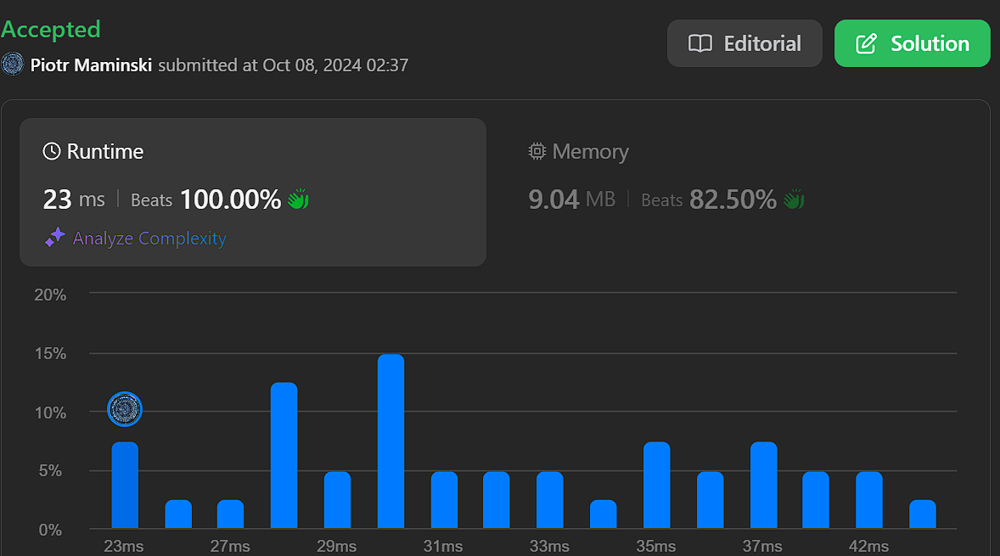

# ✅ Beats 100% | Working 08.10.2024 | Explained Step by Step

**Author:** Piotr_Maminski
**Votes:** 18
**Link:** [https://leetcode.com/problems/minimum-number-of-swaps-to-make-the-string-balanced/solutions/5884240/](https://leetcode.com/problems/minimum-number-of-swaps-to-make-the-string-balanced/solutions/5884240/)

---

```python3 []
class Solution:
    def minSwaps(self, s: str) -> int:
        # Initialize a variable to keep track of unmatched opening brackets
        stack_size = 0

        # Iterate through each character in the input string
        for ch in s:
            if ch == "[":
                # If we encounter an opening bracket, increment the stack size
                stack_size += 1
            else:
                # If we encounter a closing bracket
                if stack_size > 0:
                    # If there's a matching opening bracket (stack_size > 0),
                    # decrement the stack size
                    stack_size -= 1
                

        # Calculate the minimum number of swaps needed
        # We need to swap half of the remaining unmatched brackets
        # Use integer division (//) and add 1 to round up for odd numbers
        return (stack_size + 1) // 2
```
```cpp []
class Solution {
public:
    int minSwaps(string s) {
        // Initialize a variable to keep track of the stack size
        int stack_size = 0;

        // Iterate through each character in the input string
        for (char ch : s) {
            if (ch == '[') {
                // If we encounter an opening bracket, increase the stack size
                stack_size++;
            } else {
                // If we encounter a closing bracket
                if (stack_size > 0) {
                    // If there's a matching opening bracket (stack_size > 0),
                    // decrease the stack size
                    stack_size--;
                }
            }
        }

        // Calculate the minimum number of swaps needed
        // We need to swap half of the remaining unmatched brackets
        // Use (stack_size + 1) / 2 for integer division rounding up
        return (stack_size + 1) / 2;
    }
};
```
```java []
class Solution {
    public int minSwaps(String s) {
        // Initialize a variable to keep track of unmatched opening brackets
        int stackSize = 0;

        // Iterate through each character in the input string
        for (char ch : s.toCharArray()) {
            if (ch == '[') {
                // If we encounter an opening bracket, increment the stack size
                stackSize++;
            } else {
                // If we encounter a closing bracket
                if (stackSize > 0) {
                    // If there's a matching opening bracket (stackSize > 0),
                    // decrement the stack size
                    stackSize--;
                }
                
            }
        }

        // Calculate the minimum number of swaps needed
        // We need to swap half of the remaining unmatched brackets
        // Use integer division and add 1 to round up for odd numbers
        return (stackSize + 1) / 2;
    }
}
```
```javascript [JS]
/**
 * @param {string} s
 * @return {number}
 */
var minSwaps = function(s) {
    // Initialize a variable to keep track of unmatched opening brackets
    let stackSize = 0;

    // Iterate through each character in the input string
    for (let ch of s) {
        if (ch === '[') {
            // If we encounter an opening bracket, increment the stack size
            stackSize++;
        } else {
            // If we encounter a closing bracket
            if (stackSize > 0) {
                // If there's a matching opening bracket (stackSize > 0),
                // decrement the stack size
                stackSize--;
            }
            // If stackSize is 0, it means we have an unmatched closing bracket,
            // but we don't need to do anything special for this case
        }
    }

    // Calculate the minimum number of swaps needed
    // We need to swap half of the remaining unmatched brackets
    // Use Math.floor to round down the division result after adding 1
    return Math.floor((stackSize + 1) / 2);
};
```
```typescript [TS]
function minSwaps(s: string): number {
    // Initialize a variable to keep track of unmatched opening brackets
    let stackSize: number = 0;

    // Iterate through each character in the input string
    for (let ch of s) {
        if (ch === '[') {
            // If we encounter an opening bracket, increment the stack size
            stackSize++;
        } else {
            // If we encounter a closing bracket
            if (stackSize > 0) {
                // If there's a matching opening bracket (stackSize > 0),
                // decrement the stack size
                stackSize--;
            }
            // If stackSize is 0, it means we have an unmatched closing bracket,
            // but we don't need to do anything special for this case
        }
    }

    // Calculate the minimum number of swaps needed
    // We need to swap half of the remaining unmatched brackets
    // Use Math.floor to round down the division result after adding 1
    return Math.floor((stackSize + 1) / 2);
}
```
```csharp []
public class Solution {
    public int MinSwaps(string s) {
        // Initialize counters for unmatched opening and closing brackets
        int open = 0;   // Count of unmatched opening brackets
        int close = 0;  // Count of unmatched closing brackets

        // Iterate through each character in the input string
        foreach(var c in s)
        {
            if(c == '[')
                // If we encounter an opening bracket, increment the 'open' counter
                open++;
            else if(c == ']')
            {
                if(open > 0)
                    // If there's an unmatched opening bracket, match it with this closing bracket
                    open--;
                else
                    // If there's no unmatched opening bracket, this is an unmatched closing bracket
                    close++;
            }
        }

        // Calculate the minimum number of swaps needed
        // We need to swap half of the unmatched closing brackets, plus one more if the count is odd
        return close / 2 + (close % 2);
    }
}
```
```golang []
func minSwaps(s string) int {
    // Initialize variables to keep track of closing brackets and maximum imbalance
    var close, maxClose int

    // Iterate through each character in the string
    for _, c := range s {
        if c == ']' {
            // If we encounter a closing bracket, increment the 'close' counter
            close++
            // Update maxClose to be the maximum of current maxClose and close
            // This keeps track of the maximum imbalance we've seen so far
            maxClose = max(maxClose, close)
        } else {
            // If we encounter an opening bracket '[', decrement the 'close' counter
            // This balances out a previous closing bracket
            close--
        }
    }

    // The minimum number of swaps needed is (maxClose + 1) / 2
    // This formula works because:
    // 1. We need to balance out the maximum imbalance we've seen (maxClose)
    // 2. Each swap can fix two imbalances (it moves a '[' to the left and a ']' to the right)
    // 3. We round up using (x + 1) / 2 to handle odd numbers of imbalances
    return (maxClose + 1) / 2
}
```
```rust [Rust(8ms)]
impl Solution {
    pub fn min_swaps(s: String) -> i32 {
        let mut stack_size = 0;
        
        // Iterate through each character in the string
        for ch in s.chars() {
            if ch == '[' {
                // If we encounter an opening bracket, increment stack size
                stack_size += 1;
            } else if ch == ']' {
                // If we encounter a closing bracket and have unmatched opening brackets,
                // decrement stack size
                if stack_size > 0 {
                    stack_size -= 1;
                }
            }
        }
        
        // The minimum number of swaps needed is (remaining unmatched brackets + 1) / 2
        (stack_size + 1) / 2
    }
}
```
```ruby []
# @param {String} s
# @return {Integer}
def min_swaps(s)
  # Initialize a variable to keep track of unmatched opening brackets
  stack_size = 0

  # Iterate through each character in the input string
  s.each_char do |ch|
    if ch == '['
      # If we encounter an opening bracket, increment the stack size
      stack_size += 1
    else
      # If we encounter a closing bracket
      if stack_size > 0
        # If there's a matching opening bracket (stack_size > 0),
        # decrement the stack size
        stack_size -= 1
      end
      # If stack_size is 0, it means we have an unmatched closing bracket,
      # but we don't need to do anything special for this case
    end
  end

  # Calculate the minimum number of swaps needed
  # We need to swap half of the remaining unmatched brackets
  # Use integer division to round down the result after adding 1
  (stack_size + 1) / 2
end

# impresive solution from k_duder https://leetcode.com/problems/minimum-number-of-swaps-to-make-the-string-balanced/solutions/5884247/1-liner/
```
```swift []
class Solution {
    func minSwaps(_ s: String) -> Int {
        // Initialize a variable to keep track of unmatched opening brackets
        var stackSize = 0
        
        // Iterate through each character in the input string
        for ch in s {
            if ch == "[" {
                // If we encounter an opening bracket, increment the stack size
                stackSize += 1
            } else {
                // If we encounter a closing bracket
                if stackSize > 0 {
                    // If there's a matching opening bracket (stackSize > 0),
                    // decrement the stack size
                    stackSize -= 1
                }
                // If stackSize is 0, it means we have an unmatched closing bracket,
                // but we don't need to do anything special for this case
            }
        }
        
        // Calculate the minimum number of swaps needed
        // We need to swap half of the remaining unmatched brackets
        // Use integer division and add 1 to round up for odd numbers
        return (stackSize + 1) / 2
    }
}
```
### Explained Step by Step

1. We start by initializing a variable `stack_size ` to **0** 
This variable will keep track of the number of unmatched opening brackets as we iterate through the string.

2. We then iterate through each character in the input string s:
-  2.a. If we encounter an opening bracket "[", we increment `stack_size ` by **1** . This is because we've found an opening bracket that hasn't been matched yet.
- 2.b.. If we encounter a closing bracket "]", we check if `stack_size `is greater than 0. If it is, it means we have an unmatched opening bracket available, so we can match it with this closing bracket. In this case, we decrement `stack_size ` by **1**.
3. After iterating through the entire string, `stack_size` will represent the number of **unmatched** opening brackets.
4. To calculate the minimum number of swaps needed, we use the formula `(stack_size + 1) // 2`:

-  We need to swap half of the unmatched brackets because each swap fixes two brackets (it moves a "[" to the right and a "]" to the left).
- We add 1 before dividing by 2 to handle cases where stack_size is odd. This ensures we round up to the nearest integer.
- We use integer division (`//`) to get the final result as an integer.

Thats the the reason this solution works is that it effectively counts the number of mismatched brackets and then calculates how many swaps are needed to fix them.

By keeping track of unmatched opening brackets, so **we can determine how many closing brackets are out of place**.

...and efficient bcs only one pass through the string and dont need extra space 
**time: O(n) space: O(1)**

Is it understandable? Do you have any suggestions on how I could write this more clearly? Please for contrictive critisis.

### Complexity
- Time complexity: O(n)

- Space complexity: O(1)




