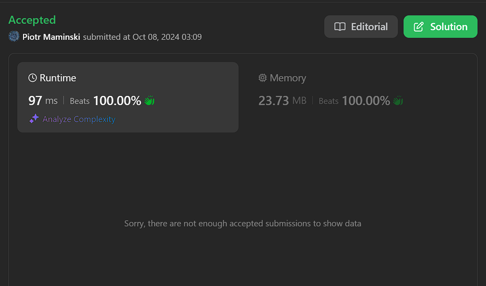

# Php, Kotlin, Dart | Working 08.10.2024

**Author:** Piotr_Maminski
**Votes:** 3
**Link:** [https://leetcode.com/problems/minimum-number-of-swaps-to-make-the-string-balanced/solutions/5884320/](https://leetcode.com/problems/minimum-number-of-swaps-to-make-the-string-balanced/solutions/5884320/)

---

# Code
```php []
class Solution {
    /**
     * @param String $s
     * @return Integer
     */
    function minSwaps($s) {
        // Initialize a variable to keep track of unmatched opening brackets
        $stackSize = 0;

        // Iterate through each character in the input string
        for ($i = 0; $i < strlen($s); $i++) {
            $ch = $s[$i];
            if ($ch === '[') {
                // If we encounter an opening bracket, increment the stack size
                $stackSize++;
            } else {
                // If we encounter a closing bracket
                if ($stackSize > 0) {
                    // If there's a matching opening bracket (stackSize > 0),
                    // decrement the stack size
                    $stackSize--;
                }
                // If stackSize is 0, it means we have an unmatched closing bracket,
                // but we don't need to do anything special for this case
            }
        }

        // Calculate the minimum number of swaps needed
        // We need to swap half of the remaining unmatched brackets
        // Use intdiv to perform integer division after adding 1
        return intdiv($stackSize + 1, 2);
    }
}
```
```kotlin []
class Solution {
    fun minSwaps(s: String): Int {
        var stack = 0
        var swaps = 0
        for((i,c) in s.withIndex()){
            if(c == '[') stack++
            else if(c == ']' && stack == 0) { swaps++; stack++ }
            else stack--
        }
        return swaps
    }
}
```
```Dart []
class Solution {
  int minSwaps(String s) {
    int count =0;
int maxImbalance =0;
    for(int i=0;i<s.length;i++){
        if(s[i]=='['){
            count--;
        }else{
            count++;
        }
        if(count>maxImbalance){
            maxImbalance = count;
        }
    }
  int  ans =  ((maxImbalance + 1) /2).toInt();
    return ans;
  }
}
```

### Complexity
- Time complexity: O(n)
- Space complexity: O(1)

C++, C#, Python3, Java, TypeScript, Javascript, GOlang, Ruby, Rust and Swift Solution here:
https://leetcode.com/problems/minimum-number-of-swaps-to-make-the-string-balanced/solutions/5884240/beats-100-working-08-10-2024-explained/



