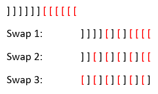
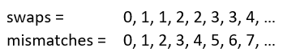

# How to reach the optimal solution | Explained with Intuition and Diagram

**Author:** aayush912
**Votes:** 615
**Link:** [https://leetcode.com/problems/minimum-number-of-swaps-to-make-the-string-balanced/solutions/1390319/](https://leetcode.com/problems/minimum-number-of-swaps-to-make-the-string-balanced/solutions/1390319/)

---

*------Please **upvote!** if you like the solution and explanation.  Please put your doubts/queries in the comments section below.  I will try my best to answer them.------*

**Intuition:**

We can discard the balanced components from our input string as they will not matter in balancing the string.  Now, after excluding them, we will find that all the unbalanced brackets look like this:

**]]]]]\u2026..[[[[[\u2026..**

Now, since we can swap any pair of brackets, the **optimal approach is to balance 2 sets of brackets at a time using 1 swap** (hinting at `result = total unbalanced / 2`, which we will handle for **even and odd lengths** together).  Take this for example:



So, following this, we will notice a pattern (try out the same with different number of mismatches to see the pattern):



So, our result (min. swaps) = **`(mismatches + 1) / 2`**

***The key here is to start balancing from the middle.***


```
class Solution {
    public int minSwaps (String s) {
        Stack <Character> stack = new Stack ();
        int mismatch = 0;
        for (int i = 0; i < s.length (); i++) {
            char ch = s.charAt (i);
            if (ch == '[')
                stack.push (ch);
            else {
                if (!stack.isEmpty ())
                    stack.pop ();
                else 
                    mismatch++;
            }
        }
        return (mismatch + 1) / 2;
    }
}
```

**Update:** As suggested by quite a few people in the comments, here is the Space Optimized Approach which removes the need of the stack.  We will simply use a variable **`stack_size`** to keep track of mismatches.  If the current character is a **'['**, then we increment **`stack_size`**, else, we decrement it only if it is **greater than 0** (meaning we have seen some valid [ brackets before, so this ] bracket is going to balance them out).  At the end, **`stack_size`** will contain the count of brackets which are not balanced, i.e **`[[[[[....`**.  *Code below:*

```
class Solution {
    public int minSwaps (String s) {
        int stack_size = 0;
        for (int i = 0; i < s.length (); i++) {
            char ch = s.charAt (i);
            if (ch == '[')
                stack_size++;
            else {
                if (stack_size > 0)
                    stack_size--;
            }
        }
        return (stack_size + 1) / 2;
    }
}
```

Please **upvote!** if you like the solutions.
