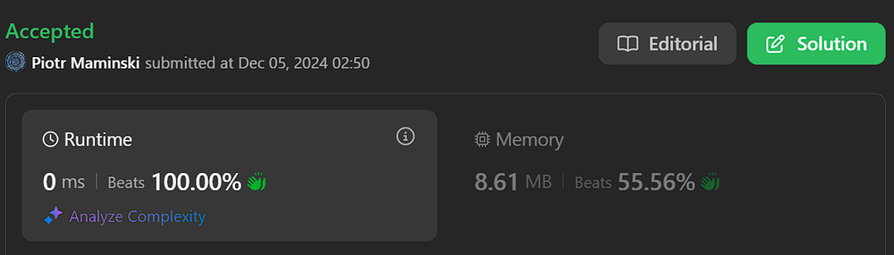
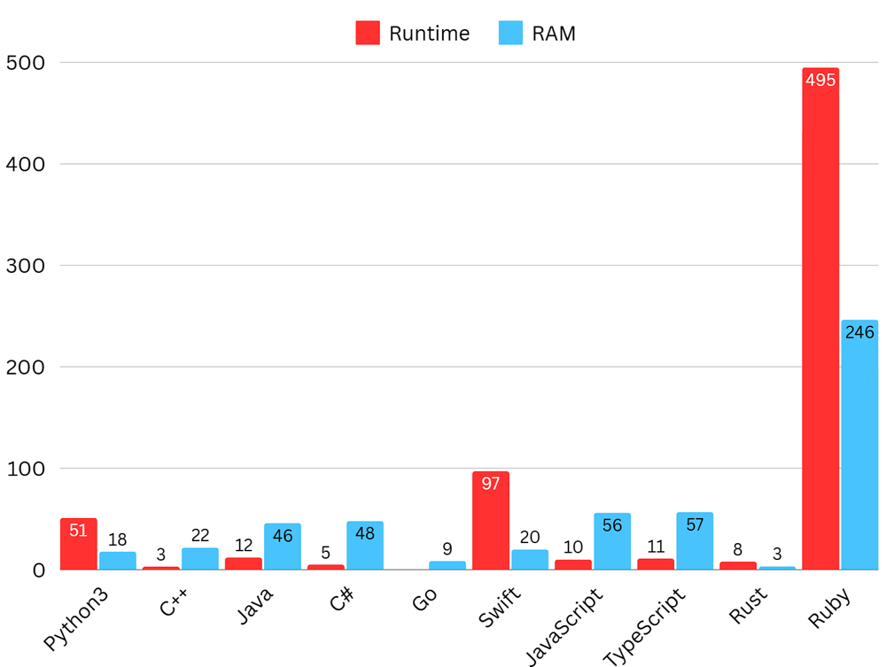
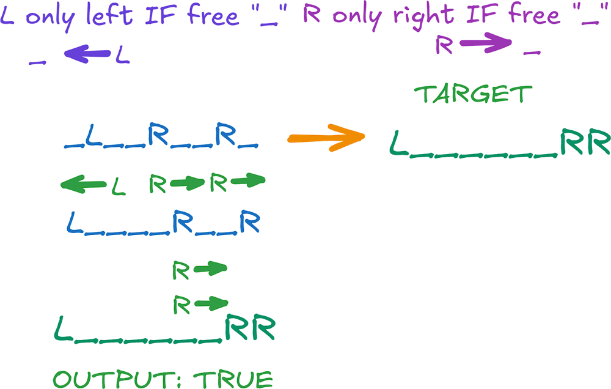
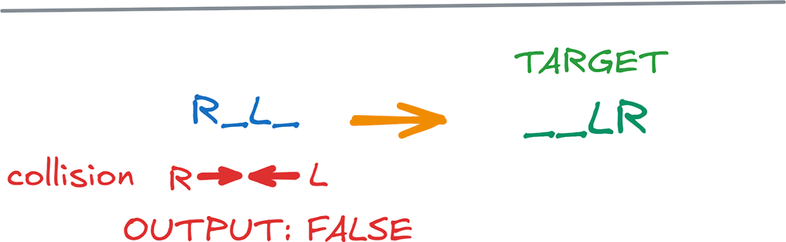

# ✅ 100% Beats | Short & Simple

**Author:** Piotr_Maminski
**Votes:** 87
**Link:** [https://leetcode.com/problems/move-pieces-to-obtain-a-string/solutions/6114504/](https://leetcode.com/problems/move-pieces-to-obtain-a-string/solutions/6114504/)

---




# Two Pointers (Mostly 100% [[1]](https://leetcode.com/problems/move-pieces-to-obtain-a-string/submissions/1470618274)[[2]](https://leetcode.com/problems/move-pieces-to-obtain-a-string/submissions/1470617908)[[3]](https://leetcode.com/problems/move-pieces-to-obtain-a-string/submissions/1470616981)[[4]](https://leetcode.com/problems/move-pieces-to-obtain-a-string/submissions/1470616762)[[5]](https://leetcode.com/problems/move-pieces-to-obtain-a-string/submissions/1470616452)[[6]](https://leetcode.com/problems/move-pieces-to-obtain-a-string/submissions/1470620484)[[7]](https://leetcode.com/problems/move-pieces-to-obtain-a-string/submissions/1470621041)[[8]](https://leetcode.com/problems/move-pieces-to-obtain-a-string/submissions/1470621659)[[9]](https://leetcode.com/problems/move-pieces-to-obtain-a-string/submissions/1470616312)[[10]](https://leetcode.com/problems/move-pieces-to-obtain-a-string/submissions/1470622222))
```python3 []
class Solution:
    def canChange(self, start: str, target: str) -> bool:
        if start == target:
            return True
        waitL = 0   
        waitR = 0    

        for curr, goal in zip(start, target):
            if curr == 'R':
                if waitL > 0:
                    return False
                waitR += 1  
            if goal == 'L':
                if waitR > 0:
                    return False
                waitL += 1
            if goal == 'R':
                if waitR == 0:
                    return False
                waitR -= 1 
            if curr == 'L':
                if waitL == 0:
                    return False
                waitL -= 1    
        return waitL == 0 and waitR == 0
```
```cpp []
class Solution {
public:
    bool canChange(string start, string target) {
        if (start == target) {
            return true;
        }
        int waitL = 0;
        int waitR = 0;
        
        for (int i = 0; i < start.length(); i++) {
            char curr = start[i];
            char goal = target[i];
            if (curr == 'R') {
                if (waitL > 0) {
                    return false;
                }
                waitR++;
            }
            if (goal == 'L') {
                if (waitR > 0) {
                    return false;
                }
                waitL++;
            }
            if (goal == 'R') {
                if (waitR == 0) {
                    return false;
                }
                waitR--;
            }
            if (curr == 'L') {
                if (waitL == 0) {
                    return false;
                }
                waitL--;
            }
        }
        return waitL == 0 && waitR == 0;
    }
};
```
```java []
class Solution {
    public boolean canChange(String start, String target) {
        if (start.equals(target)) {
            return true;
        }
        int waitL = 0;
        int waitR = 0;
        
        for (int i = 0; i < start.length(); i++) {
            char curr = start.charAt(i);
            char goal = target.charAt(i);
            
            if (curr == 'R') {
                if (waitL > 0) {
                    return false;
                }
                waitR++;
            }
            if (goal == 'L') {
                if (waitR > 0) {
                    return false;
                }
                waitL++;
            }
            if (goal == 'R') {
                if (waitR == 0) {
                    return false;
                }
                waitR--;
            }
            if (curr == 'L') {
                if (waitL == 0) {
                    return false;
                }
                waitL--;
            }
        }
        
        return waitL == 0 && waitR == 0;
    }
}
```
```csharp []
public class Solution {
    public bool CanChange(string start, string target) {
        if (start == target) return true;
        int waitL = 0, waitR = 0;
        
        for (int i = 0; i < start.Length; i++) {
            char curr = start[i];
            char goal = target[i];
            
            if (curr == 'R') {
                if (waitL > 0) return false;
                waitR++;
            }
            if (goal == 'L') {
                if (waitR > 0) return false;
                waitL++;
            }
            if (goal == 'R') {
                if (waitR == 0) return false;
                waitR--;
            }
            if (curr == 'L') {
                if (waitL == 0) return false;
                waitL--;
            }
        }
        return waitL == 0 && waitR == 0;
    }
}
```
```golang []
func canChange(start string, target string) bool {
    if start == target {
        return true
    }
    waitL, waitR := 0, 0
    
    for i := 0; i < len(start); i++ {
        curr := start[i]
        goal := target[i]
        
        if curr == 'R' {
            if waitL > 0 {
                return false
            }
            waitR++
        }
        if goal == 'L' {
            if waitR > 0 {
                return false
            }
            waitL++
        }
        if goal == 'R' {
            if waitR == 0 {
                return false
            }
            waitR--
        }
        if curr == 'L' {
            if waitL == 0 {
                return false
            }
            waitL--
        }
    }
    return waitL == 0 && waitR == 0
}
```
```swift []
class Solution {
    func canChange(_ start: String, _ target: String) -> Bool {
        if start == target { return true }
        var waitL = 0, waitR = 0
        
        let startChars = Array(start)
        let targetChars = Array(target)
        
        for i in 0..<startChars.count {
            let curr = startChars[i]
            let goal = targetChars[i]
            
            if curr == "R" {
                if waitL > 0 { return false }
                waitR += 1
            }
            if goal == "L" {
                if waitR > 0 { return false }
                waitL += 1
            }
            if goal == "R" {
                if waitR == 0 { return false }
                waitR -= 1
            }
            if curr == "L" {
                if waitL == 0 { return false }
                waitL -= 1
            }
        }
        return waitL == 0 && waitR == 0
    }
}
```
```javascript [JS]
// JavaScript

var canChange = function(start, target) {
    if (start === target) return true;
    let waitL = 0, waitR = 0;
    
    for (let i = 0; i < start.length; i++) {
        const curr = start[i];
        const goal = target[i];
        
        if (curr === 'R') {
            if (waitL > 0) return false;
            waitR++;
        }
        if (goal === 'L') {
            if (waitR > 0) return false;
            waitL++;
        }
        if (goal === 'R') {
            if (waitR === 0) return false;
            waitR--;
        }
        if (curr === 'L') {
            if (waitL === 0) return false;
            waitL--;
        }
    }
    return waitL === 0 && waitR === 0;
};
```
```typescript [TS]
// TypeScript

function canChange(start: string, target: string): boolean {
    if (start === target) return true;
    let waitL = 0, waitR = 0;
    
    for (let i = 0; i < start.length; i++) {
        const curr = start[i];
        const goal = target[i];
        
        if (curr === 'R') {
            if (waitL > 0) return false;
            waitR++;
        }
        if (goal === 'L') {
            if (waitR > 0) return false;
            waitL++;
        }
        if (goal === 'R') {
            if (waitR === 0) return false;
            waitR--;
        }
        if (curr === 'L') {
            if (waitL === 0) return false;
            waitL--;
        }
    }
    return waitL === 0 && waitR === 0;
}
```
```rust []
impl Solution {
    pub fn can_change(start: String, target: String) -> bool {
        if start == target {
            return true;
        }
        let mut wait_l = 0;
        let mut wait_r = 0;
        
        let start_chars: Vec<char> = start.chars().collect();
        let target_chars: Vec<char> = target.chars().collect();
        
        for i in 0..start_chars.len() {
            let curr = start_chars[i];
            let goal = target_chars[i];
            
            if curr == 'R' {
                if wait_l > 0 {
                    return false;
                }
                wait_r += 1;
            }
            if goal == 'L' {
                if wait_r > 0 {
                    return false;
                }
                wait_l += 1;
            }
            if goal == 'R' {
                if wait_r == 0 {
                    return false;
                }
                wait_r -= 1;
            }
            if curr == 'L' {
                if wait_l == 0 {
                    return false;
                }
                wait_l -= 1;
            }
        }
        wait_l == 0 && wait_r == 0
    }
}
```
```ruby []
def can_change(start, target)
    return true if start == target
    wait_l = 0
    wait_r = 0
    
    start.chars.zip(target.chars).each do |curr, goal|
        if curr == 'R'
            return false if wait_l > 0
            wait_r += 1
        end
        if goal == 'L'
            return false if wait_r > 0
            wait_l += 1
        end
        if goal == 'R'
            return false if wait_r == 0
            wait_r -= 1
        end
        if curr == 'L'
            return false if wait_l == 0
            wait_l -= 1
        end
    end
    wait_l == 0 && wait_r == 0
end
```


- Complexity: Time O(n) & Space O(1)




# Explanation


---


## Intuition



- "Letters" cannot jump over another "letter"




## Approach

1. Edge Case: **IF** start = target **RETURN** True 

```
        if start == target:
            return True
```

- we save on efficiency, we don't do the rest


`waitL` - count waiting **L**
`waitR` - count waiting **R**

2. Core

- **R** on Start:
    - IF waiting **L**s return **False** ( **R** can't jump over **L**)
        - Increment `waitR` counter

- **L** in target string:
    - IF waiting **R**s return **False** ( **L** can't jump over **R**)
        - Increment `waitL` counter

- **R** in target string:
    - IF **NO** waiting **R**s return **False** (nothing to move)
        - Decrement `waitR` counter

- **L** in target string:
    - IF **NO** waiting **L**s return **False** (nothing to move)
        - Decrement `waitL` counter

3. Check if all **L** and **R** are "matched"

```
return waitL == 0 and waitR == 0
```

Done. 


**UpVote** if you think it is helpful and will help others


---


# Most common String Interview Problems
List based on my research (interviews, reddit, github) Probably not 100% accurate but very close to my recruitments. Leetcode Premium is probably more accurate [I don't have]

**Easy:** [[20. Valid Parentheses]](https://leetcode.com/problems/valid-parentheses/solutions/6013115/solution) [[28. Find the Index of the First Occurrence in a String]](https://leetcode.com/problems/find-the-index-of-the-first-occurrence-in-a-string) [[13. Roman to Integer]](https://leetcode.com/problems/roman-to-integer/solutions/6021029/beats-100-explained-step-by-step-list-most-common-string-interview-problems/) [[125. Valid Palindrome]](https://leetcode.com/problems/valid-palindrome) [[680. Valid Palindrome II]](https://leetcode.com/problems/valid-palindrome-ii) [[67. Add Binary]](https://leetcode.com/problems/add-binary)


**Medium/Hard:** [[8. String to Integer (atoi)]](https://leetcode.com/problems/string-to-integer-atoi/solutions/6013112/solution/) [[3. Longest Substring Without Repeating Characters]](https://leetcode.com/problems/longest-substring-without-repeating-characters/solutions/6013106/solutions/) [[5. Longest Palindromic Substring]](https://leetcode.com/problems/longest-palindromic-substring/solutions/6013111/solution/) [[937. Reorder Data in Log Files]](https://leetcode.com/problems/reorder-data-in-log-files) [[68. Text Justification]](https://leetcode.com/problems/text-justification) [[32. Longest Valid Parentheses]](https://leetcode.com/problems/longest-valid-parentheses) [[12. Integer to Roman]](https://leetcode.com/problems/integer-to-roman/solutions/6023402/solutions) [[22. Generate Parentheses]](https://leetcode.com/problems/generate-parentheses) [[65. Valid Number]](https://leetcode.com/problems/valid-number) [[49. Group Anagrams]](https://leetcode.com/problems/group-anagrams)


####  [Interview Questions and Answers Repository](https://github.com/RooTinfinite/Interview-questions-and-answers)

