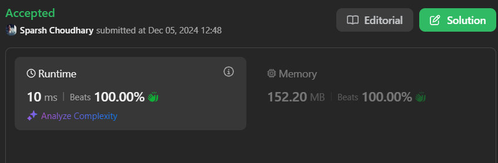

# 🔥BEATS 💯 % 🎯 |✨SUPER EASY BEGINNERS 👏

**Author:** CodeWithSparsh
**Votes:** 4
**Link:** [https://leetcode.com/problems/move-pieces-to-obtain-a-string/solutions/6115425/](https://leetcode.com/problems/move-pieces-to-obtain-a-string/solutions/6115425/)

---



---

Here\u2019s the detailed explanation and solution for the problem of checking whether `start` can be transformed into `target` by moving 'L' to the left and 'R' to the right, skipping the blanks represented by `_`.

---

# Intuition
The problem can be visualized as aligning two strings (`start` and `target`) by respecting movement constraints:
1. 'L' can only move to the left (reducing its index).
2. 'R' can only move to the right (increasing its index).
3. Blank spaces `_` are ignored, and the relative order of characters must be maintained.

Using two pointers allows efficient traversal while skipping blanks and verifying the transformation.

---

# Approach
1. Initialize two pointers `i` and `j` for `start` and `target`, respectively.
2. Skip all `_` in both strings until a non-blank character is encountered or the pointer reaches the end of the string.
3. Check:
   - If characters at `start[i]` and `target[j]` mismatch, the transformation isn't possible.
   - If the character is `L` and its position in `start` is greater than its position in `target`, return `false` (it can't move right).
   - If the character is `R` and its position in `start` is less than its position in `target`, return `false` (it can't move left).
4. Repeat until both pointers reach the end. If they do, return `true`.

---

# Complexity
- **Time complexity:**  
  $$O(n)$$ where \\(n\\) is the length of the strings. Each character is processed once.
  
- **Space complexity:**  
  $$O(1)$$ since we only use two pointers for traversal.

---


```dart []
class Solution {
  bool canChange(String start, String target) {
    int n = start.length;
    int i = 0, j = 0;

    while (i < n || j < n) {
      // Skip blanks ('_') in `start`
      while (i < n && start[i] == '_') i++;
      // Skip blanks ('_') in `target`
      while (j < n && target[j] == '_') j++;

      // If one pointer reaches the end but the other doesn't, return false
      if (i == n || j == n) return i == n && j == n;

      // Compare the pieces at the current positions
      if (start[i] != target[j]) return false;

      // Movement constraints:
      if (start[i] == 'L' && i < j) return false; // 'L' can't move right
      if (start[i] == 'R' && i > j) return false; // 'R' can't move left

      // Move both pointers
      i++;
      j++;
    }

    return true;
  }
}


```

```c []
#include <stdbool.h>
#include <string.h>

bool canChange(char* start, char* target) {
    int n = strlen(start);
    int i = 0, j = 0;

    while (i < n || j < n) {
        while (i < n && start[i] == '_') i++;
        while (j < n && target[j] == '_') j++;

        if (i == n || j == n) return i == n && j == n;
        if (start[i] != target[j]) return false;

        if (start[i] == 'L' && i < j) return false;
        if (start[i] == 'R' && i > j) return false;

        i++;
        j++;
    }

    return true;
}
```
```cpp []
class Solution {
public:
    bool canChange(string start, string target) {
        int n = start.size();
        int i = 0, j = 0;

        while (i < n || j < n) {
            while (i < n && start[i] == '_') i++;
            while (j < n && target[j] == '_') j++;

            if (i == n || j == n) return i == n && j == n;
            if (start[i] != target[j]) return false;

            if (start[i] == 'L' && i < j) return false;
            if (start[i] == 'R' && i > j) return false;

            i++;
            j++;
        }

        return true;
    }
};
```
```java []
class Solution {
    public boolean canChange(String start, String target) {
        int n = start.length();
        int i = 0, j = 0;

        while (i < n || j < n) {
            while (i < n && start.charAt(i) == '_') i++;
            while (j < n && target.charAt(j) == '_') j++;

            if (i == n || j == n) return i == n && j == n;
            if (start.charAt(i) != target.charAt(j)) return false;

            if (start.charAt(i) == 'L' && i < j) return false;
            if (start.charAt(i) == 'R' && i > j) return false;

            i++;
            j++;
        }

        return true;
    }
}
```
```go []
func canChange(start string, target string) bool {
    n := len(start)
    i, j := 0, 0

    for i < n || j < n {
        for i < n && start[i] == '_' {
            i++
        }
        for j < n && target[j] == '_' {
            j++
        }

        if i == n || j == n {
            return i == n && j == n
        }
        if start[i] != target[j] {
            return false
        }

        if start[i] == 'L' && i < j {
            return false
        }
        if start[i] == 'R' && i > j {
            return false
        }

        i++
        j++
    }

    return true
}
```
```python []
class Solution:
    def canChange(self, start: str, target: str) -> bool:
        n = len(start)
        i, j = 0, 0

        while i < n or j < n:
            while i < n and start[i] == '_':
                i += 1
            while j < n and target[j] == '_':
                j += 1

            if i == n or j == n:
                return i == n and j == n
            if start[i] != target[j]:
                return False

            if start[i] == 'L' and i < j:
                return False
            if start[i] == 'R' and i > j:
                return False

            i += 1
            j += 1

        return True
```
```javascript []
var canChange = function(start, target) {
    let n = start.length, i = 0, j = 0;

    while (i < n || j < n) {
        while (i < n && start[i] === '_') i++;
        while (j < n && target[j] === '_') j++;

        if (i === n || j === n) return i === n && j === n;
        if (start[i] !== target[j]) return false;

        if (start[i] === 'L' && i < j) return false;
        if (start[i] === 'R' && i > j) return false;

        i++;
        j++;
    }

    return true;
};
```

---

 {:style='width:250px'}