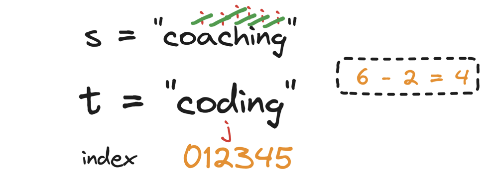
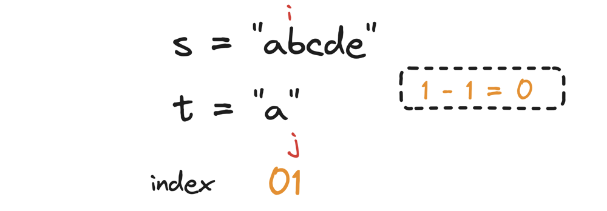

# !💯% || 🔥🔥 1 Billion% Visually Explained 😨😱🤯🤧

**Author:** hi-malik
**Votes:** 46
**Link:** [https://leetcode.com/problems/append-characters-to-string-to-make-subsequence/solutions/5249231/](https://leetcode.com/problems/append-characters-to-string-to-make-subsequence/solutions/5249231/)

---

What is a subsequence, that we need to be checked!

So, initially what we have given is, let's take one example :
```
Input: s = "coaching", t = "coding"
Output: 4
```
Now, what is subsequence? Subsequence is something that the order, shoudn't be changed! But the character should be there like, if we consider **coding**, in **s** `c` is there, `o` is there, but `d` is not there. 


So if we append `d` in the string **s**, then for the remaining characters `ing`, we can't comeback in the string **s**, because we can only move forward and that is what **Subsequence** is! This is the simple definition of subsequence is.


We need to collect the characters in the **forward direction** only! By any chance, we can't return back.

Now what we will be doing in this is,

> Initally we will take an iterator **i** on string **s** and **j** on string **t**


* Now if our pointer **i** and **j** both characters are matching, we will increment both of them!
* Now, we will see that **i** is stainding on `o` and **j** is standing on `o` character as well, 
 
* Again both the characters are matching, we will increment both of them!
* Now, we will see that **i** is stainding on `a` and **j** is standing on `d` character as well, 
* Now, we will only increment pointer **i** and check in the whole string if there character `d` exists in the string **s** or not!
* So, through out the complete string, not even a single character matches!


So, if we mark the **indexes** of string **t** and see that there are **6** charaters in the string find out position of **j** pointer is **2**.
So, can i say **length of string** - **j current position** i.e. **`6 - 2 => 4`**

**4** characters we have to add into our string **s**, so that **t** can become a subsequence of **s**

```
Let's understand with one more example
```
```
Input: s = "abcde", t = "a"
Output: 0
```
> Initally we will take an pointer **i** on string **s** and **j** on string **t**


* Now if our pointer **i** and **j** both characters are matching, we will increment both of them!
* Now, we will see that **i** is stainding on `a` and **j** is standing on `a` character as well, 
* we will increment both of them!
* But all the characters from string **t** is over, we will just return from there

So, if we mark the **indexes** of string **t** and see that there are **1** charaters in the string find out position of **j** pointer is **1**.
So, can i say **length of string** - **j current position** i.e. **`1 - 1 => 0`**


Let me explain you the code as well

1. **Initialize Lengths:** Calculate the lengths of strings `s` and `t` and store them in `m` and `n`, respectively.

2. **Set Indices:** Initialize two indices `i` and `j` to 0. `i` will traverse `s`, and `j` will traverse `t`.

3. **Traverse Strings:** Loop through `s` and `t` until reaching the end of either string. For each character in `s`, if it matches the current character in `t`, increment `j` to move to the next character in `t`.

4. **Count Unmatched Characters:** Continue to increment `i` to check the next character in `s`, regardless of whether a match was found.

5. **Return Result:** After the loop, return `n - j`, which represents the number of characters from the end of `t` that were not matched in `s`. This is the number of characters needed to append to `s` to make `t` a subsequence.

**Let's code it UP!**

**C++**
```
class Solution {
public:
    int appendCharacters(string s, string t) {
        int m = s.size();
        int n = t.size();
        
        int i = 0, j = 0;
        while (i < m && j < n) {
            if (s[i] == t[j]) j++;
            i++;
        }
        
        return n - j;
    }
};
```
**JAVA**
```
class Solution {
    public int appendCharacters(String s, String t) {
        int m = s.length();
        int n = t.length();
        
        int i = 0, j = 0;
        while (i < m && j < n) {
            if (s.charAt(i) == t.charAt(j)) j++;
            i++;
        }
        
        return n - j;
    }
}
```
**PYTHON**
```
class Solution:
    def appendCharacters(self, s: str, t: str) -> int:
        m = len(s)
        n = len(t)
        
        i = 0
        j = 0
        while i < m and j < n:
            if s[i] == t[j]:
                j += 1
            i += 1
        
        return n - j
```

___
Complexity Analysis 
___

* **Time Complexity :-** BigO(N)
* **Space Complexity :-** BigO(1)