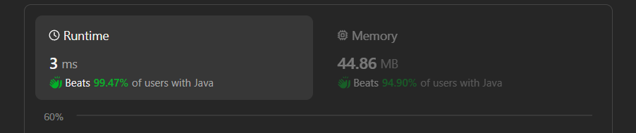

# ✅Beats 100% - Explained with [ Video ] - C++/Java/Python/JS - Two Pointers - Strings

**Author:** lancertech6
**Votes:** 218
**Link:** [https://leetcode.com/problems/append-characters-to-string-to-make-subsequence/solutions/5249501/](https://leetcode.com/problems/append-characters-to-string-to-make-subsequence/solutions/5249501/)

---



# YouTube Video Explanation:

<!-- **If you want a video for this question please write in the comments** -->

<!-- https://www.youtube.com/watch?v=ujU-jeO1v-k -->

https://youtu.be/v6HpF4aydDU

**\uD83D\uDD25 Please like, share, and subscribe to support our channel's mission of making complex concepts easy to understand.**

Subscribe Link: https://www.youtube.com/@leetlogics/?sub_confirmation=1

*Subscribe Goal: 1800 Subscribers*
*Current Subscribers: 1753*

---


# Intuition

To make `t` a subsequence of `s`, we need to find the longest prefix of `t` that is already a subsequence of `s`. The remaining characters of `t` that are not part of this longest prefix will need to be appended to the end of `s`. 

# Approach

1. **Two Pointers Technique**: 
   - Use two pointers, one (`i`) for `s` and one (`j`) for `t`.
   - Traverse through `s` and `t` simultaneously. If characters `s[i]` and `t[j]` match, move both pointers forward. If they don\u2019t match, move only the pointer `i` for `s`.
   - The goal is to find how many characters from `t` we can match in `s` sequentially.
2. **Remaining Characters**:
   - After the traversal, if the pointer `j` is equal to the length of `t`, it means all characters in `t` are matched in `s`, and no characters need to be appended.
   - Otherwise, the number of characters that need to be appended is the length of `t` minus the position of `j`.

# Complexity Analysis

- **Time Complexity**: O(n + m), where `n` is the length of `s` and `m` is the length of `t`. This is because we are traversing both strings once.
- **Space Complexity**: O(1), as we are using a constant amount of space for the pointers and no additional data structures.


### Explanation with Example

1. **Example 1**: 
   - `s = "coaching"`, `t = "coding"`
   - Traverse through `s` and match characters with `t`: 
     - `c` matches `c`
     - `o` matches `o`
     - `a` does not match `d`
     - `c` does not match `d`
     - `h` does not match `d`
     - `i` matches `d`
     - `n` does not match `i`
     - `g` matches `i`
   - Remaining characters in `t` after matching: "ding"
   - Append "ding" to `s`
   - Output: `4`

2. **Example 2**: 
   - `s = "abcde"`, `t = "a"`
   - `t` is already a subsequence of `s`.
   - Output: `0`

3. **Example 3**: 
   - `s = "z"`, `t = "abcde"`
   - No characters in `s` match with `t`.
   - Append "abcde" to `s`
   - Output: `5`

This approach ensures that we find the minimum number of characters that need to be appended to `s` so that `t` becomes a subsequence.


# Step-by-Step Explanation

**1. Initialize Pointers and Variables**
- `s_index` for string `s` starts at 0.
- `t_index` for string `t` starts at 0.
- `s_length` is the length of `s`.
- `t_length` is the length of `t`.

**2. Traversing the Strings**

- **Table of Iteration**

| Step | `s_index` | `t_index` | `s[s_index]` | `t[t_index]` | Action                                 | Comment                                 |
|------|-----------|-----------|--------------|--------------|----------------------------------------|-----------------------------------------|
| 1    | 0         | 0         | 'c'          | 'c'          | Move both `s_index` and `t_index`      | Characters match                        |
| 2    | 1         | 1         | 'o'          | 'o'          | Move both `s_index` and `t_index`      | Characters match                        |
| 3    | 2         | 2         | 'a'          | 'd'          | Move `s_index`                         | Characters do not match                 |
| 4    | 3         | 2         | 'c'          | 'd'          | Move `s_index`                         | Characters do not match                 |
| 5    | 4         | 2         | 'h'          | 'd'          | Move `s_index`                         | Characters do not match                 |
| 6    | 5         | 2         | 'i'          | 'd'          | Move `s_index`                         | Characters do not match                 |
| 7    | 6         | 2         | 'n'          | 'd'          | Move `s_index`                         | Characters do not match                 |
| 8    | 7         | 2         | 'g'          | 'd'          | Move `s_index`                         | Characters do not match                 |
| 9    | 8         | 2         | End of `s`   | 'd'          | End of `s`, calculate remaining `t` | Remaining `t` is "ding"                  |

- **Observation:**
  - `t_index` is at position 2.
  - Remaining characters in `t` are `t[2:] = "ding"`.

**3. Calculate the Number of Characters to Append**
- Remaining characters in `t` that need to be appended to `s` = `t_length - t_index`.
- For example, if `t` = "coding" and `t_index` is 2:
  - Remaining characters = `t[2:] = "ding"`.
  - Number of characters to append = 5 - 2 = 3.

### Final Result
- Append "ding" to `s` to make `t` a subsequence of `s`.
- **Output**: `4`


### Summary
- **Initialize pointers** for `s` and `t`.
- **Traverse through `s`** using a while loop.
- **Check character match** and move pointers accordingly.
- **Calculate remaining characters** of `t` and return the count.
- This approach efficiently finds the minimum number of characters to append to `s` to make `t` a subsequence of `s`.


# Code
```java []
class Solution {
    public int appendCharacters(String s, String t) {
        int sIndex = 0, tIndex = 0;
        int sLength = s.length(), tLength = t.length();
        
        while (sIndex < sLength && tIndex < tLength) {
            if (s.charAt(sIndex) == t.charAt(tIndex)) {
                tIndex++;
            }
            sIndex++;
        }
        
        return tLength - tIndex;
        
    }
}
```
``` C++ []
class Solution {
public:
    int appendCharacters(string s, string t) {
        int s_index = 0, t_index = 0;
        int s_length = s.length(), t_length = t.length();
    
        while (s_index < s_length && t_index < t_length) {
            if (s[s_index] == t[t_index]) {
                t_index++;
            }
            s_index++;
        }
    
        return t_length - t_index;
    }
};
```
```Python []
class Solution(object):
    def appendCharacters(self, s, t):
        s_index, t_index = 0, 0
        s_length, t_length = len(s), len(t)
    
        while s_index < s_length and t_index < t_length:
            if s[s_index] == t[t_index]:
                t_index += 1
            s_index += 1
    
        return t_length - t_index
        
```
```JavaScript []
/**
 * @param {string} s
 * @param {string} t
 * @return {number}
 */
var appendCharacters = function(s, t) {
    let sIndex = 0, tIndex = 0;
    const sLength = s.length, tLength = t.length;
    
    while (sIndex < sLength && tIndex < tLength) {
        if (s[sIndex] === t[tIndex]) {
            tIndex++;
        }
        sIndex++;
    }
    
    return tLength - tIndex;
};
```

