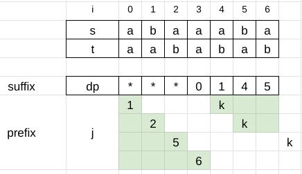

# Right and Left O(n)

**Author:** votrubac
**Votes:** 95
**Link:** [https://leetcode.com/problems/subsequence-with-the-minimum-score/solutions/3174041/](https://leetcode.com/problems/subsequence-with-the-minimum-score/solutions/3174041/)

---

Based on the problem description, we need to find the longest prefix + suffix of `t` that is a subsequence of `s`.

We first match `t` starting from the right.

For each matched character in `t`, we remember the corresponding point in `s` in the `dp` array. This is our suffix.

Then we go left-to-right building our prefix. For each prefix, we determine the longest suffix using `dp`.



**C++**
```cpp
int minimumScore(string s, string t) {
    int ss = s.size(), st = t.size(), k = st - 1;
    vector<int> dp(st, -1);
    for (int i = ss - 1; i >= 0 && k >= 0; --i)
        if (s[i] == t[k])
            dp[k--] = i;
    int res = k + 1;
    for (int i = 0, j = 0; i < ss && j < st && res > 0; ++i)
        if (s[i] == t[j]) {
            for (; k < t.size() && dp[k] <= i; ++k);
            res = min(res, k - (++j));
        }
    return res;
}
```
**Java**
```java
public int minimumScore(String s, String t) {
    int ss = s.length(), st = t.length(), k = st - 1;
    int[] dp = new int[st];
    Arrays.fill(dp, -1);
    for (int i = ss - 1; i >= 0 && k >= 0; --i)
        if (s.charAt(i) == t.charAt(k))
            dp[k--] = i;
    int res = k + 1;
    for (int i = 0, j = 0; i < ss && j < st && res > 0; ++i)
        if (s.charAt(i) == t.charAt(j)) {
            for (; k < st && dp[k] <= i; ++k);
            res = Math.min(res, k - (++j));
        }
    return res;
}
```