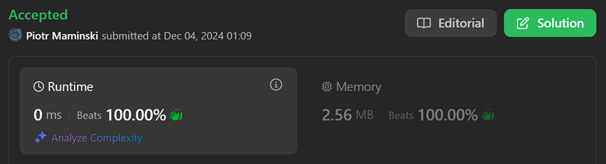
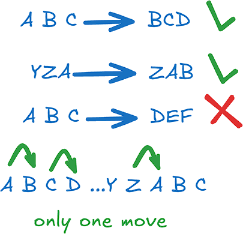

# ✅ 100% Beats | Short & Simple

**Author:** Piotr_Maminski
**Votes:** 119
**Link:** [https://leetcode.com/problems/make-string-a-subsequence-using-cyclic-increments/solutions/6110638/](https://leetcode.com/problems/make-string-a-subsequence-using-cyclic-increments/solutions/6110638/)

---




# #1 Greedy Two Pointers (Rust,Ruby,Swift,C# - 100% Py - 97% )

```python3 []
class Solution:
    def canMakeSubsequence(self, source: str, target: str) -> bool:
        targetIdx, targetLen = 0, len(target)  
        for currChar in source:
            if targetIdx < targetLen and (ord(target[targetIdx]) - ord(currChar)) % 26 < 2:
                targetIdx += 1  
        return targetIdx == targetLen
```
```cpp []
class Solution {
public:
    bool canMakeSubsequence(string source, string target) {
        int targetIdx = 0;
        int targetLen = target.length();
        for (char currChar : source) {
            if (targetIdx < targetLen && (target[targetIdx] - currChar + 26) % 26 <= 1) {
                targetIdx++;
            }
        }
        return targetIdx == targetLen;
    }
};
```
```java []
class Solution {
    public boolean canMakeSubsequence(String source, String target) {
        int targetIdx = 0, targetLen = target.length();
        
        for (char currChar : source.toCharArray()) {
            if (targetIdx < targetLen && (target.charAt(targetIdx) - currChar + 26) % 26 <= 1) {
                targetIdx++;
            }
        }
        return targetIdx == targetLen;
    }
}
```
```csharp []
public class Solution {
    public bool CanMakeSubsequence(string source, string target) {
        int targetIdx = 0, targetLen = target.Length;
        
        foreach (char currChar in source) {
            if (targetIdx < targetLen && (target[targetIdx] - currChar + 26) % 26 <= 1) {
                targetIdx++;
            }
        }
        return targetIdx == targetLen;
    }
}
```
```golang []
func canMakeSubsequence(source string, target string) bool {
    targetIdx, targetLen := 0, len(target)
    
    for _, currChar := range source {
        if targetIdx < targetLen && (int(target[targetIdx]) - int(currChar) + 26) % 26 <= 1 {
            targetIdx++
        }
    }
    return targetIdx == targetLen
}
```
```swift []
class Solution {
    func canMakeSubsequence(_ source: String, _ target: String) -> Bool {
        var targetIdx = 0
        let targetLen = target.count
        let targetArray = Array(target)
        
        for currChar in source {
            if targetIdx < targetLen && (Int(targetArray[targetIdx].asciiValue!) - Int(currChar.asciiValue!) + 26) % 26 <= 1 {
                targetIdx += 1
            }
        }
        return targetIdx == targetLen
    }
}
```
```javascript [JS]
// JavaScript

var canMakeSubsequence = function(source, target) {
    let targetIdx = 0;
    const targetLen = target.length;
    
    for (let currChar of source) {
        if (targetIdx < targetLen && 
            ((target.charCodeAt(targetIdx) - currChar.charCodeAt(0) + 26) % 26 <= 1)) {
            targetIdx++;
        }
    }
    
    return targetIdx === targetLen;
};
```
```typescript [TS]
// TypeScript

function canMakeSubsequence(source: string, target: string): boolean {
    let targetIdx = 0;
    const targetLen = target.length;
    
    for (const currChar of source) {
        if (targetIdx < targetLen && 
            (target.charCodeAt(targetIdx) - currChar.charCodeAt(0) + 26) % 26 <= 1) {
            targetIdx++;
        }
    }
    return targetIdx === targetLen;
}
```
```rust []
impl Solution {
    pub fn can_make_subsequence(source: String, target: String) -> bool {
        let mut target_idx = 0;
        let target_len = target.len();
        let target_bytes = target.as_bytes();
        
        for curr_char in source.bytes() {
            if target_idx < target_len && 
               (target_bytes[target_idx] as i32 - curr_char as i32 + 26) % 26 <= 1 {
                target_idx += 1;
            }
        }
        target_idx == target_len
    }
}
```
```ruby []
def can_make_subsequence(source, target)
    target_idx = 0
    target_len = target.length
    
    source.each_char do |curr_char|
        if target_idx < target_len && (target[target_idx].ord - curr_char.ord) % 26 <= 1
            target_idx += 1
        end
    end
    
    target_idx == target_len
end
```

- Complexity - Time O(n) & Space O(1)

# #2 Edit: better way, not mine (inspired [An-Wen Deng solution](https://leetcode.com/problems/make-string-a-subsequence-using-cyclic-increments/solutions/6110652/1-pass-2-pointers-beats-100), If you like UpVote in that link)


```python3 []
class Solution:
    def canMakeSubsequence(self, source: str, target: str) -> bool:
        src_len, tgt_len = len(source), len(target)
        target_char = target[0]
        
        src_idx = tgt_idx = 0
        while src_idx < src_len and tgt_idx < tgt_len:
            src_char = source[src_idx]
            
            if (src_char == target_char or 
                chr(ord(src_char) + 1) == target_char or 
                (src_char == 'z' and target_char == 'a')):
                tgt_idx += 1
                if tgt_idx < tgt_len:
                    target_char = target[tgt_idx]
            
            src_idx += 1
            
        return tgt_idx == tgt_len
```
```cpp []
class Solution {
public:
    static bool canMakeSubsequence(string& source, string& target) {
        const int srcLen = source.size(), tgtLen = target.size();
        char targetChar = target[0];
        
        int srcIdx, tgtIdx;
        for(srcIdx = 0, tgtIdx = 0; srcIdx < srcLen && tgtIdx < tgtLen; srcIdx++) {
            char srcChar = source[srcIdx];
            
            if (srcChar == targetChar || 
                srcChar + 1 == targetChar || 
                (srcChar == 'z' && targetChar == 'a')) {
                targetChar = target[++tgtIdx];
            }
        }
        
        return tgtIdx == tgtLen;
    }
};
```
```java []
class Solution {
    public static boolean canMakeSubsequence(String source, String target) {
        int srcLen = source.length(), tgtLen = target.length();
        char targetChar = target.charAt(0);
        
        int srcIdx = 0, tgtIdx = 0;
        while (srcIdx < srcLen && tgtIdx < tgtLen) {
            char srcChar = source.charAt(srcIdx);
            
            if (srcChar == targetChar || 
                (char)(srcChar + 1) == targetChar || 
                (srcChar == 'z' && targetChar == 'a')) {
                tgtIdx++;
                if (tgtIdx < tgtLen) {
                    targetChar = target.charAt(tgtIdx);
                }
            }
            
            srcIdx++;
        }
        
        return tgtIdx == tgtLen;
    }
}
```
```csharp []
public class Solution {
    public bool CanMakeSubsequence(string source, string target) {
        int srcLen = source.Length, tgtLen = target.Length;
        char targetChar = target[0];
        
        int srcIdx = 0, tgtIdx = 0;
        while (srcIdx < srcLen && tgtIdx < tgtLen) {
            char srcChar = source[srcIdx];
            
            if (srcChar == targetChar || 
                srcChar + 1 == targetChar || 
                (srcChar == 'z' && targetChar == 'a')) {
                tgtIdx++;
                if (tgtIdx < tgtLen) {
                    targetChar = target[tgtIdx];
                }
            }
            srcIdx++;
        }
        
        return tgtIdx == tgtLen;
    }
}
```
```golang []
func canMakeSubsequence(source string, target string) bool {
    srcLen, tgtLen := len(source), len(target)
    targetChar := target[0]
    
    srcIdx, tgtIdx := 0, 0
    for srcIdx < srcLen && tgtIdx < tgtLen {
        srcChar := source[srcIdx]
        
        if srcChar == targetChar || 
           srcChar + 1 == targetChar || 
           (srcChar == 'z' && targetChar == 'a') {
            tgtIdx++
            if tgtIdx < tgtLen {
                targetChar = target[tgtIdx]
            }
        }
        
        srcIdx++
    }
    
    return tgtIdx == tgtLen
}
```
```swift []
class Solution {
    func canMakeSubsequence(_ source: String, _ target: String) -> Bool {
        let srcLen = source.count
        let tgtLen = target.count
        var targetChar = target.first!
        
        var srcIdx = 0
        var tgtIdx = 0
        let sourceArray = Array(source)
        let targetArray = Array(target)
        
        while srcIdx < srcLen && tgtIdx < tgtLen {
            let srcChar = sourceArray[srcIdx]
            
            if srcChar == targetChar ||
               srcChar.asciiValue! + 1 == targetChar.asciiValue! ||
               (srcChar == "z" && targetChar == "a") {
                tgtIdx += 1
                if tgtIdx < tgtLen {
                    targetChar = targetArray[tgtIdx]
                }
            }
            srcIdx += 1
        }
        
        return tgtIdx == tgtLen
    }
}
```
```javascript [JS]
// JavaScript

var canMakeSubsequence = function(source, target) {
    const srcLen = source.length;
    const tgtLen = target.length;
    let targetChar = target[0];
    
    let srcIdx = 0, tgtIdx = 0;
    while (srcIdx < srcLen && tgtIdx < tgtLen) {
        const srcChar = source[srcIdx];
        
        if (srcChar === targetChar || 
            String.fromCharCode(srcChar.charCodeAt(0) + 1) === targetChar ||
            (srcChar === 'z' && targetChar === 'a')) {
            tgtIdx++;
            if (tgtIdx < tgtLen) {
                targetChar = target[tgtIdx];
            }
        }
        
        srcIdx++;
    }
    
    return tgtIdx === tgtLen;
};
```
```typescript [TS]
// TypeScript

function canMakeSubsequence(source: string, target: string): boolean {
    const srcLen = source.length;
    const tgtLen = target.length;
    let targetChar = target[0];
    
    let srcIdx = 0, tgtIdx = 0;
    while (srcIdx < srcLen && tgtIdx < tgtLen) {
        const srcChar = source[srcIdx];
        
        if (srcChar === targetChar || 
            String.fromCharCode(srcChar.charCodeAt(0) + 1) === targetChar ||
            (srcChar === 'z' && targetChar === 'a')) {
            tgtIdx++;
            if (tgtIdx < tgtLen) {
                targetChar = target[tgtIdx];
            }
        }
        
        srcIdx++;
    }
    
    return tgtIdx === tgtLen;
}
```
```rust []
impl Solution {
    pub fn can_make_subsequence(source: String, target: String) -> bool {
        let src_chars: Vec<char> = source.chars().collect();
        let tgt_chars: Vec<char> = target.chars().collect();
        let (src_len, tgt_len) = (src_chars.len(), tgt_chars.len());
        
        let mut target_char = tgt_chars[0];
        let mut tgt_idx = 0;
        
        for src_char in src_chars {
            if src_char == target_char || 
               ((src_char as u8 + 1) as char == target_char) ||
               (src_char == 'z' && target_char == 'a') {
                tgt_idx += 1;
                if tgt_idx == tgt_len {
                    break;
                }
                target_char = tgt_chars[tgt_idx];
            }
        }
        
        tgt_idx == tgt_len
    }
}
```
```ruby []
def can_make_subsequence(source, target)
    src_len = source.length
    tgt_len = target.length
    target_char = target[0]
    
    src_idx = 0
    tgt_idx = 0
    
    while src_idx < src_len && tgt_idx < tgt_len
        src_char = source[src_idx]
        
        if src_char == target_char || 
           src_char.next[0] == target_char || 
           (src_char == 'z' && target_char == 'a')
            tgt_idx += 1
            target_char = target[tgt_idx] if tgt_idx < tgt_len
        end
        
        src_idx += 1
    end
    
    tgt_idx == tgt_len
end
```

- Complexity - Time O(n) & Space O(1)


# #3 Greedy Two Pointers (Java,Rust - 100%)
```python3 []
class Solution:
    def canMakeSubsequence(self, source: str, target: str) -> bool:
        src_len = len(source)
        tgt_len = len(target)
        src_idx = 0
        tgt_idx = 0
        
        while src_idx < src_len and tgt_idx < tgt_len:
            if (source[src_idx] == target[tgt_idx] or 
                (source[src_idx] == 'z' and target[tgt_idx] == 'a') or 
                (ord(source[src_idx]) + 1 == ord(target[tgt_idx]))):
                src_idx += 1
                tgt_idx += 1
            else:
                src_idx += 1
                
        return tgt_idx == tgt_len
```
```cpp []
class Solution {
public:
    bool canMakeSubsequence(string source, string target) {
        int srcLen = source.size();
        int tgtLen = target.size();
        int srcIdx = 0;
        int tgtIdx = 0;
        
        while(srcIdx < srcLen && tgtIdx < tgtLen) {
            if((source[srcIdx] == target[tgtIdx]) || 
               (source[srcIdx] == 'z' && target[tgtIdx] == 'a') || 
               (source[srcIdx] + 1 == target[tgtIdx])) {
                srcIdx++;
                tgtIdx++;
            } else {
                srcIdx++;
            }
        }
        return tgtIdx == tgtLen;
    }
};
```
```java []
class Solution {
    public boolean canMakeSubsequence(String source, String target) {
        int srcLen = source.length();
        int tgtLen = target.length();
        int srcIdx = 0;
        int tgtIdx = 0;
        
        while (srcIdx < srcLen && tgtIdx < tgtLen) {
            char srcChar = source.charAt(srcIdx);
            char tgtChar = target.charAt(tgtIdx);
            
            if (srcChar == tgtChar || 
                (srcChar == 'z' && tgtChar == 'a') || 
                (srcChar + 1 == tgtChar)) {
                srcIdx++;
                tgtIdx++;
            } else {
                srcIdx++;
            }
        }
        return tgtIdx == tgtLen;
    }
}
```

```javascript []
var canMakeSubsequence = function(source, target) {
    let srcLen = source.length;
    let tgtLen = target.length;
    let srcIdx = 0;
    let tgtIdx = 0;
    
    while (srcIdx < srcLen && tgtIdx < tgtLen) {
        if (source[srcIdx] === target[tgtIdx] || 
            (source[srcIdx] === 'z' && target[tgtIdx] === 'a') || 
            (source.charCodeAt(srcIdx) + 1 === target.charCodeAt(tgtIdx))) {
            srcIdx++;
            tgtIdx++;
        } else {
            srcIdx++;
        }
    }
    return tgtIdx === tgtLen;
};
```
```rust []
impl Solution {
    pub fn can_make_subsequence(source: String, target: String) -> bool {
        let src_bytes = source.as_bytes();
        let tgt_bytes = target.as_bytes();
        let (mut src_idx, mut tgt_idx) = (0, 0);
        
        while src_idx < src_bytes.len() && tgt_idx < tgt_bytes.len() {
            if src_bytes[src_idx] == tgt_bytes[tgt_idx] || 
               (src_bytes[src_idx] == b'z' && tgt_bytes[tgt_idx] == b'a') || 
               (src_bytes[src_idx] + 1 == tgt_bytes[tgt_idx]) {
                src_idx += 1;
                tgt_idx += 1;
            } else {
                src_idx += 1;
            }
        }
        tgt_idx == tgt_bytes.len()
    }
}
```

- Complexity - Time O(n) & Space O(1)

# Explanation


---

## Intuition





# Approach #1

- `targetIdx` - Cur position in target string
- `targetLen` - length of target string


##### Main Loop - Comparison Character 

- for Current Charater in source string...

```
(ord(target[targetIdx]) - ord(currChar)) % 26 < 2
```

`ord(currChar)` - Get ASCII value of current source character
`ord(target[targetIdx])`- Get ASCII value of cur target char
`-`(subtraction) and `< 2` - Subtracting the numbers tells us the difference in the alphabet between the characters ( **if** 0 = same, **if** 1 = one move , more? not good)
`% 26` -  handles alphabet wrapped (z -> a)

Done. 

**UpVote** if you think it is helpful and will help others

---


# Most common String Interview Problems
List based on my research (interviews, reddit, github) Probably not 100% accurate but very close to my recruitments. Leetcode Premium is probably more accurate [I don't have]

**Easy:** [[20. Valid Parentheses]](https://leetcode.com/problems/valid-parentheses/solutions/6013115/solution) [[28. Find the Index of the First Occurrence in a String]](https://leetcode.com/problems/find-the-index-of-the-first-occurrence-in-a-string) [[13. Roman to Integer]](https://leetcode.com/problems/roman-to-integer/solutions/6021029/beats-100-explained-step-by-step-list-most-common-string-interview-problems/) [[125. Valid Palindrome]](https://leetcode.com/problems/valid-palindrome) [[680. Valid Palindrome II]](https://leetcode.com/problems/valid-palindrome-ii) [[67. Add Binary]](https://leetcode.com/problems/add-binary)


**Medium/Hard:** [[8. String to Integer (atoi)]](https://leetcode.com/problems/string-to-integer-atoi/solutions/6013112/solution/) [[3. Longest Substring Without Repeating Characters]](https://leetcode.com/problems/longest-substring-without-repeating-characters/solutions/6013106/solutions/) [[5. Longest Palindromic Substring]](https://leetcode.com/problems/longest-palindromic-substring/solutions/6013111/solution/) [[937. Reorder Data in Log Files]](https://leetcode.com/problems/reorder-data-in-log-files) [[68. Text Justification]](https://leetcode.com/problems/text-justification) [[32. Longest Valid Parentheses]](https://leetcode.com/problems/longest-valid-parentheses) [[12. Integer to Roman]](https://leetcode.com/problems/integer-to-roman/solutions/6023402/solutions) [[22. Generate Parentheses]](https://leetcode.com/problems/generate-parentheses) [[65. Valid Number]](https://leetcode.com/problems/valid-number) [[49. Group Anagrams]](https://leetcode.com/problems/group-anagrams)


####  [Interview Questions and Answers Repository](https://github.com/RooTinfinite/Interview-questions-and-answers)


