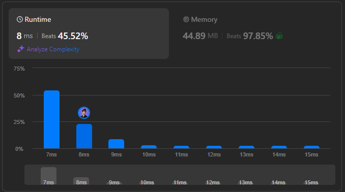

# 🌟 Step-by-Step Guide to Grouping Black and White Balls! 💯🔥

**Author:** withaarzoo
**Votes:** 16
**Link:** [https://leetcode.com/problems/separate-black-and-white-balls/solutions/5913688/](https://leetcode.com/problems/separate-black-and-white-balls/solutions/5913688/)

---


## **\uD83C\uDF1F Access Daily LeetCode Solutions Repo :** [click here](https://github.com/withaarzoo/LeetCode-Solutions)

---



---

# Intuition
The problem asks us to group all black balls (represented by `1`s) to the right and all white balls (represented by `0`s) to the left. We are only allowed to swap adjacent balls. Our goal is to calculate the minimum number of swaps required to achieve this.

### Key Insight:
The number of swaps needed is directly related to the number of white balls (`0`s) that each black ball (`1`) needs to "skip" over to reach its desired position. Each black ball needs to move past all white balls to its left, and for each white ball encountered, it requires one swap.

---

# Approach
1. **Initialization**: We keep two variables:
   - `cnt`: Tracks the cumulative number of black balls (`1`s) encountered so far.
   - `ans`: Stores the total number of swaps needed.

2. **Traversal**: Iterate through the string:
   - If the current character is a white ball (`0`), it needs to be swapped with the black balls that are on its left. So, add the number of black balls encountered so far (`cnt`) to `ans`.
   - If the current character is a black ball (`1`), simply increment the `cnt` to reflect that there\u2019s one more black ball that needs to be considered in future swaps.

3. **Final Result**: The total swaps required to group all black balls to the right is stored in `ans`.

---

# Complexity
- **Time complexity**: 
  The solution runs in \\(O(n)\\), where \\(n\\) is the length of the string, as we traverse the string only once.

- **Space complexity**: 
  \\(O(1)\\), since we are only using a few extra variables regardless of the input size.

---

# Code
```C++ []
class Solution {
public:
    long long minimumSteps(string s) {
        int n = s.length();
        long long ans = 0;
        int cnt = 0; // Tracks the number of black balls (1s)

        // Traverse through the string
        for (int i = 0; i < n; i++) {
            if (s[i] == '0') {
                // White ball encountered, add the number of black balls on its left
                ans += cnt;
            } else {
                // Black ball encountered, increment the black ball count
                cnt++;
            }
        }
        return ans;
    }
};

```
```Java []
class Solution {
    public long minimumSteps(String s) {
        long ans = 0;
        int blackCount = 0; // Tracks the number of black balls (1s)

        // Traverse through the string
        for (int i = 0; i < s.length(); i++) {
            if (s.charAt(i) == '0') {
                // White ball encountered, add the number of black balls on its left
                ans += blackCount;
            } else {
                // Black ball encountered, increment the black ball count
                blackCount++;
            }
        }
        return ans;
    }
}

```
```JavaScript []
/**
 * @param {string} s
 * @return {number}
 */
var minimumSteps = function(s) {
    let ans = 0;
    let blackCount = 0; // Tracks the number of black balls (1s)

    // Traverse through the string
    for (let i = 0; i < s.length; i++) {
        if (s[i] === '0') {
            // White ball encountered, add the number of black balls on its left
            ans += blackCount;
        } else {
            // Black ball encountered, increment the black ball count
            blackCount++;
        }
    }

    return ans;
};

```
```Python []
class Solution:
    def minimumSteps(self, s: str) -> int:
        ans = 0
        blackCount = 0 # Tracks the number of black balls (1s)

        # Traverse through the string
        for ch in s:
            if ch == '0':
                # White ball encountered, add the number of black balls on its left
                ans += blackCount
            else:
                # Black ball encountered, increment the black ball count
                blackCount += 1

        return ans

```
```Go []
func minimumSteps(s string) int64 {
    var ans int64 = 0
    var blackCount int = 0 // Tracks the number of black balls (1s)

    // Traverse through the string
    for i := 0; i < len(s); i++ {
        if s[i] == '0' {
            // White ball encountered, add the number of black balls on its left
            ans += int64(blackCount)
        } else {
            // Black ball encountered, increment the black ball count
            blackCount++
        }
    }

    return ans
}

```

---

# Step-by-Step Detailed Explanation

1. **Initialize Variables**: 
   - `cnt` or `blackCount`: This keeps track of how many black balls (`1`s) we've encountered so far.
   - `ans`: This variable stores the total number of swaps needed.

2. **Iterate Over the String**:
   - If we find a `0` (white ball), this ball needs to swap places with all the black balls encountered so far (`blackCount`). Therefore, we increment `ans` by `blackCount` (this represents how many swaps it takes to move this white ball past the black balls to its right).
   - If we find a `1` (black ball), increment `blackCount` because now there\u2019s one more black ball on the left.

3. **Return the Result**: 
   - After processing the entire string, `ans` contains the minimum number of swaps needed to group all black balls to the right and white balls to the left.

---


