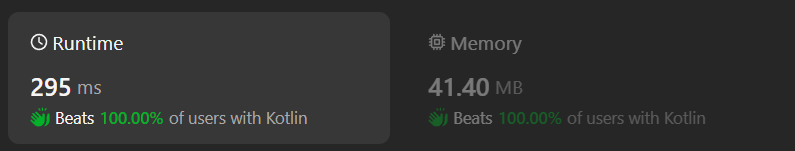

# Kotlin solution (KMP algorithm + Binary search)

**Author:** chayangkoon
**Votes:** 0
**Link:** [https://leetcode.com/problems/find-beautiful-indices-in-the-given-array-i/solutions/5125611/](https://leetcode.com/problems/find-beautiful-indices-in-the-given-array-i/solutions/5125611/)

---




# Code
```
class Solution {
    fun beautifulIndices(s: String, a: String, b: String, k: Int): List<Int> {
        val indexesOfA = s.indexesOf(a)
        val indexesOfB = s.indexesOf(b)

        if (indexesOfA.isEmpty() || indexesOfB.isEmpty()) return emptyList()

        val results = mutableListOf<Int>()
        for (i in 0 until indexesOfA.size) {
            val indexA = indexesOfA[i]
            val indexB = indexesOfB.binarySearch(indexA + k)
            if (indexB != -1 && abs(indexesOfB[indexB] - indexA) <= k) {
                results.add(indexA)
            }
        }

        return results
    }

    private fun String.indexesOf(string: String): MutableList<Int> {
        val results = mutableListOf<Int>()
        val lps = string.buildLPS()
        val n = this.length
        val m = string.length
        var i = 0
        var j = 0

        while (i < n && j < m) {
            if (this[i] == string[j]) {
                i++
                j++
            } else if (j > 0) {
                j = lps[j - 1]
            } else {
                i++
            }

            if (j == m) {
                results.add(i - j)
                j = lps[j - 1]
            }
        }

        return results
    }

    private fun String.buildLPS(): IntArray {
        val lps = IntArray(length)
        var i = 1
        var j = 0

        while (i < length) {
            if (this[i] == this[j]) {
                lps[i++] = ++j
            } else if (j > 0) {
                j = lps[j - 1]
            } else {
                lps[i++] = j
            }
        } 

        return lps
    }

    private fun List<Int>.binarySearch(target: Int): Int {
        var low = 0
        var high = size - 1
        while (low <= high) {
            val mid = low + (high - low) / 2
            if (this[mid] <= target) {
                low = mid + 1
            } else {
                high = mid - 1
            }
        }
        return high
    }
}
```