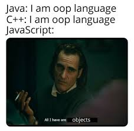

# ✅ Easiest || 2 Liner || JS || TS || Detailed Explanation with Meme 🤣|| Beats 99%⚡

**Author:** lovishtater
**Votes:** 26
**Link:** [https://leetcode.com/problems/check-if-object-instance-of-class/solutions/3416578/](https://leetcode.com/problems/check-if-object-instance-of-class/solutions/3416578/)

---

# Intuition
<!-- Describe your first thoughts on how to solve this problem. -->
My first thought is to use the instanceof operator to check if the object is an instance of the class. If it is, then return true, otherwise return false. I will also need to handle edge cases, such as if the object or the class function is null or undefined.
# Approach
<!-- Describe your approach to solving the problem. -->
My approach to solving the problem is as follows:

- Check if the object is null or undefined, or if the type of the object is null. If any of these conditions are true, return false.
- Check if the second argument (class function) is a function. If it is not a function, return false.
- Use the instanceof operator to check if the given object is an instance of the given class function.
- If the object is an instance of the class function, return true. Otherwise, return false.

# Complexity
- Time complexity:
<!-- Add your time complexity here, e.g. $$O(n)$$ -->
The time complexity is $$O(1)$$, as the code performs a fixed number of operations that do not depend on the size of the input.


- Space complexity:
<!-- Add your space complexity here, e.g. $$O(n)$$ -->
The space complexity is also $$O(1)$$, as the code does not require any extra memory beyond the input object and class function.


# Code

```javascript []
var checkIfInstanceOf = function(obj, classFunction) {
    if (obj == null || typeof classFunction !== 'function' ) return false;
    return Object(obj) instanceof classFunction;
};
```

```typescript []
function checkIfInstanceOf(obj: any, classFunction: any): boolean {
 if (obj == null || typeof classFunction !== 'function' ) return false;
    return Object(obj) instanceof classFunction;
};
```


