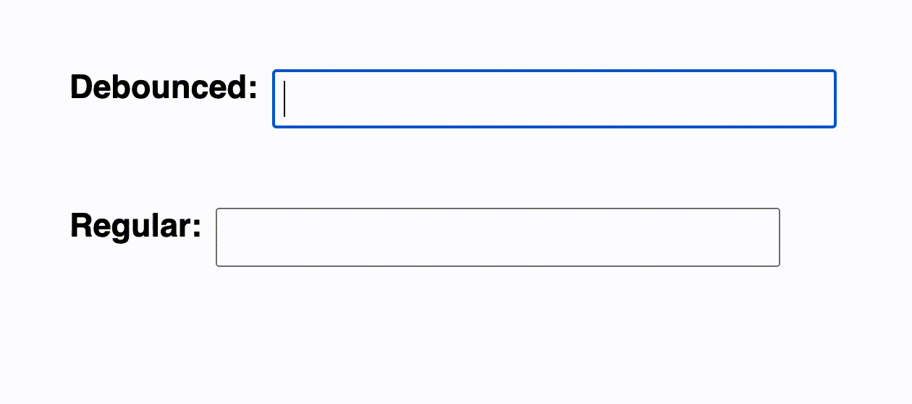

# ✅ Easiest Explanation with CodeSandBox example || Closure 🔥 || setTimeout || Beats 99%⚡

**Author:** lovishtater
**Votes:** 412
**Link:** [https://leetcode.com/problems/debounce/solutions/3416731/](https://leetcode.com/problems/debounce/solutions/3416731/)

---

# Why to use Debouncing?

Have you ever encountered a situation where a function gets called multiple times within a short amount of time, leading to performance issues or unexpected behavior? This is a common problem in JavaScript, especially when working with events like scrolling, resizing, or typing.

Fortunately, there's a simple technique called "debouncing" that can help you control the frequency of function calls and avoid these issues.

# What is Debouncing?

Debouncing is a method that limits the rate at which a function gets called. It works by delaying the execution of a function until a certain amount of time has passed without any additional function calls. If another function call happens within this time frame, the timer resets and the function execution is delayed again.

- Debouncing is useful in situations where you want to prevent a function from being called too frequently, such as:

- Handling user input events like keypresses, mouse movements, or button clicks
- Handling expensive computations or network requests that don't need to be performed on every function call

[Try it out on Codesandbox](https://codesandbox.io/s/debounce-example-zccfci)




# Intuition and Approach
<!-- Describe your approach to solving the problem. -->
- debounce takes two arguments: `fn` and `t`.
- `fn` is the function that you want to debounce.
- `t` is the amount of time you want to wait before executing `fn` after the last time it was called.
- The `debounce` function returns a new function that takes any number of arguments (`...args`).
- Within the returned function, a timer is set using `setTimeout`. The timer is initially set to `t` milliseconds.
- Every time the returned function is called, the `clearTimeout` function is called to reset the timer to `t` milliseconds.
- Once the timer has elapsed without the returned function being called again, the timer's callback function is executed. The callback function calls `fn` with the arguments that were passed to the returned function.
- The `debounce` function returns the new function that was created in step 2.

In simpler terms, the debounce function creates a new function that can only be executed after a certain amount of time has passed without it being called again. This is achieved by creating a timer that is reset every time the debounced function is called. Once the timer has elapsed without the debounced function being called again, the function is executed. This is useful when you want to limit the frequency of some expensive operation, such as making an HTTP request or rendering a large number of elements on a page.

# Complexity
- Time complexity:
<!-- Add your time complexity here, e.g. $$O(n)$$ -->
The time complexity of the debounce function is constant, $$O(1)$$, since it performs a constant number of operations (setting and clearing a timer).

- Space complexity:
<!-- Add your space complexity here, e.g. $$O(n)$$ -->

The space complexity of the debounce function is also constant, $$O(1)$$, since it only uses a fixed amount of memory to store the timer variable.


# Code
```javascript []
var debounce = function(fn, t = 1000) {
    let timer;
    return function(...args) {
        clearTimeout(timer);
        timer = setTimeout(() => fn(...args), t);
    }
};
```
```typescript []
type F = (...p: any[]) => any

function debounce(fn: F, t: number): F {
    let timer : ReturnType<typeof setTimeout>;
    return function(...args) {
        clearTimeout(timer);
        timer = setTimeout(() => fn(...args), t);
    }
};
```