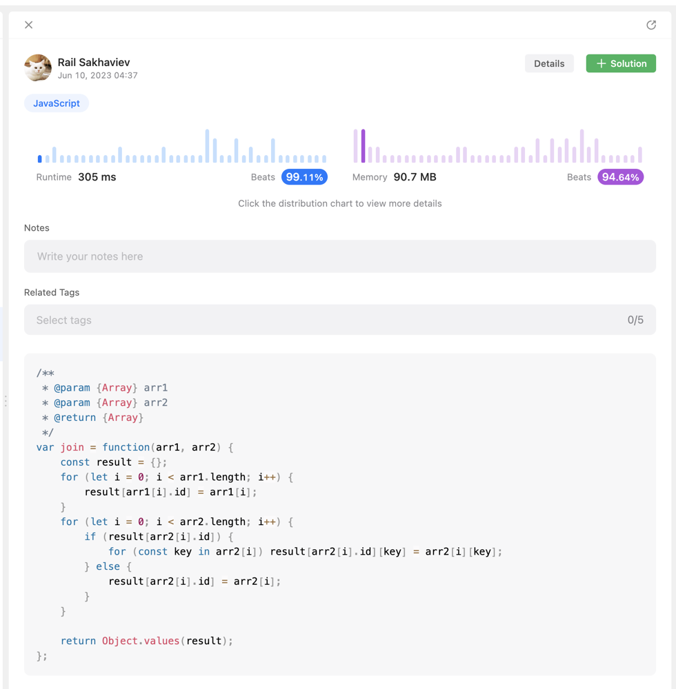

# 🔥 Fastest & Easiest Solution | Time O(n) > 99% & Extra Space O(n) > ~95% ✅

**Author:** sahaviev
**Votes:** 46
**Link:** [https://leetcode.com/problems/join-two-arrays-by-id/solutions/3619941/](https://leetcode.com/problems/join-two-arrays-by-id/solutions/3619941/)

---

# Solution from Pro JS Developer

Please take a look at the code below.

# Alghoritm Details

Create **result** - helper hashmap where **key** - id, **value** - object from array.

1. initiate **result** with *arr1*
2. join *arr2* to **result** with simple logic of join inside iterator function
3. return values of object
<!-- Describe your approach to solving the problem. -->


# Compiler Optimized Approach

### Complexity
- Time complexity: O(n) - Runtime: **305 ms** - beats > 99%
<!-- Add your time complexity here, e.g. $$O(n)$$ -->

- Space complexity: O(n) - Memory: **90.7 MB** - beats > ~95%
<!-- Add your space complexity here, e.g. $$O(n)$$ -->

### Code

```
/**
 * @param {Array} arr1
 * @param {Array} arr2
 * @return {Array}
 */
var join = function(arr1, arr2) {
    const result = {};
    for (let i = 0; i < arr1.length; i++) {
        result[arr1[i].id] = arr1[i];
    } 
    for (let i = 0; i < arr2.length; i++) {
        if (result[arr2[i].id]) {
            for (const key in arr2[i]) result[arr2[i].id][key] = arr2[i][key];  
        } else {
            result[arr2[i].id] = arr2[i];
        }
    } 

    return Object.values(result);
};
```




# ES6 Approach

### Complexity
- Time complexity: O(n) - Runtime: **~335 ms** - beats > ~95%
<!-- Add your time complexity here, e.g. $$O(n)$$ -->

- Space complexity: O(n) - Memory: **~104.5 MB** - beats > ~79%
<!-- Add your space complexity here, e.g. $$O(n)$$ -->

### Code
```
/**
 * @param {Array} arr1
 * @param {Array} arr2
 * @return {Array}
 */
var join = function(arr1, arr2) {
    const result = {};

    // 1. initialization
    arr1.forEach(item => {
        result[item.id] = item;
    });
    // 2. joining
    arr2.forEach(item => {
        if (result[item.id]) {
            Object.keys(item).forEach(key => {
                result[item.id][key] = item[key];    
            });
        } else {
            result[item.id] = item;
        }
    });

    return Object.values(result);
};
```