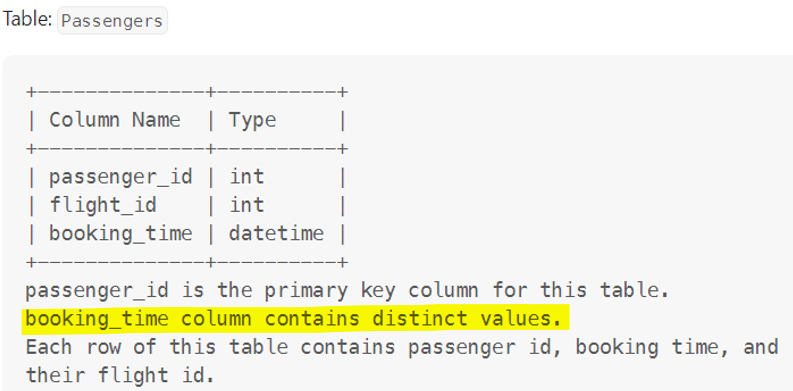

# [MySQL] Partition and rank. Misleading description "distinct values".

**Author:** huangshan01
**Votes:** 3
**Link:** [https://leetcode.com/problems/status-of-flight-tickets/solutions/3829694/](https://leetcode.com/problems/status-of-flight-tickets/solutions/3829694/)

---

# Intuition
Solution is quite straightforward - for each flight, rank the passengers by their booking time, and one whose rank exceeding capacity get waitlisted.

The passenger table description highlighted below is seriously misleading, **test cases have multiple passengers booking a same flight at a same time**, and there is only one seat left, all of them get `Confirmed`.  Therefore, `rank()` works but `row_number()` doesnt.




# Code
```
# Write your MySQL query statement below
select passenger_id, if(idx <= capacity, "Confirmed", "Waitlist") Status
from
(
    select passenger_id, rank() over(partition by p.flight_id order by booking_time) idx, f.capacity
    from passengers p
    left join
    flights f
    on f.flight_id = p.flight_id
) t
order by passenger_id
```