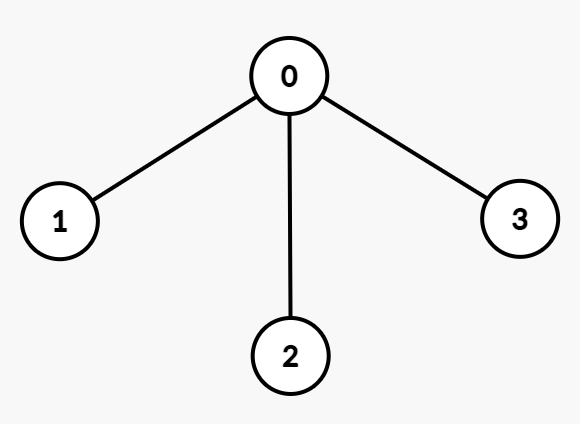

# [3786. Total Sum of Interaction Cost in Tree Groups](https://leetcode.com/problems/total-sum-of-interaction-cost-in-tree-groups/)

| Category | Difficulty | Likes | Dislikes |
| :------: | :--------: | :---: | :------: |
| Algorithms | Hard | 27 | 2 |

## Description

You are given an integer `n` and an undirected tree with `n` nodes numbered from 0 to `n - 1`. This is represented by a 2D array `edges` of length `n - 1`, where `edges[i] = [u_i, v_i]` indicates an undirected edge between nodes `u_i` and `v_i`.

You are also given an integer array `group` of length `n`, where `group[i]` denotes the group label assigned to node `i`.

	- Two nodes `u` and `v` are considered part of the same group if `group[u] == group[v]`.

	- The **interaction cost** between `u` and `v` is defined as the number of edges on the unique path connecting them in the tree.

Return an integer denoting the **sum** of interaction costs over all **unordered** pairs `(u, v)` with `u != v` such that `group[u] == group[v]`.

 

**Example 1:**

**Input:** n = 3, edges = [[0,1],[1,2]], group = [1,1,1]

**Output:** 4

**Explanation:**

****

All nodes belong to group 1. The interaction costs between the pairs of nodes are:

	- Nodes `(0, 1)`: 1

	- Nodes `(1, 2)`: 1

	- Nodes `(0, 2)`: 2

Thus, the total interaction cost is `1 + 1 + 2 = 4`.

**Example 2:**

**Input:** n = 3, edges = [[0,1],[1,2]], group = [3,2,3]

**Output:** 2

**Explanation:**

	- Nodes 0 and 2 belong to group 3. The interaction cost between this pair is 2.

	- Node 1 belongs to a different group and forms no valid pair. Therefore, the total interaction cost is 2.

**Example 3:**

**Input:** n = 4, edges = [[0,1],[0,2],[0,3]], group = [1,1,4,4]

**Output:** 3

**Explanation:**

Nodes belonging to the same groups and their interaction costs are:

	- Group 1: Nodes `(0, 1)`: 1

	- Group 4: Nodes `(2, 3)`: 2

Thus, the total interaction cost is `1 + 2 = 3`.

**Example 4:**

**Input:** n = 2, edges = [[0,1]], group = [9,8]

**Output:** 0

**Explanation:**

All nodes belong to different groups and there are no valid pairs. Therefore, the total interaction cost is 0.

 

**Constraints:**

	- `1 <= n <= 10^5`

	- `edges.length == n - 1`

	- `edges[i] = [u_i, v_i]`

	- `0 <= u_i, v_i <= n - 1`

	- `group.length == n`

	- `1 <= group[i] <= 20`

	- The input is generated such that `edges` represents a valid tree.

---

**Links:** [Submissions](https://leetcode.com/problems/total-sum-of-interaction-cost-in-tree-groups/) | [Solutions](https://leetcode.com/problems/total-sum-of-interaction-cost-in-tree-groups/)
