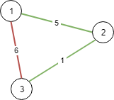
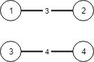

# [1135. Connecting Cities With Minimum Cost](https://leetcode.com/problems/connecting-cities-with-minimum-cost/)

| Category | Difficulty | Likes | Dislikes |
| :------: | :--------: | :---: | :------: |
| Algorithms | Medium | 1170 | 60 |

**Tags:** [`union-find`](https://leetcode.com/tag/union-find), [`graph`](https://leetcode.com/tag/graph), [`heap-priority-queue`](https://leetcode.com/tag/heap-priority-queue), [`minimum-spanning-tree`](https://leetcode.com/tag/minimum-spanning-tree)

**Companies:** `amazon`

## Description

There are `n` cities labeled from `1` to `n`. You are given the integer `n` and an array `connections` where `connections[i] = [x_i, y_i, cost_i]` indicates that the cost of connecting city `x_i` and city `y_i` (bidirectional connection) is `cost_i`.

Return *the minimum **cost** to connect all the *`n`* cities such that there is at least one path between each pair of cities*. If it is impossible to connect all the `n` cities, return `-1`,

The **cost** is the sum of the connections' costs used.

 

**Example 1:**


```

Input: n = 3, connections = [[1,2,5],[1,3,6],[2,3,1]]
Output: 6
Explanation: Choosing any 2 edges will connect all cities so we choose the minimum 2.

```

**Example 2:**


```

Input: n = 4, connections = [[1,2,3],[3,4,4]]
Output: -1
Explanation: There is no way to connect all cities even if all edges are used.

```

 

**Constraints:**

	- `1 <= n <= 10^4`

	- `1 <= connections.length <= 10^4`

	- `connections[i].length == 3`

	- `1 <= x_i, y_i <= n`

	- `x_i != y_i`

	- `0 <= cost_i <= 10^5`

---

**Links:** [Submissions](https://leetcode.com/problems/connecting-cities-with-minimum-cost/) | [Solutions](https://leetcode.com/problems/connecting-cities-with-minimum-cost/)
