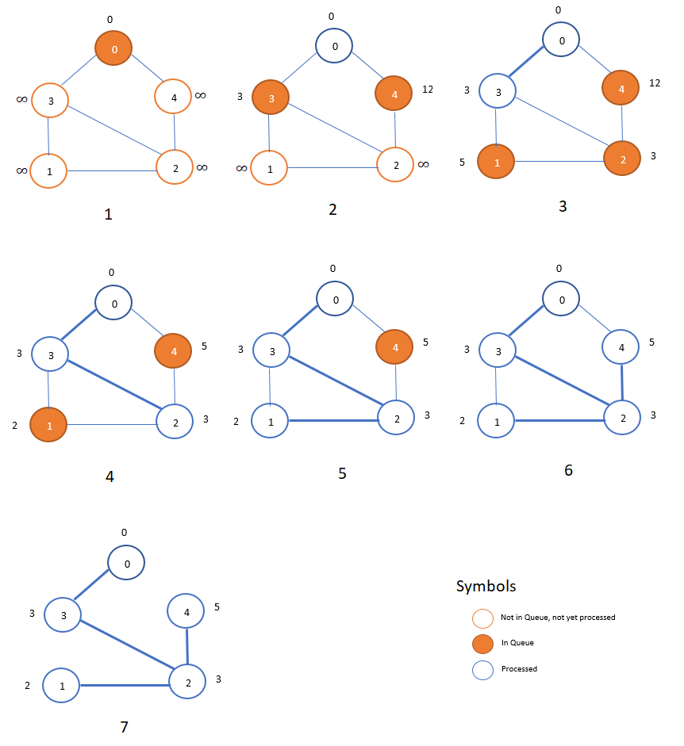
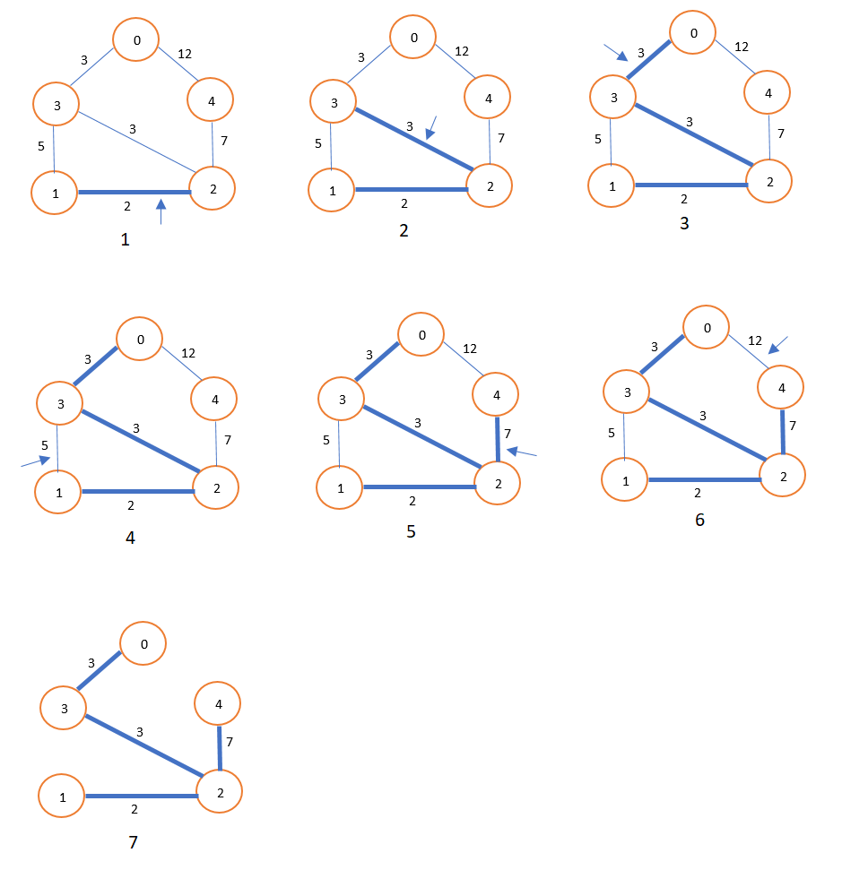

# Java Minimum Spanning Tree two solutions(Prim and Kruskal)

**Author:** XinweiWalt
**Votes:** 5
**Link:** [https://leetcode.com/problems/connecting-cities-with-minimum-cost/solutions/1703461/](https://leetcode.com/problems/connecting-cities-with-minimum-cost/solutions/1703461/)

---

There are two solutions to solve this problem, **Prim** or **Kruskal**
# Prim: 
find any node first and from this node, find next node that is not been visited and has the less cost edge, until visited all nodes.
How to find out which edge is the less cost edge?
We can use PriorityQueue(min heap) to sort the edges.

```
public int minimumCost(int n, int[][] connections) {
        Map<Integer, List<int[]>> graph = new HashMap<>();
        for (int[] connection : connections) {
            int from = connection[0], to = connection[1], cost = connection[2];
            graph.putIfAbsent(from, new ArrayList<>());
            graph.putIfAbsent(to, new ArrayList<>());
            graph.get(from).add(new int[]{to, cost});
            graph.get(to).add(new int[]{from, cost});
        }
        
        int sum = 0;
        Set<Integer> visited = new HashSet<>();
        //{to, cost}
        PriorityQueue<int[]> pq = new PriorityQueue<>((a, b) -> a[1] - b[1]);
        pq.add(new int[]{connections[0][0], 0});
        
        while (!pq.isEmpty()) {
            int[] curr = pq.remove();
            if (visited.contains(curr[0])) 
                continue;
            visited.add(curr[0]);
            sum += curr[1];
            for (int[] next : graph.get(curr[0])) {
                int to = next[0], cost = next[1];
                if (!visited.contains(to)) {
                    pq.add(new int[]{to, cost});
                }
            }
        }
        
        return visited.size() == n ? sum : -1;
    }
```


# 
# Kruskal:
Sort all edges first and start with the less cost edge connect nodes. How to know if two nodes already been connected? We can use UnionFind to figure out. 


```
    public int minimumCost(int n, int[][] connections) {
        UnionFind uf = new UnionFind(n + 1);
        List<int[]> connectionList = new ArrayList<>();
        for (int[] connection : connections)
            connectionList.add(connection);
        
        Collections.sort(connectionList, (a, b) -> a[2] - b[2]);
        int sum = 0, count = 0;
        for (int[] connection: connectionList) {
            int from = connection[0], to = connection[1], cost = connection[2];
            if (uf.find(from) == uf.find(to))
                continue;
            sum += cost;
            count++;
            uf.union(from, to);
        }
        
        return count >= n - 1 ? sum : -1;
    }
    
    class UnionFind {
        int[] parent;
        public UnionFind(int n) {
            parent = new int[n];
            for (int i = 0; i < n; i++)
                parent[i] = i;
        }
        
        public int find(int x) {
            if (parent[x] != x)
                parent[x] = find(parent[x]);
            return parent[x];
        }
        
        public void union(int x, int y) {
            parent[find(x)] = find(y);
        }
    }
```
