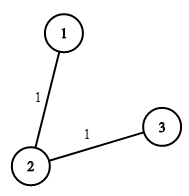

# [1168. Optimize Water Distribution in a Village](https://leetcode.com/problems/optimize-water-distribution-in-a-village/)

| Category | Difficulty | Likes | Dislikes |
| :------: | :--------: | :---: | :------: |
| Algorithms | Hard | 1202 | 40 |

**Tags:** [`union-find`](https://leetcode.com/tag/union-find), [`graph`](https://leetcode.com/tag/graph), [`heap-priority-queue`](https://leetcode.com/tag/heap-priority-queue), [`minimum-spanning-tree`](https://leetcode.com/tag/minimum-spanning-tree)

**Companies:** `google`

## Description

There are `n` houses in a village. We want to supply water for all the houses by building wells and laying pipes.

For each house `i`, we can either build a well inside it directly with cost `wells[i - 1]` (note the `-1` due to **0-indexing**), or pipe in water from another well to it. The costs to lay pipes between houses are given by the array `pipes` where each `pipes[j] = [house1_j, house2_j, cost_j]` represents the cost to connect `house1_j` and `house2_j` together using a pipe. Connections are bidirectional, and there could be multiple valid connections between the same two houses with different costs.

Return *the minimum total cost to supply water to all houses*.

 

**Example 1:**


```

Input: n = 3, wells = [1,2,2], pipes = [[1,2,1],[2,3,1]]
Output: 3
Explanation: The image shows the costs of connecting houses using pipes.
The best strategy is to build a well in the first house with cost 1 and connect the other houses to it with cost 2 so the total cost is 3.

```

**Example 2:**

```

Input: n = 2, wells = [1,1], pipes = [[1,2,1],[1,2,2]]
Output: 2
Explanation: We can supply water with cost two using one of the three options:
Option 1:
  - Build a well inside house 1 with cost 1.
  - Build a well inside house 2 with cost 1.
The total cost will be 2.
Option 2:
  - Build a well inside house 1 with cost 1.
  - Connect house 2 with house 1 with cost 1.
The total cost will be 2.
Option 3:
  - Build a well inside house 2 with cost 1.
  - Connect house 1 with house 2 with cost 1.
The total cost will be 2.
Note that we can connect houses 1 and 2 with cost 1 or with cost 2 but we will always choose the cheapest option. 

```

 

**Constraints:**

	- `2 <= n <= 10^4`

	- `wells.length == n`

	- `0 <= wells[i] <= 10^5`

	- `1 <= pipes.length <= 10^4`

	- `pipes[j].length == 3`

	- `1 <= house1_j, house2_j <= n`

	- `0 <= cost_j <= 10^5`

	- `house1_j != house2_j`

---

**Links:** [Submissions](https://leetcode.com/problems/optimize-water-distribution-in-a-village/) | [Solutions](https://leetcode.com/problems/optimize-water-distribution-in-a-village/)
