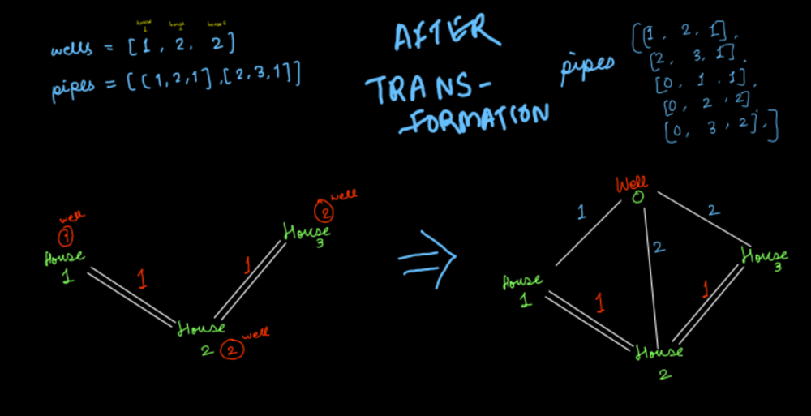

# JavaScript implementation with explanation and picture - MSP (Kruskal's)

**Author:** darkalarm
**Votes:** 3
**Link:** [https://leetcode.com/problems/optimize-water-distribution-in-a-village/solutions/1613480/](https://leetcode.com/problems/optimize-water-distribution-in-a-village/solutions/1613480/)

---

A prerequisite of this question is Minimum Spanning Tree. To give you a quick summary of it, a Minimum Spanning Tree (MST), is a tree made from a weighted graph. The tree has the same number of vertices as the graph, and `vertices - 1` number of edges. These edges are selected such that all the vertices are covered, and the total weight of these edges is minimum.

You might get confused because of the presence of well here. Otherwise, pipes intuitively feel like an edge. And the cost of putting a pipeline is the weight of an edge.

The trick here is to think of all the wells as _one_ additional node in the graph. And the cost of making the well for each house as the weight of the edge that connects the house and the well. This picture should clarify any doubts.



From the picture, we can see that the edges with weight 1 are collectively forming an MST. We need to calculate the total weight of its edges. We use Kruska's algorithm to form the minimum spanning tree here. Time for the implementation part.

```javascript
/**
 * @param {number} n
 * @param {number[]} wells
 * @param {number[][]} pipes
 * @return {number}
 */
var minCostToSupplyWater = function(n, wells, pipes) {
  // n + 1 vertices (n houses and 1 well)
  // Add edges coming from the well to pipes array
  for (let i = 0; i < wells.length; i++) {
    let house = i + 1;
    let wellId = 0;
    let weight = wells[i];
    pipes.push([wellId, house, weight]);
  }
  
  // sort pipes array according to weight
  pipes.sort((a, b) => (a[2] - b[2]));
  
  // We need to connect n edges so that they form a 
  // minimum spanning tree, we take help of a Union Find
  // data structure here. All the edges from pipes array
  // are added there
  
  let unionFind = new UnionFind(pipes.length);
  
  // count is the number of vertices added to the MST
  let count = 0;
  
  // total cost (minimum weight of the MST)
  let totalCost = 0;
  for (let i = 0; i < pipes.length; i++) {
    let v1 = pipes[i][0];
    let v1Group = unionFind.find(v1);
    let v2 = pipes[i][1];
    let v2Group = unionFind.find(v2);
    
    // We add an edge to the spanning tree if both the vertices
    // are not from the same group (thereby not forming a cycle)
    if (v1Group !== v2Group) {
      count += 1
      totalCost += pipes[i][2];
      unionFind.union(v1Group, v2Group);
      if (count === n) {
        break;
      }
    }
  }
  
  return totalCost;
};


// Standard implementation of Union Find data structure
class UnionFind {
  constructor(length) {
    this.parent = Array.from({length: length}, (_, i) => (i));
    this.rank = new Array(length).fill(1)
  }
  
  find(item) {
    if (this.parent[item] === item) {
      return item;
    }
    
    this.parent[item] = this.find(this.parent[item]);
    return this.parent[item];
  }
  
  union(x, y) {
    let parentX = this.find(x);
    let parentY = this.find(y);
    
    if (parentX === parentY) {
      return parentX;
    }
    
    if (this.rank[parentX] < this.rank[parentY]) {
      this.parent[parentX] = parentY;
      return parentY;
    } else if (this.rank[parentY] < this.rank[parentX]) {
      this.parent[parentY] = parentX;
      return parentX;
    } else {
      this.parent[parentY] = parentX;
      this.rank[parentX] += 1;
      return parentX;
    }
  }
}
```