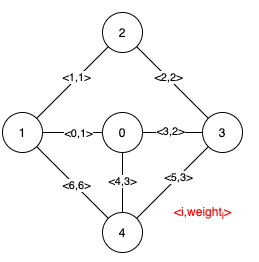
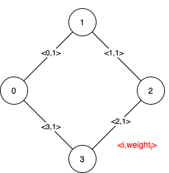

# [1489. Find Critical and Pseudo-Critical Edges in Minimum Spanning Tree](https://leetcode.com/problems/find-critical-and-pseudo-critical-edges-in-minimum-spanning-tree/)

| Category | Difficulty | Likes | Dislikes |
| :------: | :--------: | :---: | :------: |
| Algorithms | Hard | 1977 | 168 |

**Tags:** [`union-find`](https://leetcode.com/tag/union-find), [`graph`](https://leetcode.com/tag/graph), [`sorting`](https://leetcode.com/tag/sorting), [`minimum-spanning-tree`](https://leetcode.com/tag/minimum-spanning-tree), [`strongly-connected-component`](https://leetcode.com/tag/strongly-connected-component)

**Companies:** `google`, `amazon`

## Description

Given a weighted undirected connected graph with `n` vertices numbered from `0` to `n - 1`, and an array `edges` where `edges[i] = [a_i, b_i, weight_i]` represents a bidirectional and weighted edge between nodes `a_i` and `b_i`. A minimum spanning tree (MST) is a subset of the graph's edges that connects all vertices without cycles and with the minimum possible total edge weight.

Find *all the critical and pseudo-critical edges in the given graph's minimum spanning tree (MST)*. An MST edge whose deletion from the graph would cause the MST weight to increase is called a *critical edge*. On the other hand, a pseudo-critical edge is that which can appear in some MSTs but not all.

Note that you can return the indices of the edges in any order.

 

**Example 1:**



```

Input: n = 5, edges = [[0,1,1],[1,2,1],[2,3,2],[0,3,2],[0,4,3],[3,4,3],[1,4,6]]
Output: [[0,1],[2,3,4,5]]
Explanation: The figure above describes the graph.
The following figure shows all the possible MSTs:

Notice that the two edges 0 and 1 appear in all MSTs, therefore they are critical edges, so we return them in the first list of the output.
The edges 2, 3, 4, and 5 are only part of some MSTs, therefore they are considered pseudo-critical edges. We add them to the second list of the output.

```

**Example 2:**



```

Input: n = 4, edges = [[0,1,1],[1,2,1],[2,3,1],[0,3,1]]
Output: [[],[0,1,2,3]]
Explanation: We can observe that since all 4 edges have equal weight, choosing any 3 edges from the given 4 will yield an MST. Therefore all 4 edges are pseudo-critical.

```

 

**Constraints:**

	- `2 <= n <= 100`

	- `1 <= edges.length <= min(200, n * (n - 1) / 2)`

	- `edges[i].length == 3`

	- `0 <= a_i < b_i < n`

	- `1 <= weight_i <= 1000`

	- All pairs `(a_i, b_i)` are **distinct**.

---

**Links:** [Submissions](https://leetcode.com/problems/find-critical-and-pseudo-critical-edges-in-minimum-spanning-tree/) | [Solutions](https://leetcode.com/problems/find-critical-and-pseudo-critical-edges-in-minimum-spanning-tree/)
