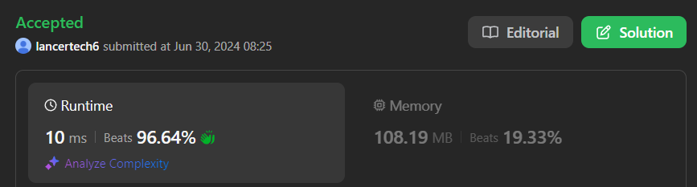

# ✅Beats 100% -Explained with [ Video ] -C++/Java/Python/JS - Union Find

**Author:** lancertech6
**Votes:** 161
**Link:** [https://leetcode.com/problems/remove-max-number-of-edges-to-keep-graph-fully-traversable/solutions/5389181/](https://leetcode.com/problems/remove-max-number-of-edges-to-keep-graph-fully-traversable/solutions/5389181/)

---




# YouTube Video Explanation:

<!-- ### To watch the video please click on "Watch On Youtube" option  available the left bottom corner of the thumbnail. -->

<!-- **If you want a video for this question please write in the comments** -->


https://youtu.be/LfaQjcE_LEM

# The video doesn't have the code part today due to some failure. Please watch it from the solution below. Sorry for it.


**\uD83D\uDD25 Please like, share, and subscribe to support our channel's mission of making complex concepts easy to understand.**

Subscribe Link: https://www.youtube.com/@leetlogics/?sub_confirmation=1

*Subscribe Goal: 2400 Subscribers*
*Current Subscribers: 2357*

Follow me on Instagram : https://www.instagram.com/divyansh.nishad/

---


# Intuition
<!-- Describe your first thoughts on how to solve this problem. -->
To solve this problem, we need to ensure that both Alice and Bob can traverse the entire graph independently. This can be achieved by ensuring each has a connected graph (spanning tree). Using the Union-Find data structure, we can efficiently manage the connectivity of the graph. The goal is to maximize the number of edges removed while ensuring both Alice and Bob can still traverse all nodes.

# Approach
<!-- Describe your approach to solving the problem. -->
1. **Initialize Union-Find Structures**: Create two separate Union-Find structures, one for Alice and one for Bob, to manage their connectivity.
2. **Process Type 3 Edges First**: Type 3 edges are the most valuable because they can be used by both Alice and Bob. We iterate through these edges first and attempt to add them to both Alice's and Bob's graphs. If the edge successfully connects two previously unconnected components for either Alice or Bob, it is necessary.
3. **Process Type 1 and Type 2 Edges**: After handling type 3 edges, we separately process type 1 edges for Alice and type 2 edges for Bob. These edges are only useful if they connect new components for Alice or Bob, respectively.
4. **Check Full Connectivity**: After processing all edges, we check if both Alice's and Bob's graphs are fully connected.
5. **Calculate Removable Edges**: The number of removable edges is the total number of edges minus the number of edges required to ensure full connectivity for both Alice and Bob.

# Complexity
- **Time Complexity**: 
  - The Union-Find operations (find and union) are nearly constant time due to path compression and union by rank. 
  - Processing all edges involves iterating through them twice, giving a complexity of \\(O(E)\\), where \\(E\\) is the number of edges.
- **Space Complexity**: 
  - We use extra space for the Union-Find data structures, each requiring \\(O(N)\\) space for representative and component size arrays, where \\(N\\) is the number of nodes.


# Explanation

1. **Initialization**:
    - Create two Union-Find instances: one for Alice and one for Bob.
    - Initialize the number of edges required to be included in the graph (`edgesRequired`).

    | Variable        | Description                                         |
    |-----------------|-----------------------------------------------------|
    | `alice`         | Union-Find instance for Alice                       |
    | `bob`           | Union-Find instance for Bob                         |
    | `edgesRequired` | Counter for edges that are required in the graph    |

2. **Processing Type 3 Edges**:
    - First, include all type 3 edges, which can be used by both Alice and Bob.

    | Edge Type | Operation                                                   |
    |-----------|-------------------------------------------------------------|
    | Type 3    | Try to union nodes in both `alice` and `bob` Union-Find     |
    |           | If successful in either, increment `edgesRequired`          |

3. **Processing Type 1 and Type 2 Edges**:
    - Process remaining edges: type 1 (Alice) and type 2 (Bob).

    | Edge Type | Operation                                                   |
    |-----------|-------------------------------------------------------------|
    | Type 1    | Try to union nodes in `alice` Union-Find                    |
    |           | If successful, increment `edgesRequired`                    |
    | Type 2    | Try to union nodes in `bob` Union-Find                      |
    |           | If successful, increment `edgesRequired`                    |

4. **Final Check**:
    - Ensure both Alice and Bob can fully traverse the graph by checking if their respective Union-Find structures are fully connected.

    | Condition                                | Action                          |
    |------------------------------------------|---------------------------------|
    | Both `alice` and `bob` are connected     | Return `len(edges) - edgesRequired` |
    | Either `alice` or `bob` is not connected | Return `-1`                         |

#### Example Walkthrough

**Example Input**:
```python
n = 4
edges = [[3,1,2],[3,2,3],[1,1,3],[1,2,4],[1,1,2],[2,3,4]]
```

**Processing Steps**:

1. **Initialize**:
    - `alice` and `bob` Union-Find instances.
    - `edgesRequired = 0`.

2. **Type 3 Edges**:
    - Process `[3,1,2]`:
        - Union nodes 1 and 2 in both `alice` and `bob`.
        - Increment `edgesRequired` to 1.
    - Process `[3,2,3]`:
        - Union nodes 2 and 3 in both `alice` and `bob`.
        - Increment `edgesRequired` to 2.

3. **Type 1 and Type 2 Edges**:
    - Process `[1,1,3]` for `alice`:
        - Union nodes 1 and 3.
        - Increment `edgesRequired` to 3.
    - Process `[1,2,4]` for `alice`:
        - Union nodes 2 and 4.
        - Increment `edgesRequired` to 4.
    - Process `[1,1,2]` for `alice`:
        - Union not needed (already connected), no increment.
    - Process `[2,3,4]` for `bob`:
        - Union nodes 3 and 4.
        - Increment `edgesRequired` to 5.

4. **Final Check**:
    - Both `alice` and `bob` Union-Find structures are fully connected.
    - Total edges: 6, edges required: 5.
    - Edges removed: `6 - 5 = 1`.

**Output**:
```python
1
```

# Code
```java []
class Solution {
    public int maxNumEdgesToRemove(int n, int[][] edges) {
        UnionFind alice = new UnionFind(n);
        UnionFind bob = new UnionFind(n);

        
        int edgesRequired = 0;
        for(int[] edge : edges) {
            if(edge[0]==3) {
                edgesRequired+= (alice.preformUnion(edge[1], edge[2]) | bob.preformUnion(edge[1], edge[2]));
            }
        }

        for(int[] edge : edges) {
            if(edge[0]==2) {
                edgesRequired += bob.preformUnion(edge[1], edge[2]);
            } else if(edge[0]==1) {
                edgesRequired += alice.preformUnion(edge[1], edge[2]);
            }
        }

        if(alice.isConnected() && bob.isConnected()) {
            return edges.length - edgesRequired;
        }

        return -1;

    }

    class UnionFind {

        int[] representative;
        int[] componentSize;
        int components;

        UnionFind(int n) {
            components = n;
            representative = new int[n+1];
            componentSize = new int[n+1];

            for(int i=0;i<=n;i++) {
                representative[i] = i;
                componentSize[i] = i;
            }
        }

        int findRepresentative(int x) {
            if(representative[x] == x) {
                return x;
            }

            return representative[x] = findRepresentative(representative[x]);
        }

        int preformUnion(int x, int y) {
            x = findRepresentative(x); y = findRepresentative(y);

            if(x==y) {
                return 0;
            }

            if(componentSize[x]>componentSize[y]) {
                componentSize[x]+=componentSize[y];
                representative[y] = x;
            } else {
                componentSize[y]+=componentSize[x];
                representative[x] = y;
            }

            components--;
            return 1;
        }

        boolean isConnected() {
            return components==1;
        }
    }    
}
```
```C++ []
class Solution {
public:
    int maxNumEdgesToRemove(int n, vector<vector<int>>& edges) {
        class UnionFind {
        public:
            vector<int> parent, size;
            int components;
            UnionFind(int n) {
                components = n;
                parent.resize(n + 1);
                size.resize(n + 1, 1);
                for (int i = 0; i <= n; ++i) {
                    parent[i] = i;
                }
            }

            int find(int x) {
                if (parent[x] != x) {
                    parent[x] = find(parent[x]);
                }
                return parent[x];
            }

            bool unite(int x, int y) {
                int rootX = find(x), rootY = find(y);
                if (rootX == rootY) return false;
                if (size[rootX] < size[rootY]) swap(rootX, rootY);
                parent[rootY] = rootX;
                size[rootX] += size[rootY];
                components--;
                return true;
            }

            bool isConnected() {
                return components == 1;
            }
        };
        
        UnionFind alice(n), bob(n);
        int edgesRequired = 0;
        
        // Process type 3 edges first
        for (const auto& edge : edges) {
            if (edge[0] == 3) {
                if (alice.unite(edge[1], edge[2]) | bob.unite(edge[1], edge[2])) {
                    edgesRequired++;
                }
            }
        }
        
        // Process type 1 and type 2 edges
        for (const auto& edge : edges) {
            if (edge[0] == 1) {
                if (alice.unite(edge[1], edge[2])) {
                    edgesRequired++;
                }
            } else if (edge[0] == 2) {
                if (bob.unite(edge[1], edge[2])) {
                    edgesRequired++;
                }
            }
        }
        
        // Check if both are fully connected
        if (alice.isConnected() && bob.isConnected()) {
            return edges.size() - edgesRequired;
        }
        
        return -1;
    }
};
```
```Python []
class Solution(object):
    def maxNumEdgesToRemove(self, n, edges):
        # UnionFind class definition
        class UnionFind:
            def __init__(self, n):
                self.representative = list(range(n + 1))
                self.component_size = [1] * (n + 1)
                self.components = n
            
            def find_representative(self, x):
                if self.representative[x] == x:
                    return x
                self.representative[x] = self.find_representative(self.representative[x])
                return self.representative[x]
            
            def perform_union(self, x, y):
                x = self.find_representative(x)
                y = self.find_representative(y)
                
                if x == y:
                    return 0
                
                if self.component_size[x] > self.component_size[y]:
                    self.component_size[x] += self.component_size[y]
                    self.representative[y] = x
                else:
                    self.component_size[y] += self.component_size[x]
                    self.representative[x] = y
                
                self.components -= 1
                return 1
            
            def is_connected(self):
                return self.components == 1
        
        # Main function logic
        alice = UnionFind(n)
        bob = UnionFind(n)
        
        edges_required = 0
        
        for edge in edges:
            if edge[0] == 3:
                edges_required += (alice.perform_union(edge[1], edge[2]) | bob.perform_union(edge[1], edge[2]))
        
        for edge in edges:
            if edge[0] == 2:
                edges_required += bob.perform_union(edge[1], edge[2])
            elif edge[0] == 1:
                edges_required += alice.perform_union(edge[1], edge[2])
        
        if alice.is_connected() and bob.is_connected():
            return len(edges) - edges_required
        
        return -1
```
```JavaScript []
var maxNumEdgesToRemove = function(n, edges) {
    // UnionFind class definition
    class UnionFind {
        constructor(n) {
            this.representative = Array.from({ length: n + 1 }, (_, index) => index);
            this.componentSize = Array.from({ length: n + 1 }, () => 1);
            this.components = n;
        }

        findRepresentative(x) {
            if (this.representative[x] === x) {
                return x;
            }
            this.representative[x] = this.findRepresentative(this.representative[x]);
            return this.representative[x];
        }

        performUnion(x, y) {
            x = this.findRepresentative(x);
            y = this.findRepresentative(y);

            if (x === y) {
                return 0;
            }

            if (this.componentSize[x] > this.componentSize[y]) {
                this.componentSize[x] += this.componentSize[y];
                this.representative[y] = x;
            } else {
                this.componentSize[y] += this.componentSize[x];
                this.representative[x] = y;
            }

            this.components--;
            return 1;
        }

        isConnected() {
            return this.components === 1;
        }
    }

    // Main function logic
    let alice = new UnionFind(n);
    let bob = new UnionFind(n);

    let edgesRequired = 0;

    for (let edge of edges) {
        if (edge[0] === 3) {
            edgesRequired += (alice.performUnion(edge[1], edge[2]) | bob.performUnion(edge[1], edge[2]));
        }
    }

    for (let edge of edges) {
        if (edge[0] === 2) {
            edgesRequired += bob.performUnion(edge[1], edge[2]);
        } else if (edge[0] === 1) {
            edgesRequired += alice.performUnion(edge[1], edge[2]);
        }
    }

    if (alice.isConnected() && bob.isConnected()) {
        return edges.length - edgesRequired;
    }

    return -1;
};
```

