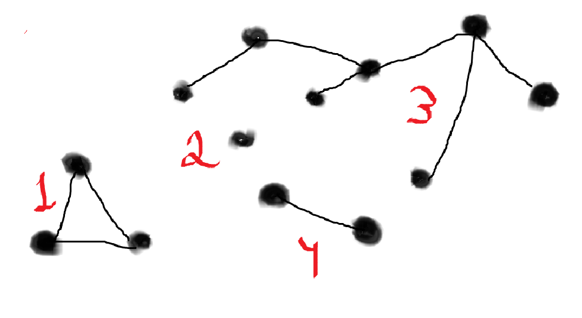
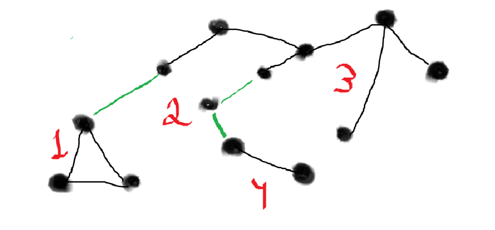

# Golang Solution ||| O(N) ||| DFS (No union find) ||| A lot of Explanations ||| Clean code

**Author:** https_whxyan
**Votes:** 10
**Link:** [https://leetcode.com/problems/remove-max-number-of-edges-to-keep-graph-fully-traversable/solutions/5391554/](https://leetcode.com/problems/remove-max-number-of-edges-to-keep-graph-fully-traversable/solutions/5391554/)

---

# Intuition
Create 3 graphs, find out the number of required edges for each graph and subtract them from the total number of edges.

# Approach
# Solution through connectivity components

The idea is that **we create separate connectivity components only from edges of type 3**, and depending on their number we see how many edges we need for alice and for bob.

# Let me give an example of some graph consisting only of edges of type 3 and explain how we can use it to find the answer.

This is an example of a graph that consists of only 3 edges.

**It has four components of cohesion:**



# Recall that the minimum possible number of edges for a graph to be connected is n - 1, where n is the number of vertices.
> Such a graph is called a tree.

---


To make it possible for Alice, for example, to get from any vertex to any other vertex, **we need to connect all these connectivity components by a minimum number of edges.**
This number is equal to **4 - 1 = 3.**
The same logic applies to bean - **4 - 1 = 3.**

Example:


# That is, for both alice and bean, the number of good edges is equal to the number of connectivity components of the graph of general type - 1.**


---

# Let's talk about the number of good type 3 ribs. 

We have, say, **m connectivity components.**
Try to understand, I tried to make it clear). \uD83D\uDE02
1. For each of the m components, the number of edges it needs for the component to be connected is equal to the number of its vertices - 1.
2. In total, we have n vertices. And m components.
3. The sum of all vertices of all components is n.
4. If we sum up all the numbers of good edges for each component, we have n - m, because for each of the m components we subtract 1.

# So the total number of good edges of type 3 is n - m.

---
# Thus, the total number of ribs needed:
**Find the number of connectivity components of the graph consisting only of edges of type 3. Let it be m.**

1. Number of good edges of type 3: n - m
2. Number of good edges of type 1: m - 1
3. Number of good edges of type 2: m - 1 (sane as 1)
4. Total number of good edges: 
  (n - m) + (m - 1) + (m - 1) = 
  n - m + 2 * m - 2 = 
  n + m - 2
# Total ans: nEdges - (n + m - 2)


---


# Let's deal with -1.
We return -1 **only if either Alice or Bob cannot pass the graph completely to any vertex.**

**To check this**, we will create 2 graphs, one for Alice and one for Bob. 
For alice we will add all edges whose type is either 1 or 3, and for bean either 2 or 3.

**For them we** will also **find out the number of connectivity components. If it is not equal to 1**, then traversing the complete graph is impossible, **we return -1.**

---
# Code Explanation

---
```Golang []
type GraphType int

const (
    AliceType GraphType  = 1
    BobType GraphType    = 2
    CommonType GraphType = 3
)

// Graph Struct

type Graph struct {
    n int

    g map[int][]int
    graphType GraphType
}
```
**The initialization methods are as follows:**
```Golang []
func NewGraph(graphType GraphType, n int, edges [][]int) *Graph {
    newG := &Graph{
        n: n,

        g: make(map[int][]int),
        graphType: graphType,
    }

    for _, edge := range edges {
        newG.addEdge(edge)
    }

    return newG
}

func (g *Graph) addEdge(edge []int) {
    edgeType, fromV, toV := edge[0], edge[1], edge[2]

    switch g.graphType {
    case AliceType:
        if edgeType == 1 || edgeType == 3 {
            g.g[fromV] = append(g.g[fromV], toV)
            g.g[toV] = append(g.g[toV], fromV)
        }
    case BobType:
        if edgeType == 2 || edgeType == 3 {
            g.g[fromV] = append(g.g[fromV], toV)
            g.g[toV] = append(g.g[toV], fromV)
        }
    case CommonType:
        if edgeType == 3 {
            g.g[fromV] = append(g.g[fromV], toV)
            g.g[toV] = append(g.g[toV], fromV)
        }
    }
}
```

**The remaining 2 methods are used to find the number of connectivity components.**
# How do you find the number of components of a connectivity?
In the graph structure we will add the used field - an array of boolean's.
```Golang []
type Graph struct {
    //....

    used []bool
}
```
In a special method, where we will get the number of components of links, **we will try to call DFS from all vertices from 1 to n.**

**If we succeed** *(i.e., the vertex has not yet been marked as used)*, **we increment the counter and start DFS from this vertex.** 

```Golang []
func (g *Graph) GetComponentsCount() int {
    componentsCount := 0
    for startV := 1; startV <= g.n; startV++ {
        if !g.used[startV] {
            g.dfs(startV)
            componentsCount++
        }
    }

    return componentsCount
}
```
**DFS is super standard, absolutely nothing new.**
```Golang []
func (g *Graph) dfs(v int) {
    if g.used[v] {
        return
    }
    g.used[v] = true
    for _, nextV := range g.g[v] {
        g.dfs(nextV)
    }
}
```

# Because of the structure, it is now very easy for us to start a graph and count the number of good and necessary edges according to our solution.

**The main method itself looks like this.** *I didn't comment the code, just made the names of the variables.*

```Golang []
func maxNumEdgesToRemove(n int, edges [][]int) int {
    aliceG := NewGraph(AliceType, n, edges)
    bobG := NewGraph(BobType, n, edges)


    aliceCompopentsCount := aliceG.GetComponentsCount()
    bobCompopentsCount := bobG.GetComponentsCount()

    if aliceCompopentsCount != 1 || bobCompopentsCount != 1 {
        return -1
    }

    commonG := NewGraph(CommonType, n, edges)
    commonCompopentsCount := commonG.GetComponentsCount()

    goodCommodEdges := n - commonCompopentsCount
    goodAliceEdges := commonCompopentsCount - 1
    goodBobEdges := goodAliceEdges // (commonCompopentsCount - 1)
    
    sumOfGoodEdges := goodCommodEdges + goodAliceEdges + goodBobEdges
    return len(edges) - sumOfGoodEdges
}
```


# Complexity
**- Time complexity:**
The graph creation itself takes at most $$O(N)$$.
The sum of execution time of the GetComponentsCount() method is $$O(N)$$, because we pass strictly over N vertices. total. 
Calculation of all variables in the main is $$O(1)$$.

**Total time complexity -** $$O(N)$$

# Code
```
func maxNumEdgesToRemove(n int, edges [][]int) int {
    aliceG := NewGraph(AliceType, n, edges)
    bobG := NewGraph(BobType, n, edges)


    aliceCompopentsCount := aliceG.GetComponentsCount()
    bobCompopentsCount := bobG.GetComponentsCount()

    if aliceCompopentsCount != 1 || bobCompopentsCount != 1 {
        return -1
    }

    commonG := NewGraph(CommonType, n, edges)
    commonCompopentsCount := commonG.GetComponentsCount()

    goodCommodEdges := n - commonCompopentsCount
    goodAliceEdges := commonCompopentsCount - 1
    goodBobEdges := goodAliceEdges // (commonCompopentsCount - 1)
    
    sumOfGoodEdges := goodCommodEdges + goodAliceEdges + goodBobEdges
    return len(edges) - sumOfGoodEdges
}

// ________________
// Graph
// ________________

type GraphType int

const (
    AliceType GraphType  = 1
    BobType GraphType    = 2
    CommonType GraphType = 3
)

// Graph Struct

type Graph struct {
    n int

    g map[int][]int
    graphType GraphType

    used []bool
}

// Initializators

func NewGraph(graphType GraphType, n int, edges [][]int) *Graph {
    newG := &Graph{
        n: n,

        g: make(map[int][]int),
        graphType: graphType,

        used: make([]bool, n + 1),
    }

    for _, edge := range edges {
        newG.addEdge(edge)
    }

    return newG
}

func (g *Graph) addEdge(edge []int) {
    edgeType, fromV, toV := edge[0], edge[1], edge[2]

    switch g.graphType {
    case AliceType:
        if edgeType == 1 || edgeType == 3 {
            g.g[fromV] = append(g.g[fromV], toV)
            g.g[toV] = append(g.g[toV], fromV)
        }
    case BobType:
        if edgeType == 2 || edgeType == 3 {
            g.g[fromV] = append(g.g[fromV], toV)
            g.g[toV] = append(g.g[toV], fromV)
        }
    case CommonType:
        if edgeType == 3 {
            g.g[fromV] = append(g.g[fromV], toV)
            g.g[toV] = append(g.g[toV], fromV)
        }
    }
}

// ____________
// DFS
// ____________

func (g *Graph) GetComponentsCount() int {
    componentsCount := 0
    for startV := 1; startV <= g.n; startV++ {
        if !g.used[startV] {
            g.dfs(startV)
            componentsCount++
        }
    }

    return componentsCount
}

func (g *Graph) dfs(v int) {
    if g.used[v] {
        return
    }
    g.used[v] = true
    for _, nextV := range g.g[v] {
        g.dfs(nextV)
    }
}


```

