# Image Explanation🏆- [Easiest & Complete Intuition] - C++/Java/Python

**Author:** lc00701
**Votes:** 112
**Link:** [https://leetcode.com/problems/remove-max-number-of-edges-to-keep-graph-fully-traversable/solutions/3468066/](https://leetcode.com/problems/remove-max-number-of-edges-to-keep-graph-fully-traversable/solutions/3468066/)

---

# Video Solution (`Aryan Mittal`) - Link in LeetCode Profile
`Remove Max Number of Edges to Keep Graph Fully Traversable` by `Aryan Mittal`


# Approach & Intution
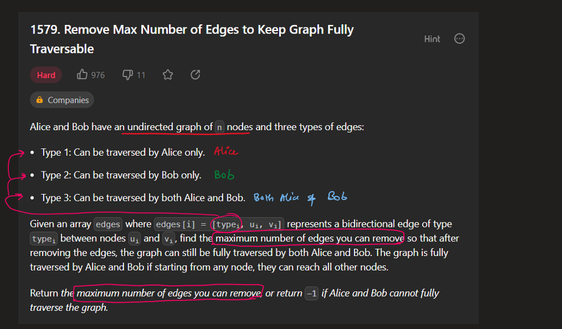
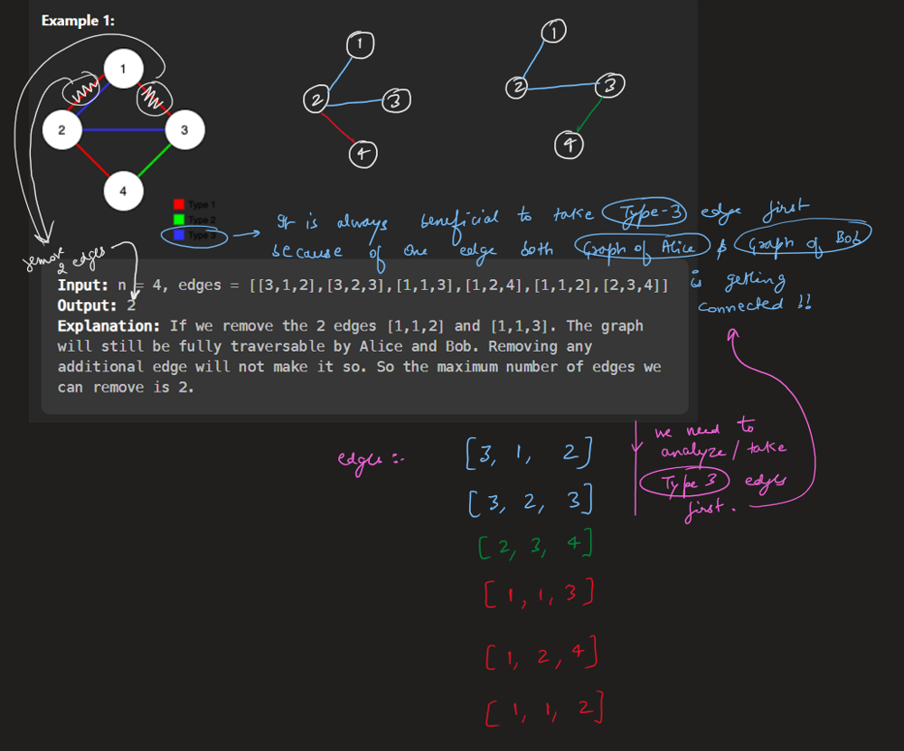
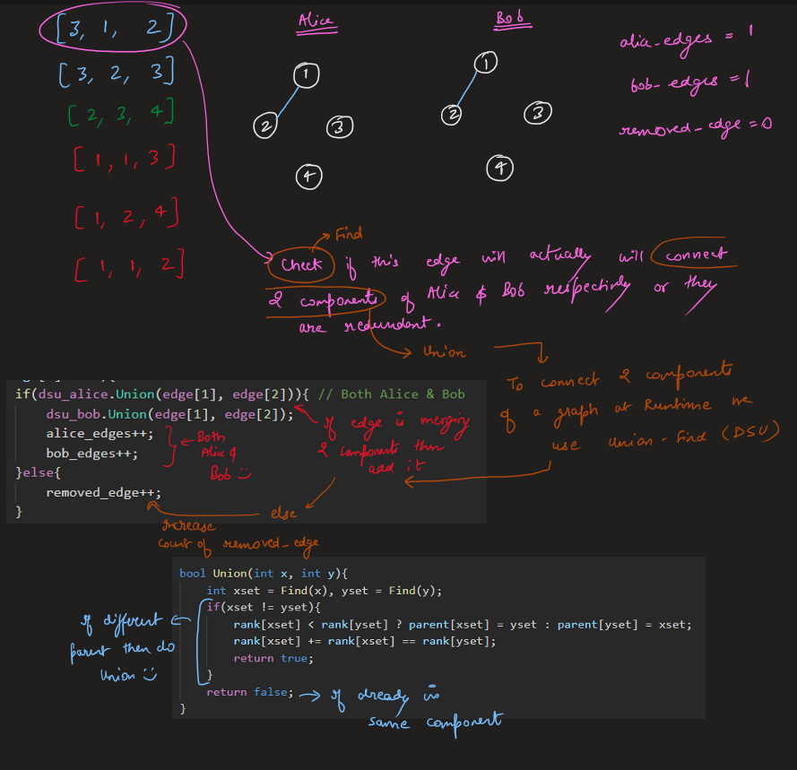
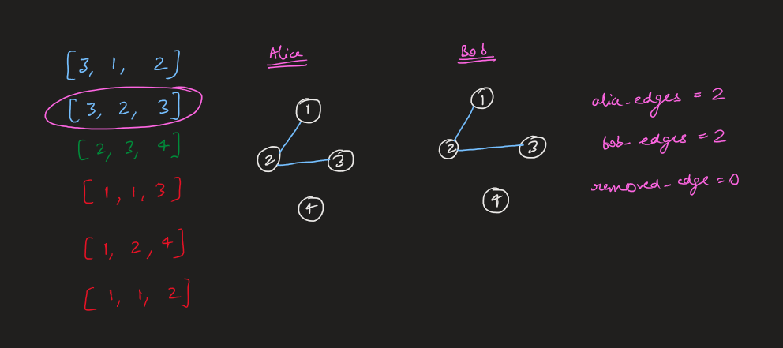
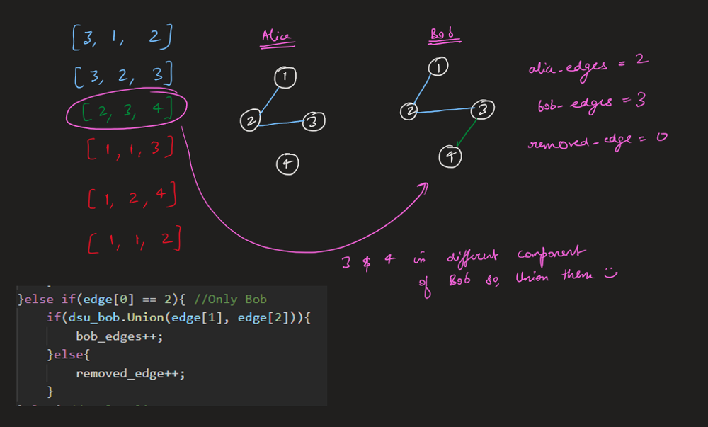
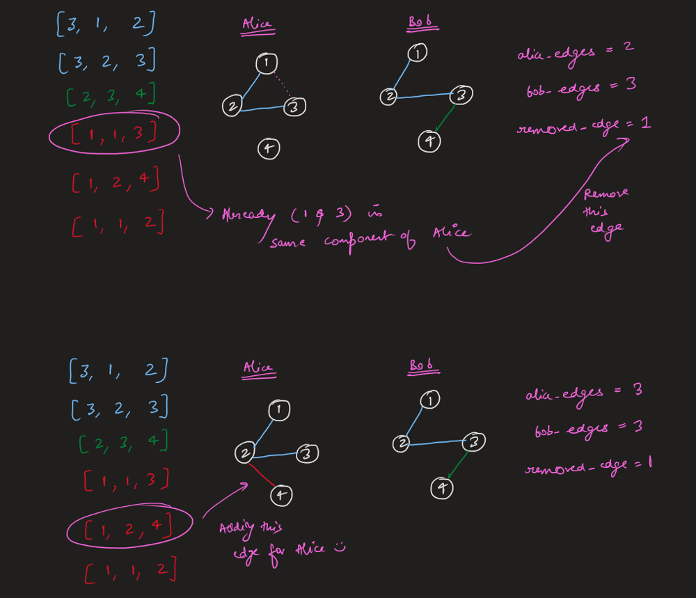
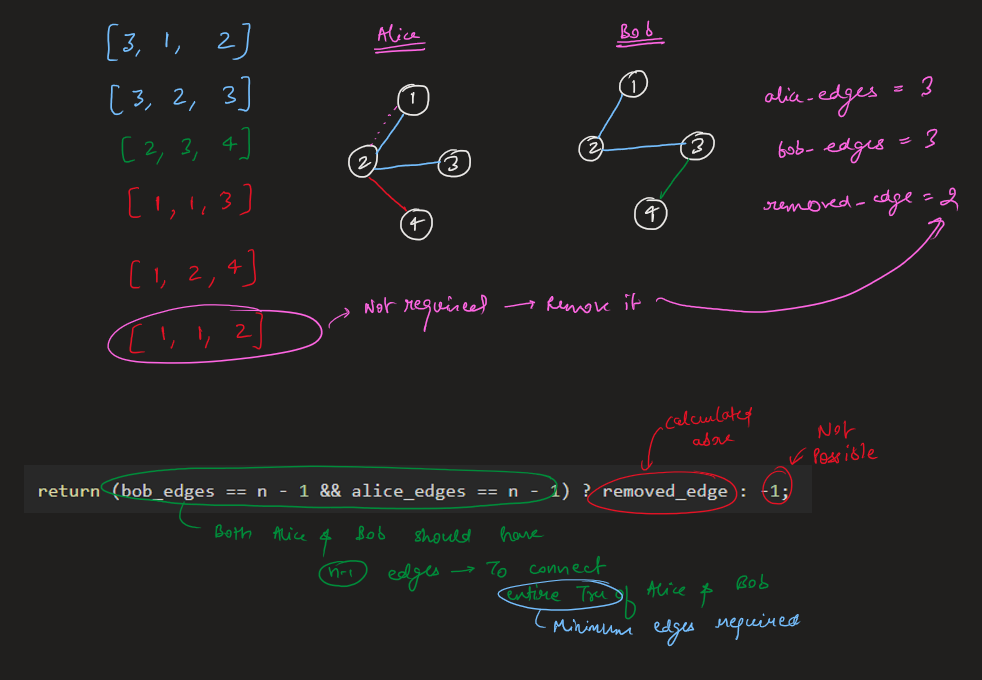
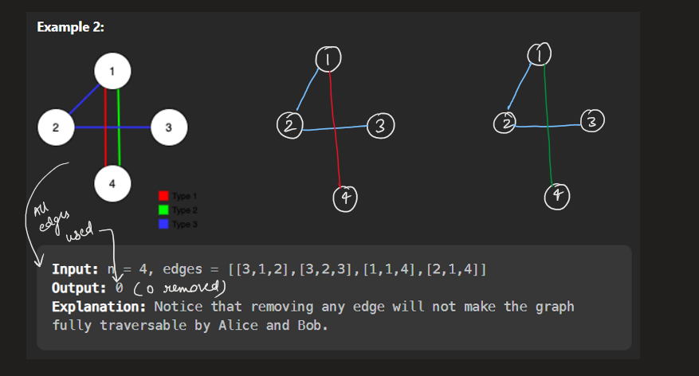
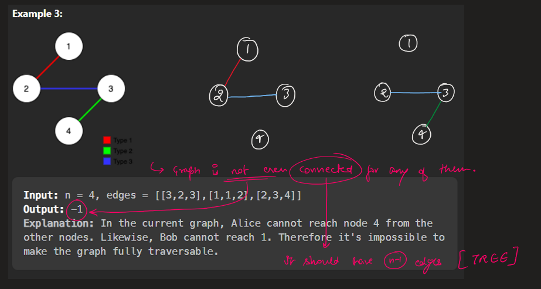
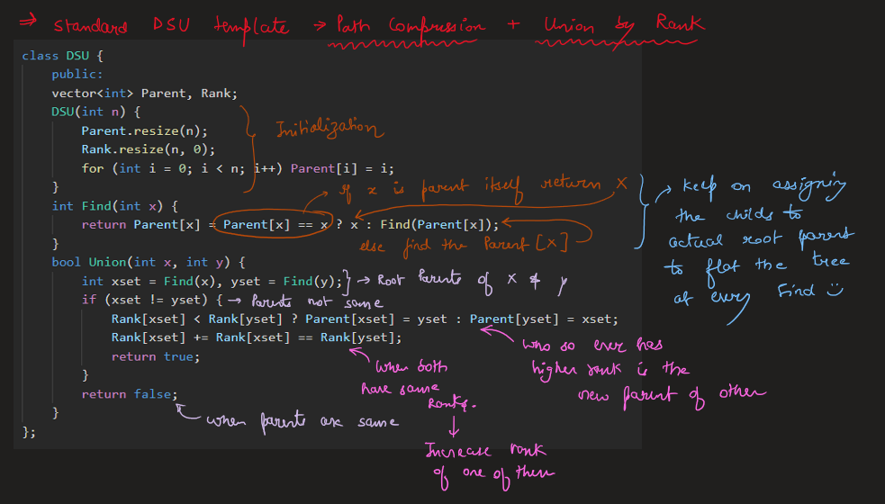
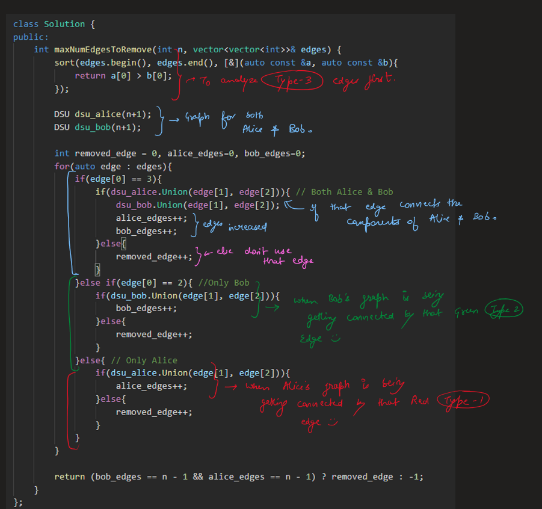
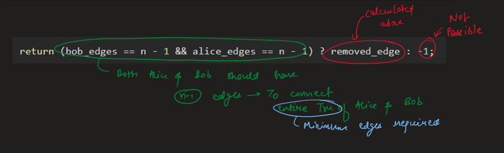
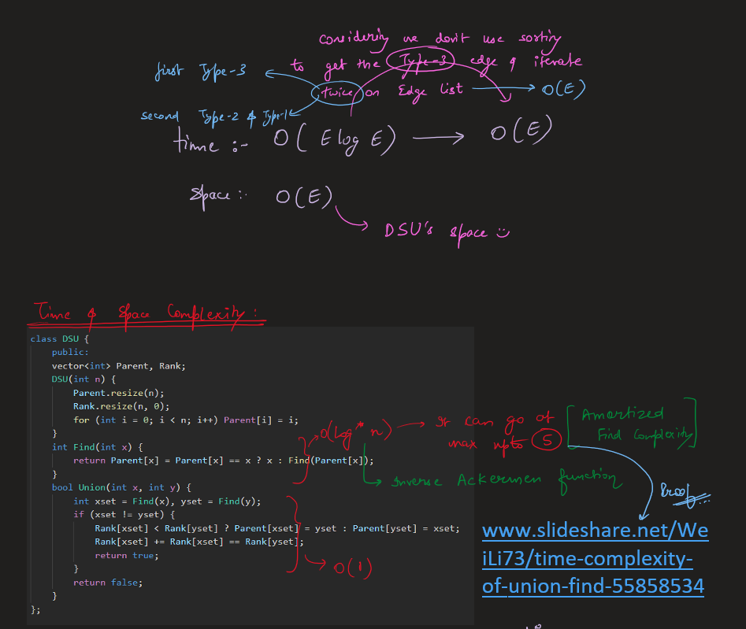
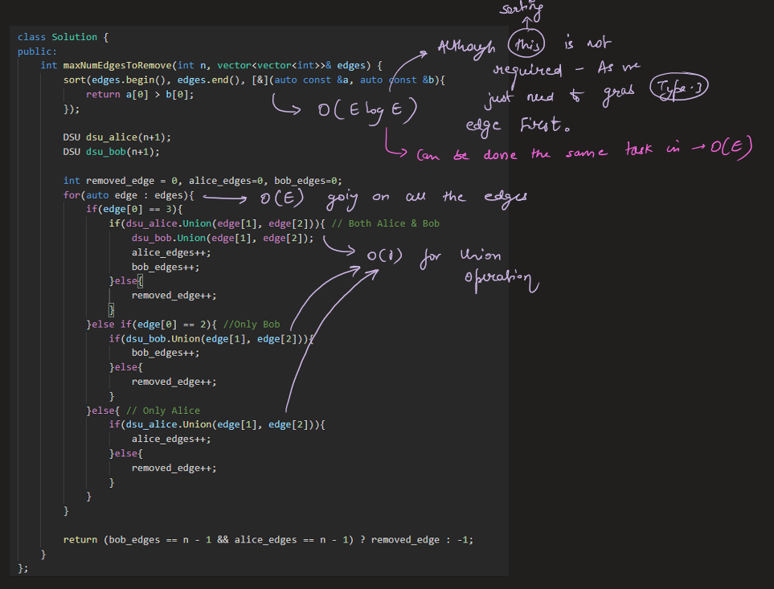


# Code
```C++ []
class DSU {
public:
    vector<int> parent, rank;
    DSU(int n){
        parent.resize(n, 0);
        rank.resize(n, 0);
        
        for(int i=0;i<n;i++) parent[i] = i;
    }
    
    int Find(int x){
        return parent[x] = parent[x] == x ? x : Find(parent[x]);
    }
    
    bool Union(int x, int y){
        int xset = Find(x), yset = Find(y);
        if(xset != yset){
            rank[xset] < rank[yset] ? parent[xset] = yset : parent[yset] = xset;
            rank[xset] += rank[xset] == rank[yset];
            return true;
        }
        return false;
    }
};

class Solution {
public:
    int maxNumEdgesToRemove(int n, vector<vector<int>>& edges) {
        sort(edges.begin(), edges.end(), [&](auto const &a, auto const &b){
            return a[0] > b[0];
        });

        DSU dsu_alice(n+1);
        DSU dsu_bob(n+1);

        int removed_edge = 0, alice_edges=0, bob_edges=0;
        for(auto edge : edges){
            if(edge[0] == 3){
                if(dsu_alice.Union(edge[1], edge[2])){ // Both Alice & Bob
                    dsu_bob.Union(edge[1], edge[2]);
                    alice_edges++;
                    bob_edges++;
                }else{
                    removed_edge++;
                }
            }else if(edge[0] == 2){ //Only Bob
                if(dsu_bob.Union(edge[1], edge[2])){
                    bob_edges++;
                }else{
                    removed_edge++;
                }
            }else{ // Only Alice
                if(dsu_alice.Union(edge[1], edge[2])){
                    alice_edges++;
                }else{
                    removed_edge++;
                }
            }
        }

        return (bob_edges == n - 1 && alice_edges == n - 1) ? removed_edge : -1;
    }
};
```
```Java []
class DSU {
    int[] parent;
    int[] rank;
    
    public DSU(int n) {
        parent = new int[n];
        rank = new int[n];
        for (int i = 0; i < n; i++) {
            parent[i] = i;
        }
    }
    
    public int find(int x) {
        if (parent[x] != x) {
            parent[x] = find(parent[x]);
        }
        return parent[x];
    }
    
    public boolean union(int x, int y) {
        int xset = find(x), yset = find(y);
        if (xset != yset) {
            if (rank[xset] < rank[yset]) {
                parent[xset] = yset;
            } else if (rank[xset] > rank[yset]) {
                parent[yset] = xset;
            } else {
                parent[xset] = yset;
                rank[yset]++;
            }
            return true;
        }
        return false;
    }
}

class Solution {
    public int maxNumEdgesToRemove(int n, int[][] edges) {
        Arrays.sort(edges, (a, b) -> Integer.compare(b[0], a[0]));
        
        DSU dsu_alice = new DSU(n+1);
        DSU dsu_bob = new DSU(n+1);
        
        int removed_edge = 0, alice_edges = 0, bob_edges = 0;
        for (int[] edge : edges) {
            if (edge[0] == 3) {
                if (dsu_alice.union(edge[1], edge[2])) {
                    dsu_bob.union(edge[1], edge[2]);
                    alice_edges++;
                    bob_edges++;
                } else {
                    removed_edge++;
                }
            } else if (edge[0] == 2) {
                if (dsu_bob.union(edge[1], edge[2])) {
                    bob_edges++;
                } else {
                    removed_edge++;
                }
            } else {
                if (dsu_alice.union(edge[1], edge[2])) {
                    alice_edges++;
                } else {
                    removed_edge++;
                }
            }
        }
        
        return (bob_edges == n - 1 && alice_edges == n - 1) ? removed_edge : -1;
    }
}
```
```Python []
class DSU:
    def __init__(self, n):
        self.parent = [i for i in range(n)]
        self.rank = [0] * n
    
    def find(self, x):
        if self.parent[x] != x:
            self.parent[x] = self.find(self.parent[x])
        return self.parent[x]
    
    def union(self, x, y):
        xset, yset = self.find(x), self.find(y)
        if xset != yset:
            if self.rank[xset] < self.rank[yset]:
                self.parent[xset] = yset
            elif self.rank[xset] > self.rank[yset]:
                self.parent[yset] = xset
            else:
                self.parent[xset] = yset
                self.rank[yset] += 1
            return True
        return False

class Solution:
    def maxNumEdgesToRemove(self, n: int, edges: List[List[int]]) -> int:
        edges.sort(reverse=True)
        dsu_alice = DSU(n+1)
        dsu_bob = DSU(n+1)
        removed_edge = 0
        alice_edges, bob_edges = 0, 0
        for edge in edges:
            if edge[0] == 3:
                if dsu_alice.union(edge[1], edge[2]):
                    dsu_bob.union(edge[1], edge[2])
                    alice_edges += 1
                    bob_edges += 1
                else:
                    removed_edge += 1
            elif edge[0] == 2:
                if dsu_bob.union(edge[1], edge[2]):
                    bob_edges += 1
                else:
                    removed_edge += 1
            else:
                if dsu_alice.union(edge[1], edge[2]):
                    alice_edges += 1
                else:
                    removed_edge += 1
        return removed_edge if bob_edges == n - 1 == alice_edges else -1
```