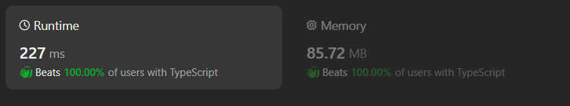
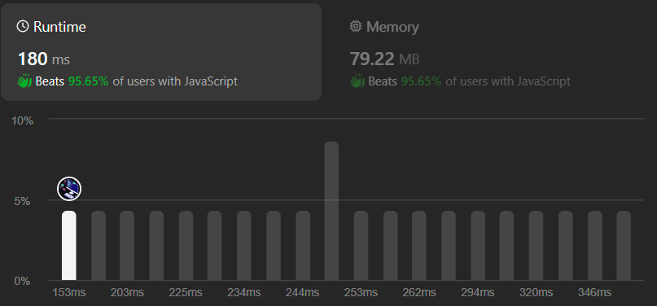

# [TypeScript] | [JavaScript] | [DSU] | [Union Find] | Fastest & Simple Approach😎🚀

**Author:** ibratnawaz
**Votes:** 1
**Link:** [https://leetcode.com/problems/remove-max-number-of-edges-to-keep-graph-fully-traversable/solutions/4711650/](https://leetcode.com/problems/remove-max-number-of-edges-to-keep-graph-fully-traversable/solutions/4711650/)

---

# TypeScript


# JavaScript



# Intuition
<!-- Describe your first thoughts on how to solve this problem. -->
- Apply DSU (Union Find) algorithm for both Alex & Bob.

# Approach
<!-- Describe your approach to solving the problem. -->
- Step-1: Apply DSU for both Alex & Bob for type 3 edges and total count type 3edges removed.
- Step-2: Apply DSU for both Alex & Bob for type 1 & type 2 edges respectively and count edges removed for type 1 & type 2 edges repectively.
- Step-3: Check for multiple components for Alex's & Bob's DSU respectively, if count of ultimate parent is more than 1 return -1;
- Step-4: Return total edges removed

# Complexity
- Total Time complexity:
    - DSU algo TC- 4 Alpha()
    - Main Logic- O(E) + O(n) // E- edges given; N- vertices
    - So, TC is O(E);
<!-- Add your time complexity here, e.g. $$O(n)$$ -->

- Space complexity:
    - DSU algo- O(n)
    - main logic- O(1)
    - So, SC is O(n);
<!-- Add your space complexity here, e.g. $$O(n)$$ -->

# Code
```
class DisjoinSet {
    parent: number[];
    size: number[];

    constructor(n: number) {
        this.parent = [];
        this.size = [];

        for (let i = 0; i <= n; i++) {
            this.parent.push(i);
            this.size.push(1);
        }
    }

    union(u: number, v: number) {
        const ulp_u = this.find(u);
        const ulp_v = this.find(v);

        if (ulp_u === ulp_v) return;

        if (this.size[ulp_u] < this.size[ulp_v]) {
            this.parent[ulp_u] = ulp_v;
            this.size[ulp_v] += this.size[ulp_u]
        } else {
            this.parent[ulp_v] = ulp_u;
            this.size[ulp_u] += this.size[ulp_v]
        }
    }

    find(node: number) {
        if (this.parent[node] === node) return node;

        return (this.parent[node] = this.find(this.parent[node]));
    }
}

function maxNumEdgesToRemove(n: number, edges: number[][]): number {
    const dsuA = new DisjoinSet(n);
    const dsuB = new DisjoinSet(n);

    let edgesRemoved = 0;

    for (const [type, u, v] of edges) {
        if (type === 3) {
            if (dsuA.find(u) === dsuA.find(v)) {
                edgesRemoved++;
            } else {
                dsuA.union(u, v);
                dsuB.union(u, v);
            }
        }
    }

    for (const [type, u, v] of edges) {
        if (type === 1) {
            if (dsuA.find(u) === dsuA.find(v)) {
                edgesRemoved++;
            } else {
                dsuA.union(u, v);
            }
        }
        else if (type === 2) {
            if (dsuB.find(u) === dsuB.find(v)) {
                edgesRemoved++;
            } else {
                dsuB.union(u, v);
            }
        }
    }

    let totalCompA = 0;
    let totalCompB = 0;
    // Checking existence of multiple components after applying DSU for Alex & Bob, if mutiple components exits that means Alice or Bob cannot fully traverse the given graph.
    for (let i = 1; i <= n; i++) {
        if (dsuA.find(i) === i) totalCompA++;
        if (dsuB.find(i) === i) totalCompB++;

        if(totalCompA > 1 || totalCompB > 1) return -1;
    }

    return edgesRemoved;
};
```